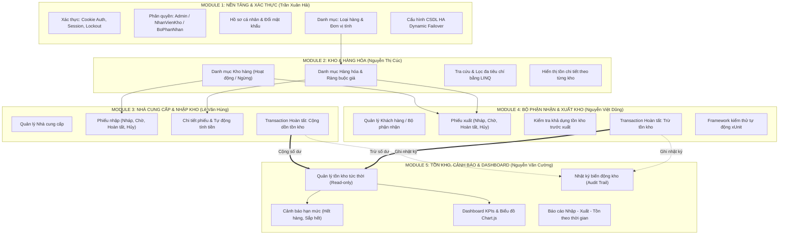
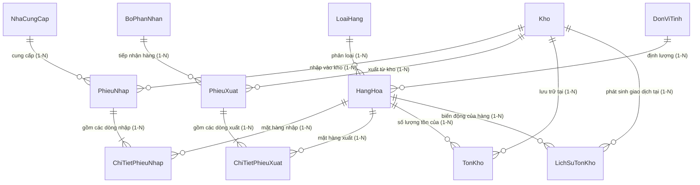

# HỆ THỐNG QUẢN LÝ KHO HÀNG NHẬP - XUẤT - TỒN (ĐỀ TÀI 21)

[Build & Test](docs/INSTALLATION_AND_TESTING.md)
[Database](docs/DATABASE_SETUP.md)
[Architecture](docs/ARCHITECTURE_AND_STRUCTURE.md)
[Security](docs/RBAC_SECURITY.md)

---

| Chuyên mục tài liệu             |                                    Tệp tài liệu chi tiết                                    | Nội dung chính                                                                                 |
| :------------------------------ | :-----------------------------------------------------------------------------------------: | :--------------------------------------------------------------------------------------------- |
| **Chi tiết từng Module**        |                   [**`docs/modules/README.md`**](docs/modules/README.md)                    | Mục lục tổng quan và tài liệu độc lập cho cả 5 Module nghiệp vụ.                               |
| **Module 1 (Trần Xuân Hải)**    |    [**`MODULE_01_TAI_KHOAN_XAC_THUC.md`**](docs/modules/MODULE_01_TAI_KHOAN_XAC_THUC.md)    | Tài khoản, Cookie Auth & Session, Chống Brute-force Lockout, Phân quyền, Danh mục cơ sở.       |
| **Module 2 (Nguyễn Thị Cúc)**   |          [**`MODULE_02_KHO_HANG_HOA.md`**](docs/modules/MODULE_02_KHO_HANG_HOA.md)          | Kho bãi, Hàng hóa, Tra cứu LINQ đa tiêu chí, Phân trang Server-side, Tồn theo từng kho.        |
| **Module 3 (Lê Văn Hùng)**      | [**`MODULE_03_NHA_CUNG_CAP_NHAP_KHO.md`**](docs/modules/MODULE_03_NHA_CUNG_CAP_NHAP_KHO.md) | Nhà cung cấp, Quy trình Nhập kho Inbound, Transaction cộng tồn kho, Chống cộng trùng lặp.      |
| **Module 4 (Nguyễn Việt Dũng)** | [**`MODULE_04_BO_PHAN_NHAN_XUAT_KHO.md`**](docs/modules/MODULE_04_BO_PHAN_NHAN_XUAT_KHO.md) | Bộ phận nhận, Xuất kho Outbound, Kiểm tra tồn khả dụng, Transaction trừ tồn, xUnit Test Suite. |
| **Module 5 (Nguyễn Văn Cường)** |     [**`MODULE_05_TON_KHO_DASHBOARD.md`**](docs/modules/MODULE_05_TON_KHO_DASHBOARD.md)     | Tồn kho tức thời, Cảnh báo hạn mức (Hết / Sắp hết), Sổ cái Audit Trail, Dashboard Chart.js.    |
| **Cấu hình Cơ sở dữ liệu**      |                   [**`docs/DATABASE_SETUP.md`**](docs/DATABASE_SETUP.md)                    | Hướng dẫn kết nối Azure SQL Remote, SQL Server LocalDB, cơ chế Auto-Failover & Auto-Recovery.  |
| **Kiến trúc & Thư mục**         |       [**`docs/ARCHITECTURE_AND_STRUCTURE.md`**](docs/ARCHITECTURE_AND_STRUCTURE.md)        | Sơ đồ kiến trúc 5 tầng, chi tiết vai trò từng thư mục và cây mã nguồn toàn diện.               |
| **Phân quyền & Bảo mật**        |                    [**`docs/RBAC_SECURITY.md`**](docs/RBAC_SECURITY.md)                     | Ma trận phân quyền 3 vai trò (Admin, NhanVienKho, BoPhanNhan), Identity PBKDF2 Hashing.        |
| **Cài đặt & Kiểm thử**          |         [**`docs/INSTALLATION_AND_TESTING.md`**](docs/INSTALLATION_AND_TESTING.md)          | Hướng dẫn khôi phục, biên dịch, chạy ứng dụng web và 26 kịch bản kiểm thử tự động xUnit.       |
| **Quy trình làm việc Git**      |                     [**`docs/GIT_WORKFLOW.md`**](docs/GIT_WORKFLOW.md)                      | Quy chuẩn nhánh làm việc và quy ước đặt tên commit: `[MSSV-Họ tên][Module] Nội dung`.          |

---

## DANH SÁCH THÀNH VIÊN & PHÂN CÔNG MODULE

|  STT  | Họ và tên sinh viên  | Module phụ trách                  | Phạm vi trách nhiệm chính                                                                                                                                      |                    Tài liệu riêng                     |
| :---: | :------------------- | :-------------------------------- | :------------------------------------------------------------------------------------------------------------------------------------------------------------- | :---------------------------------------------------: |
| **1** | **Trần Xuân Hải**    | **Module 1** & Kiến trúc nền tảng | Tài khoản, Đăng nhập Cookie/Session, Lockout 5 lần, Phân quyền RBAC, Profile & Đổi mật khẩu, Loại hàng, Đơn vị tính, CSDL Failover HA.                         |  [M1](docs/modules/MODULE_01_TAI_KHOAN_XAC_THUC.md)   |
| **2** | **Nguyễn Thị Cúc**   | **Module 2**                      | Quản lý Kho hàng, Hàng hóa, Bộ tra cứu đa tiêu chí LINQ, Lọc khoảng giá/kho/loại, Phân trang Server-side, Tồn theo từng kho.                                   |     [M2](docs/modules/MODULE_02_KHO_HANG_HOA.md)      |
| **3** | **Lê Văn Hùng**      | **Module 3**                      | Quản lý Nhà cung cấp, Quy trình Lập & Duyệt Phiếu nhập kho (Inbound Logistics), Chi tiết phiếu, Transaction cộng dồn tồn kho, Chống cộng lặp.                  | [M3](docs/modules/MODULE_03_NHA_CUNG_CAP_NHAP_KHO.md) |
| **4** | **Nguyễn Việt Dũng** | **Module 4** & Bộ kiểm thử        | Quản lý Khách hàng / Bộ phận nhận, Quy trình Lập & Duyệt Phiếu xuất kho (Outbound Logistics), Chi tiết phiếu, Kiểm tra khả dụng tồn, Trừ tồn kho, xUnit Suite. | [M4](docs/modules/MODULE_04_BO_PHAN_NHAN_XUAT_KHO.md) |
| **5** | **Nguyễn Văn Cường** | **Module 5**                      | Quản lý Tồn kho tức thời, Cảnh báo hạn mức (Hết hàng: Ton=0, Sắp hết: Ton<=Min), Nhật ký biến động (Audit Trail), Dashboard KPIs & Biểu đồ Chart.js.           |   [M5](docs/modules/MODULE_05_TON_KHO_DASHBOARD.md)   |

---

## SƠ ĐỒ LIÊN KẾT GIỮA CÁC MODULE



---

## SƠ ĐỒ QUAN HỆ THỰC THỂ CSDL (ERD TỔNG THỂ)



---

## CHẠY ỨNG DỤNG

### Tài khoản đăng nhập mẫu sẵn có (Seed Data)

| Tên đăng nhập | Mật khẩu mẫu | Vai trò (Role)  | Chủ tài khoản        | Ghi chú quyền hạn                                            |
| :------------ | :----------- | :-------------: | :------------------- | :----------------------------------------------------------- |
| `admin`       | `Admin@123`  |    **Admin**    | **Trần Xuân Hải**    | Quản trị viên tối cao: Toàn quyền tất cả các phân hệ.        |
| `nvkho_hung`  | `123456`     | **NhanVienKho** | **Lê Văn Hùng**      | Thủ kho: Lập & duyệt phiếu nhập, quản lý nhà cung cấp.       |
| `nvkho_cuc`   | `123456`     | **NhanVienKho** | **Nguyễn Thị Cúc**   | Thủ kho: Quản lý hàng hóa, tra cứu & lọc dữ liệu LINQ.       |
| `nvkho_cuong` | `123456`     | **NhanVienKho** | **Nguyễn Văn Cường** | Thủ kho: Theo dõi cảnh báo tồn, Audit Trail, Dashboard KPIs. |
| `bophan_dung` | `123456`     | **BoPhanNhan**  | **Nguyễn Việt Dũng** | Bộ phận nhận: Lập & duyệt phiếu xuất, tra cứu hàng hóa.      |

---

## BỘ KIỂM THỬ TỰ ĐỘNG (xUnit AUTOMATION TESTS)

Hệ thống tích hợp bộ kiểm thử tích hợp (Integration Tests) với **26 kịch bản kiểm thử tự động**, kiểm tra tính toàn vẹn từ Xác thực, Phân quyền đến chu trình Nhập - Xuất - Tồn:

```bash
# Chạy toàn bộ 26 test case
dotnet test
```

**Kết quả kiểm thử hiện tại:**

```text
Passed!  - Failed: 0, Passed: 26, Skipped: 0, Total: 26, Duration: 24 s - QuanLyKhoHang.Tests.dll (net10.0)
```

_(Xem hướng dẫn chi tiết về các kịch bản và cách chạy nâng cao tại [Cẩm nang kiểm thử](docs/INSTALLATION_AND_TESTING.md))._
có 5 nhóm cách chính để chạy kiểm thử tự động ngay trên Terminal:
──────

### 1. Dùng lệnh tiêu chuẩn .NET CLI (dotnet test)

Đây là cách cơ bản và phổ biến nhất:
• Chạy toàn bộ các bài test:
dotnet test
(Hoặc chỉ định rõ project test):
dotnet test Tests/QuanLyKhoHang.Tests/QuanLyKhoHang.Tests.csproj
• Chạy và hiển thị log chi tiết từng test:
dotnet test --logger "console;verbosity=detailed"

• Chạy và xuất kết quả ra file báo cáo .trx (chuẩn Visual Studio/CI):
dotnet test --logger "trx;LogFileName=test-results.trx"
• Chạy nhanh không build/restore lại (như cấu hình CI):
dotnet test Tests/QuanLyKhoHang.Tests/QuanLyKhoHang.Tests.csproj --no-build --no-restore --configuration Release

──────

### 2. Chạy có bộ lọc theo Module / Test Class (dotnet test --filter)

Dự án được phân chia thành các lớp kiểm thử tích hợp riêng biệt, bạn có thể chạy riêng từng phân hệ:
• Kiểm thử Xác thực & Phân quyền (Module 1):
dotnet test --filter "FullyQualifiedName~AuthenticationIntegrationTests"
• Kiểm thử Quy trình Nhập kho & Cộng dồn tồn (Module 3):
dotnet test --filter "FullyQualifiedName~InboundWorkflowIntegrationTests"
• Kiểm thử Quy trình Xuất kho & Chống xuất âm (Module 4):
dotnet test --filter "FullyQualifiedName~OutboundWorkflowIntegrationTests"
• Kiểm thử các kịch bản đọc từ file Excel (ExcelTestCaseIntegrationTests):
dotnet test --filter "FullyQualifiedName~ExcelTestCaseIntegrationTests"

• Kiểm thử tính nhất quán nguồn Test Case:
dotnet test --filter "FullyQualifiedName~TestcaseSourceConsistencyTests"
──────

### 3. Chạy lọc theo Mã Test Case hoặc Từ khóa chức năng (DisplayName)

Bộ test đặt tên theo mã định danh khớp với file Excel kịch bản kiểm thử:
• Lọc chính xác theo mã Test Case:
dotnet test --filter "DisplayName~TC_M1_001"
dotnet test --filter "DisplayName~TC_M3_001"
dotnet test --filter "DisplayName~TC_M4_001"

• Lọc theo từ khóa nghiệp vụ tiếng Việt:
dotnet test --filter "DisplayName~Đăng nhập"
dotnet test --filter "DisplayName~Xuất kho"
dotnet test --filter "DisplayName~Nhập kho"

──────

### 4. Dùng Script tự động hóa PowerShell chuyên biệt của dự án (Run-Tests.ps1)

Dự án đã tạo sẵn một script nâng cao để vừa chạy test, vừa đối soát với file
TestCase_QuanLyKhoHang_ASPNetCore10.xlsx và định dạng kết quả màu mè:
• Chạy toàn bộ kèm báo cáo tổng hợp:
pwsh ./Tests/Run-Tests.ps1 # Hoặc trên PowerShell Windows mặc định:
.\Tests\Run-Tests.ps1

• Chỉ chạy kịch bản ứng với mã test trong file Excel:
pwsh ./Tests/Run-Tests.ps1 -TestCase TC_M1_001

• Kết hợp truyền filter tùy biến:
pwsh ./Tests/Run-Tests.ps1 -TestFilter "FullyQualifiedName~AuthenticationIntegrationTests"

──────

### 5. Kiểm tra danh sách & đối soát độ phủ Test Case (Dry-run & Coverage)

Dùng để kiểm tra bộ test mà không cần thực thi sâu:

• Liệt kê danh sách tất cả các bài test được tìm thấy:
dotnet test -t # Hoặc:
dotnet test Tests/QuanLyKhoHang.Tests/QuanLyKhoHang.Tests.csproj --list-tests

• Chạy script kiểm tra độ phủ test case (Show-TestcaseCoverage.ps1):
pwsh ./Tests/Show-TestcaseCoverage.ps1
(Script này sẽ so sánh số lượng test case giữa testcase_summary.txt, testcase_dump.txt và các test xUnit đã được tự
động hóa).
