## MỤC LỤC TÀI LIỆU

- [DANH SÁCH THÀNH VIÊN & PHÂN CÔNG MODULE PHỤ TRÁCH](#danh-sách-thành-viên--phân-công-module-phụ-trách)
- [HƯỚNG DẪN CẤU HÌNH KẾT NỐI CƠ SỞ DỮ LIỆU REMOTE (REMOTE DATABASE SETUP)](#hướng-dẫn-cấu-hình-kết-nối-cơ-sở-dữ-liệu-remote-remote-database-setup)
  - [1. Cấu trúc chuỗi kết nối & Placeholder chung](#1-cấu-trúc-chuỗi-kết-nối--placeholder-chung)
    - [Mẫu chuỗi kết nối Microsoft SQL Server từ xa (Dedicated / VPS / On-Premise):](#mẫu-chuỗi-kết-nối-microsoft-sql-server-từ-xa-dedicated--vps--on-premise)
    - [Mẫu chuỗi kết nối Microsoft Azure SQL Database:](#mẫu-chuỗi-kết-nối-microsoft-azure-sql-database)
  - [2. Hướng dẫn dành cho Người dùng WINDOWS](#2-hướng-dẫn-dành-cho-người-dùng-windows)
    - [A. Sử dụng Visual Studio (Visual Studio 2022 / 2026)](#a-sử-dụng-visual-studio-visual-studio-2022--2026)
    - [B. Sử dụng Visual Studio Code (VS Code) trên Windows](#b-sử-dụng-visual-studio-code-vs-code-trên-windows)
  - [3. Hướng dẫn dành cho Người dùng LINUX (Ubuntu, Debian, Fedora, Arch, WSL2)](#3-hướng-dẫn-dành-cho-người-dùng-linux-ubuntu-debian-fedora-arch-wsl2)
    - [A. Sử dụng Visual Studio Code (VS Code) trên Linux](#a-sử-dụng-visual-studio-code-vs-code-trên-linux)
    - [B. Sử dụng Terminal Linux CLI (Không cần IDE / Dành cho Server & Dev tối giản)](#b-sử-dụng-terminal-linux-cli-không-cần-ide--dành-cho-server--dev-tối-giản)
  - [4. Dấu hiệu nhận biết kết nối CSDL thành công khi chạy chương trình](#4-dấu-hiệu-nhận-biết-kết-nối-csdl-thành-công-khi-chạy-chương-trình)
- [QUY TRÌNH THỦ TỤC LÀM VIỆC NHÓM VỚI GIT](#quy-trình-thủ-tục-làm-việc-nhóm-với-git)
- [CẤU TRÚC THƯ MỤC DỰ ÁN](#cấu-trúc-thư-mục-dự-án)
- [CHIA CẤU TRÚC THƯ MỤC & KIẾN TRÚC HỆ THỐNG](#chia-cấu-trúc-thư-mục--kiến-trúc-hệ-thống)
  - [Chi tiết vai trò từng thư mục:](#chi-tiết-vai-trò-từng-thư-mục)
- [PHÂN CHIA THEO CÁC MODULE](#phân-chia-theo-các-module)
  - [SƠ ĐỒ QUAN HỆ THỰC THỂ CSDL (ERD - ENTITY RELATIONSHIP DIAGRAM)](#sơ-đồ-quan-hệ-thực-thể-csdl-erd---entity-relationship-diagram)
- [CHI TIẾT CÁC CHỨC NĂNG CỦA MODULE](#chi-tiết-các-chức-năng-của-module)
  - [MODULE 1: TÀI KHOẢN, XÁC THỰC, PHÂN QUYỀN, PROFILE & DANH MỤC CƠ SỞ](#module-1-tài-khoản-xác-thực-phân-quyền-profile--danh-mục-cơ-sở)
    - [1. Bảng đặc tả chức năng & Endpoints](#1-bảng-đặc-tả-chức-năng--endpoints)
    - [2. Sơ đồ tuần tự Xác thực Đăng nhập & Brute-force Lockout](#2-sơ-đồ-tuần-tự-xác-thực-đăng-nhập--brute-force-lockout)
    - [3. Hình ảnh chụp chương trình thực tế (Module 1)](#3-hình-ảnh-chụp-chương-trình-thực-tế-module-1)
  - [MODULE 2: KHO HÀNG, HÀNG HÓA & BỘ TRA CỨU LINQ ĐA TIÊU CHÍ](#module-2-kho-hàng-hàng-hóa--bộ-tra-cứu-linq-đa-tiêu-chí)
    - [1. Bảng đặc tả chức năng & Endpoints](#1-bảng-đặc-tả-chức-năng--endpoints-1)
    - [2. Sơ đồ xử lý Tra cứu & Lọc đa tiêu chí bằng LINQ](#2-sơ-đồ-xử-lý-tra-cứu--lọc-đa-tiêu-chí-bằng-linq)
    - [3. Hình ảnh chụp chương trình thực tế (Module 2)](#3-hình-ảnh-chụp-chương-trình-thực-tế-module-2)
  - [MODULE 3: NHÀ CUNG CẤP & NGHIỆP VỤ NHẬP KHO (INBOUND LOGISTICS)](#module-3-nhà-cung-cấp--nghiệp-vụ-nhập-kho-inbound-logistics)
    - [1. Bảng đặc tả chức năng & Endpoints](#1-bảng-đặc-tả-chức-năng--endpoints-2)
    - [2. Sơ đồ tuần tự Hoàn tất Phiếu Nhập & Cộng dồn Tồn kho](#2-sơ-đồ-tuần-tự-hoàn-tất-phiếu-nhập--cộng-dồn-tồn-kho)
    - [3. Hình ảnh chụp chương trình thực tế (Module 3)](#3-hình-ảnh-chụp-chương-trình-thực-tế-module-3)
  - [MODULE 4: BỘ PHẬN NHẬN, XUẤT KHO & KIỂM THỬ TỰ ĐỘNG](#module-4-bộ-phận-nhận-xuất-kho--kiểm-thử-tự-động)
    - [1. Bảng đặc tả chức năng & Endpoints](#1-bảng-đặc-tả-chức-năng--endpoints-3)
    - [2. Sơ đồ tuần tự Kiểm tra Tồn kho & Hoàn tất Phiếu Xuất](#2-sơ-đồ-tuần-tự-kiểm-tra-tồn-kho--hoàn-tất-phiếu-xuất)
    - [3. Hình ảnh chụp chương trình thực tế (Module 4)](#3-hình-ảnh-chụp-chương-trình-thực-tế-module-4)
  - [MODULE 5: QUẢN LÝ TỒN KHO, CẢNH BÁO, LỊCH SỬ BIẾN ĐỘNG & DASHBOARD](#module-5-quản-lý-tồn-kho-cảnh-báo-lịch-sử-biến-động--dashboard)
    - [1. Bảng đặc tả chức năng & Endpoints](#1-bảng-đặc-tả-chức-năng--endpoints-4)
    - [2. Sơ đồ xử lý Thống kê & Phân loại Cảnh báo Tồn kho](#2-sơ-đồ-xử-lý-thống-kê--phân-loại-cảnh-báo-tồn-kho)
    - [3. Hình ảnh chụp chương trình thực tế (Module 5)](#3-hình-ảnh-chụp-chương-trình-thực-tế-module-5)
- [MA TRẬN PHÂN QUYỀN TRUY CẬP (ROLE-BASED ACCESS CONTROL)](#ma-trận-phân-quyền-truy-cập-role-based-access-control)
- [HƯỚNG DẪN CÀI ĐẶT, KHỞI CHẠY & BỘ KIỂM THỬ TỰ ĐỘNG](#hướng-dẫn-cài-đặt-khởi-chạy--bộ-kiểm-thử-tự-động)
  - [1. Yêu cầu môi trường](#1-yêu-cầu-môi-trường)
  - [2. Các gói thư viện kiểm thử đã tích hợp](#2-các-gói-thư-viện-kiểm-thử-đã-tích-hợp)
  - [3. Khởi chạy ứng dụng Web](#3-khởi-chạy-ứng-dụng-web)
  - [4. Tài khoản đăng nhập mẫu sẵn có (Seed Data)](#4-tài-khoản-đăng-nhập-mẫu-sẵn-có-seed-data)
  - [5. Hướng dẫn chạy bộ kiểm thử tự động (Automation Testing Commands)](#5-hướng-dẫn-chạy-bộ-kiểm-thử-tự-động-automation-testing-commands)

---

## DANH SÁCH THÀNH VIÊN & PHÂN CÔNG MODULE PHỤ TRÁCH

| STT | Họ và tên sinh viên | Module phụ trách | Phạm vi trách nhiệm chính |
| :---: | :--- | :--- | :--- |
| **1** | **Trần Xuân Hải** | **Module 1** & Kiến trúc nền tảng | Tài khoản, Đăng nhập, Xác thực Cookie & Session, Chống Brute-force (Lockout), Phân quyền đa vai trò, Profile & Đổi mật khẩu, Loại hàng, Đơn vị tính, Cấu hình CSDL Remote/Local Failover High-Availability. |
| **2** | **Nguyễn Thị Cúc** | **Module 2** | Quản lý Kho hàng, Quản lý Danh mục Hàng hóa, Bộ tra cứu đa tiêu chí LINQ, Bộ lọc theo khoảng giá / loại / kho, Sắp xếp & Phân trang Server-side, Hiển thị chi tiết tồn theo từng kho. |
| **3** | **Lê Văn Hùng** | **Module 3** | Quản lý Đối tác Nhà cung cấp, Quy trình Lập & Duyệt Phiếu nhập kho (Inbound Logistics), Chi tiết phiếu nhập, Tự động tính tiền, Hoàn tất cộng tồn kho trong Database Transaction, Chống cộng lặp, Hủy phiếu. |
| **4** | **Nguyễn Việt Dũng** | **Module 4** & Bộ kiểm thử | Quản lý Khách hàng / Bộ phận nhận, Quy trình Lập & Duyệt Phiếu xuất kho (Outbound Logistics), Chi tiết phiếu xuất, Kiểm tra tồn kho khả dụng ($\text{SoLuongXuat} \le \text{SoLuongTon}$), Trừ tồn kho, Bộ Test Suite xUnit tự động. |
| **5** | **Nguyễn Văn Cường** | **Module 5** | Quản lý Tồn kho tức thời, Cảnh báo hạn mức (Hết hàng: $\text{Ton} = 0$, Sắp hết: $0 < \text{Ton} \le \text{Min}$), Nhật ký biến động kho (Audit Trail - `LichSuTonKho`), Thống kê LINQ nâng cao theo thời gian, Dashboard KPIs & Biểu đồ Chart.js. |

---

## HƯỚNG DẪN CẤU HÌNH KẾT NỐI CƠ SỞ DỮ LIỆU REMOTE (REMOTE DATABASE SETUP)

Service quản lý kết nối ([`DatabaseConnectionManager`](Services/DatabaseConnectionManager.cs)) hỗ trợ:
- **Ưu tiên kết nối RemoteDb:** Khi khởi động, hệ thống kiểm tra kết nối tới `RemoteDb` với timeout 5 giây. Nếu thành công, ứng dụng sẽ chạy trực tiếp trên CSDL Remote và hiển thị huy hiệu xanh `[Remote DB]` trên thanh Header.
- **Tự phục hồi (Auto-Recovery):** [`DatabaseHealthCheckService`](Services/DatabaseHealthCheckService.cs) chạy ngầm kiểm tra RemoteDb mỗi 15 giây để tự động kết nối lại khi mạng ổn định.

---

### 1. Cấu trúc chuỗi kết nối & Placeholder chung

#### Mẫu chuỗi kết nối Microsoft SQL Server từ xa (Dedicated / VPS / On-Premise):
```
Server=<REMOTE_SERVER_HOST_OR_IP>,<PORT>;Database=<DATABASE_NAME>;User Id=<DATABASE_USERNAME>;Password=<DATABASE_PASSWORD>;TrustServerCertificate=True;MultipleActiveResultSets=true;Connect Timeout=15;
```

#### Mẫu chuỗi kết nối Microsoft Azure SQL Database:
```
Server=tcp:<YOUR_AZURE_SERVER>.database.windows.net,1433;Initial Catalog=<DATABASE_NAME>;Persist Security Info=False;User ID=<DATABASE_USERNAME>;Password=<DATABASE_PASSWORD>;MultipleActiveResultSets=False;Encrypt=True;TrustServerCertificate=True;Connection Timeout=30;
```

> **Bảng giải thích các thông số Placeholder:**
> - `<REMOTE_SERVER_HOST_OR_IP>`: Địa chỉ IP máy chủ.
> - `<PORT>`: Cổng dịch vụ SQL Server (mặc định là `1433`).
> - `<DATABASE_NAME>`: Tên cơ sở dữ liệu trên máy chủ.
> - `<DATABASE_USERNAME>`: Tên tài khoản đăng nhập SQL Server.
> - `<DATABASE_PASSWORD>`: Mật khẩu của tài khoản SQL Server.
> - `TrustServerCertificate=True`: **Bắt buộc** để tránh lỗi bắt tay chứng chỉ SSL (SSL Handshake Error) khi kết nối từ môi trường Linux/macOS hoặc máy phát triển.

---

### 2. Hướng dẫn dành cho Người dùng WINDOWS

#### A. Sử dụng Visual Studio (Visual Studio 2022 / 2026)
Người dùng Visual Studio trên Windows có các cách cấu hình tiện lợi sau:

- **Cách 1: Sử dụng Manage User Secrets (Khuyến nghị số 1 – An toàn nhất, không lo lộ pass lên Git):**
 1. Trong cửa sổ **Solution Explorer**, nhấp chuột phải vào dự án `QuanLyKhoHang_UNETI01_TI17A3HN`.
 2. Chọn **Manage User Secrets** (Tệp `secrets.json` sẽ tự động mở ra trên IDE).
 3. Dán cấu hình sau vào tệp và lưu lại (`Ctrl + S`):
 ```json
 {
 "ConnectionStrings": {
 "RemoteDb": "Server=<REMOTE_SERVER_HOST_OR_IP>,1433;Database=<DATABASE_NAME>;User Id=<DATABASE_USERNAME>;Password=<DATABASE_PASSWORD>;TrustServerCertificate=True;MultipleActiveResultSets=true;"
 }
 }
 ```
 *(Tệp `secrets.json` được lưu riêng tại `%APPDATA%\Microsoft\UserSecrets\<UserSecretsId>\secrets.json`).*

- **Cách 2: Cấu hình qua tệp `appsettings.Development.json`:**
 1. Mở tệp `appsettings.Development.json` (tệp này được dùng riêng cho môi trường lập trình nội bộ).
 2. Bổ sung chuỗi kết nối vào khối `ConnectionStrings`:
 ```json
 {
 "ConnectionStrings": {
 "RemoteDb": "Server=<REMOTE_SERVER_HOST_OR_IP>,1433;Database=<DATABASE_NAME>;User Id=<DATABASE_USERNAME>;Password=<DATABASE_PASSWORD>;TrustServerCertificate=True;MultipleActiveResultSets=true;"
 }
 }
 ```

- **Kiểm tra kết nối trước khi chạy (SQL Server Object Explorer):**
 1. Vào menu **View** -> **SQL Server Object Explorer** (hoặc `Ctrl + \`, `Ctrl + S`).
 2. Nhấn nút **Add SQL Server** (icon dấu cộng màu xanh).
 3. Điền các thông số:
 - Server name: `<REMOTE_SERVER_HOST_OR_IP>,1433`
 - Authentication: **SQL Server Authentication**
 - User name: `<DATABASE_USERNAME>`
 - Password: `<DATABASE_PASSWORD>`
 - Đánh dấu chọn **Trust server certificate**.
 4. Nhấn **Connect** để đảm bảo máy tính đã thông mạng tới SQL Server.
- **Khởi chạy chương trình:** Nhấn `F5` (Debug) hoặc `Ctrl + F5` (Start Without Debugging).

---

#### B. Sử dụng Visual Studio Code (VS Code) trên Windows
- **Cách 1: Cấu hình qua Terminal PowerShell tích hợp trong VS Code:**
 Chạy lệnh `dotnet user-secrets` trực tiếp tại thư mục dự án:
 ```powershell
 dotnet user-secrets set "ConnectionStrings:RemoteDb" "Server=<REMOTE_SERVER_HOST_OR_IP>,1433;Database=<DATABASE_NAME>;User Id=<DATABASE_USERNAME>;Password=<DATABASE_PASSWORD>;TrustServerCertificate=True;MultipleActiveResultSets=true;"
 ```
- **Cách 2: Thiết lập biến môi trường tạm thời trong PowerShell:**
 ```powershell
 $env:ConnectionStrings__RemoteDb="Server=<REMOTE_SERVER_HOST_OR_IP>,1433;Database=<DATABASE_NAME>;User Id=<DATABASE_USERNAME>;Password=<DATABASE_PASSWORD>;TrustServerCertificate=True;MultipleActiveResultSets=true;"
 dotnet run
 ```
- **Cách 3: Cấu hình tệp `.vscode/launch.json` để chạy bằng phím `F5`:**
 Trong file `.vscode/launch.json`, thêm biến môi trường vào cấu hình khởi chạy:
 ```json
 {
    "configurations": [
    {
        "name": ".NET Core Launch (web)",
        "type": "coreclr",
        "request": "launch",
        "preLaunchTask": "build",
        "program": "${workspaceFolder}/bin/Debug/net10.0/QuanLyKhoHang_UNETI01_TI17A3HN.dll",
        "args": [],
        "cwd": "${workspaceFolder}",
        "stopAtEntry": false,
        "env": {
            "ASPNETCORE_ENVIRONMENT": "Development",
            "ConnectionStrings__RemoteDb": "Server=<REMOTE_SERVER_HOST_OR_IP>,1433;Database=<DATABASE_NAME>;User Id=<DATABASE_USERNAME>;Password=<DATABASE_PASSWORD>;TrustServerCertificate=True;MultipleActiveResultSets=true;"
        }
    }
    ]
 }
 ```

---

### 3. Hướng dẫn dành cho LINUX (Ubuntu, Debian, Fedora, Arch, WSL2)

#### A. Sử dụng Visual Studio Code (VS Code) trên Linux
- **Khởi động dự án:** Mở cửa sổ Terminal tại thư mục dự án và gõ `code .`.
- **Cấu hình chuỗi kết nối an toàn với `dotnet user-secrets`:**
 Mở Terminal tích hợp trong VS Code (`Ctrl + ~`) và chạy lệnh:
 ```bash
 dotnet user-secrets set "ConnectionStrings:RemoteDb" "Server=<REMOTE_SERVER_HOST_OR_IP>,1433;Database=<DATABASE_NAME>;User Id=<DATABASE_USERNAME>;Password=<DATABASE_PASSWORD>;TrustServerCertificate=True;MultipleActiveResultSets=true;"
 ```
 *(Trên Linux, User Secrets được lưu tại thư mục `~/.microsoft/usersecrets/<UserSecretsId>/secrets.json`)*.
- **Hoặc cấu hình qua `.vscode/launch.json`:**
 Thêm trường `"env"` vào profile khởi chạy trong `.vscode/launch.json`:
 ```json
 "env": {
    "ASPNETCORE_ENVIRONMENT": "Development",
    "ConnectionStrings__RemoteDb": "Server=<REMOTE_SERVER_HOST_OR_IP>,1433;Database=<DATABASE_NAME>;User Id=<DATABASE_USERNAME>;Password=<DATABASE_PASSWORD>;TrustServerCertificate=True;MultipleActiveResultSets=true;"
 }
 ```
- **Chạy ứng dụng:** Nhấn `F5` trong VS Code hoặc gõ `dotnet run` trong Terminal.

---

#### B. Sử dụng Terminal Linux CLI (Không cần IDE / Dành cho Server & Dev tối giản)
1. **Thiết lập biến môi trường trước khi chạy:**
 ```bash
 export ConnectionStrings__RemoteDb="Server=<REMOTE_SERVER_HOST_OR_IP>,1433;Database=<DATABASE_NAME>;User Id=<DATABASE_USERNAME>;Password=<DATABASE_PASSWORD>;TrustServerCertificate=True;MultipleActiveResultSets=true;"
 ```
2. **Khởi chạy ứng dụng:**
 ```bash
 dotnet run
 ```

---

### 4. Dấu hiệu nhận biết kết nối CSDL thành công khi chạy chương trình

1. **Trên màn hình Console / Terminal:**
 ```text
 [Database] Đã kết nối thành công tới RemoteDb (<REMOTE_SERVER_HOST_OR_IP>).
 ```
2. **Trên giao diện Web:**
 - Trên Header sẽ xuất hiện huy hiệu `[Remote DB]`
 - Nếu không thể kết nối, hệ thống sẽ chuyển sang sử dụng `[Local DB]`.

---

# CẤU TRÚC THƯ MỤC DỰ ÁN

Dưới đây là cấu trúc thư mục thực tế của dự án trên nhánh `main` (đã loại trừ thư mục biên dịch `bin`, `obj`, thư viện client gốc `lib`, và dữ liệu nội bộ git `.git`):

```text
.                                                  # Thư mục gốc giải pháp Quản lý Kho hàng ASP.NET Core 10 MVC
├── appsettings.Development.json                   # Cấu hình môi trường phát triển (chuỗi kết nối LocalDB / RemoteDb test)
├── appsettings.json                               # Cấu hình chính hệ thống (ConnectionStrings, Logging, AllowedHosts)
├── Controllers                                    # Tầng điều khiển tiếp nhận HTTP Request & điều phối xử lý MVC
│ ├── BoPhanNhansController.cs                     # Quản lý khách hàng / bộ phận nhận hàng xuất kho (CRUD)
│ ├── ChiTietPhieuNhapsController.cs               # Quản lý dòng hàng chi tiết của phiếu nhập, đơn giá & số lượng
│ ├── ChiTietPhieuXuatsController.cs               # Quản lý chi tiết phiếu xuất, kiểm tra tồn kho khả dụng trước khi xuất
│ ├── DonViTinhsController.cs                      # Quản lý danh mục đơn vị tính hàng hóa (Hộp, Thùng, Chiếc, Bộ...)
│ ├── HangHoasController.cs                        # Quản lý danh mục hàng hóa, tra cứu đa tiêu chí LINQ & phân trang
│ ├── HomeController.cs                            # Trang chủ điều hướng và xử lý màn hình báo lỗi 403 AccessDenied
│ ├── KhoesController.cs                           # Quản lý danh mục hệ thống kho bãi vật lý và địa điểm lưu trữ
│ ├── LoaiHangsController.cs                       # Quản lý danh mục nhóm phân loại ngành hàng hóa
│ ├── NhaCungCapsController.cs                     # Quản lý danh mục đối tác nhà cung cấp hàng hóa
│ ├── PhieuNhapsController.cs                      # Quy trình lập, duyệt & hoàn tất phiếu nhập (cộng tồn trong Transaction)
│ ├── PhieuXuatsController.cs                      # Quy trình lập, duyệt & hoàn tất phiếu xuất (kiểm tra tồn & trừ tồn kho)
│ ├── TaiKhoansController.cs                       # Quản lý tài khoản, xác thực Cookie, brute-force lockout & profile
│ ├── ThongKeController.cs                         # Thống kê báo cáo Nhập-Xuất-Tồn theo kỳ, KPIs & biểu đồ Chart.js
│ └── TonKhoController.cs                          # Theo dõi tồn kho tức thời, cảnh báo hết/sắp hết & lịch sử biến động
├── Data                                           # Tầng truy cập dữ liệu và cấu hình Entity Framework Core
│ ├── AppDbContext.cs                              # DbContext chính, cấu hình Fluent API, khóa phức hợp & quan hệ bảng
│ └── DbInitializer.cs                             # Tự động chạy Migration & nạp sẵn dữ liệu ban đầu (Seed Data)
├── docs                                           # Tài liệu hướng dẫn và hình ảnh chụp minh chứng đồ án
│ └── screenshots                                  # Thư mục ảnh chụp màn hình minh chứng 13 chức năng thực tế
│ ├── 01_dang_nhap.png                             # Ảnh chụp: Giao diện xác thực đăng nhập & bảo vệ brute-force
│ ├── 02_dashboard.png                             # Ảnh chụp: Bảng điều khiển trung tâm KPIs & biểu đồ Chart.js
│ ├── 03_hang_hoa.png                              # Ảnh chụp: Danh mục hàng hóa, bộ lọc LINQ đa tiêu chí & phân trang
│ ├── 04_chi_tiet_hang_hoa.png                     # Ảnh chụp: Chi tiết hàng hóa & số lượng tồn theo từng kho
│ ├── 05_kho_hang.png                              # Ảnh chụp: Danh mục hệ thống kho bãi lưu trữ hàng hóa
│ ├── 06_phieu_nhap.png                            # Ảnh chụp: Danh sách phiếu nhập kho và trạng thái chứng từ
│ ├── 07_chi_tiet_phieu_nhap.png                   # Ảnh chụp: Chi tiết phiếu nhập & quy trình cộng dồn tồn kho
│ ├── 08_phieu_xuat.png                            # Ảnh chụp: Danh sách phiếu xuất kho và trạng thái giao hàng
│ ├── 09_chi_tiet_phieu_xuat.png                   # Ảnh chụp: Chi tiết phiếu xuất, kiểm tra tồn khả dụng & trừ tồn
│ ├── 10_canh_bao_ton_kho.png                      # Ảnh chụp: Màn hình cảnh báo hàng hết & hàng sắp hết mức tối thiểu
│ ├── 11_lich_su_ton_kho.png                       # Ảnh chụp: Nhật ký lịch sử biến động kho (Audit Trail)
│ ├── 12_bao_cao_nhap_xuat.png                     # Ảnh chụp: Báo cáo tổng hợp Nhập - Xuất - Tồn theo khoảng ngày
│ └── 13_quan_ly_tai_khoan.png                     # Ảnh chụp: Quản trị tài khoản người dùng, phân quyền & khóa tài khoản
├── dotnet-tools.json                              # Cấu hình công cụ dòng lệnh .NET CLI cục bộ (dotnet-ef)
├── Filters                                        # Bộ lọc tùy biến Controller (Action Filters)
│ └── AuthorizeRoleAttribute.cs                    # Bộ lọc phân quyền truy cập theo vai trò (Admin, NhanVienKho, BoPhanNhan)
├── global.json                                    # Cố định phiên bản .NET SDK 10.0 cho môi trường xây dựng dự án
├── Migrations                                     # Các tệp quản lý lược đồ CSDL tự động (EF Core Migrations)
│ ├── 20261012162818_InitialCreate.cs              # Migration tạo cấu trúc 15 bảng CSDL SQL Server ban đầu
│ ├── 20261012162818_InitialCreate.Designer.cs     # Metadata thiết kế migration được sinh tự động bởi EF Core
│ └── AppDbContextModelSnapshot.cs                 # Bản snapshot lược đồ dữ liệu hiện tại của AppDbContext
├── Models                                         # Tầng thực thể dữ liệu nghiệp vụ (Domain Entities & Models)
│ ├── BoPhanNhan.cs                                # Thực thể Khách hàng / Phòng ban nhận hàng xuất kho
│ ├── ChiTietPhieuNhap.cs                          # Thực thể Chi tiết dòng hàng nhập (Mã hàng, Số lượng, Đơn giá nhập)
│ ├── ChiTietPhieuXuat.cs                          # Thực thể Chi tiết dòng hàng xuất (Mã hàng, Số lượng, Đơn giá xuất)
│ ├── DatabaseInfo.cs                              # Model thông tin trạng thái máy chủ CSDL hiện tại (Local / Remote)
│ ├── DonViTinh.cs                                 # Thực thể Đơn vị tính của hàng hóa (Hộp, Thùng, Chiếc, Kg...)
│ ├── ErrorViewModel.cs                            # Model đóng gói thông báo lỗi hệ thống và Request ID
│ ├── HangHoa.cs                                   # Thực thể Hàng hóa lưu kho, mức tồn tối thiểu & giá tham khảo
│ ├── Kho.cs                                       # Thực thể Kho hàng vật lý (Mã kho, Tên kho, Địa chỉ, Thủ kho)
│ ├── LichSuTonKho.cs                              # Thực thể Nhật ký biến động kho (Audit Trail cho mọi giao dịch nhập/xuất)
│ ├── LoaiHang.cs                                  # Thực thể Danh mục phân loại nhóm ngành hàng
│ ├── NhaCungCap.cs                                # Thực thể Đối tác nhà cung cấp hàng hóa
│ ├── PhieuNhap.cs                                 # Thực thể Phiếu nhập kho (Số phiếu, Ngày nhập, Nhà CC, Kho nhận)
│ ├── PhieuXuat.cs                                 # Thực thể Phiếu xuất kho (Số phiếu, Ngày xuất, Bộ phận nhận, Kho)
│ ├── TaiKhoan.cs                                  # Thực thể Tài khoản người dùng, mật khẩu băm, vai trò & khóa tài khoản
│ └── TonKho.cs                                    # Thực thể Tồn kho tức thời với khóa chính phức hợp (MaKho, MaHang)
├── Program.cs                                     # Điểm khởi đầu ứng dụng, cấu hình DI, DbContext, Cookie Auth & Pipeline
├── Properties                                     # Cấu hình môi trường khởi chạy Visual Studio / .NET CLI
│ ├── launchSettings.json                          # Cấu hình profile khởi chạy (URL localhost, Port, Biến môi trường)
│ ├── serviceDependencies.json                     # Quản lý phụ thuộc dịch vụ kết nối của Visual Studio
│ └── serviceDependencies.local.json               # Cấu hình dịch vụ kết nối cục bộ của Visual Studio
├── QuanLyKhoHang_UNETI01_TI17A3HN.csproj          # Tệp dự án ASP.NET Core MVC .NET 10.0, danh sách NuGet packages
├── QuanLyKhoHang_UNETI01_TI17A3HN.slnx            # Tệp Solution định dạng mới (.slnx) của .NET / Visual Studio
├── README.md                                      # Tài liệu hướng dẫn đồ án, cấu trúc thư mục, kiến trúc & kiểm thử
├── Services                                       # Tầng dịch vụ nghiệp vụ & Hệ thống High-Availability Failover CSDL
│ ├── DatabaseConnectionManager.cs                 # Quản lý kết nối CSDL động, kiểm tra kết nối & failover tức thì
│ ├── DatabaseFailoverInterceptor.cs               # EF Core Interceptor bắt lỗi kết nối SQL để tự động kích hoạt failover
│ └── DatabaseHealthCheckService.cs                # Background Service chạy ngầm định kỳ kiểm tra & tự phục hồi RemoteDb
├── testcase_dump.txt                              # Dữ liệu dump thô kết quả thực thi toàn bộ test suite xUnit
├── TestCase_QuanLyKhoHang_ASPNetCore10.xlsx       # Bảng đặc tả kịch bản test case và ma trận kiểm thử đồ án
├── testcase_summary.txt                           # Báo cáo tổng hợp số lượng pass/fail và độ phủ test case
├── Tests                                          # Thư mục chứa bộ kiểm thử tự động xUnit & script điều phối
│ ├── QuanLyKhoHang.Tests                          # Dự án kiểm thử tích hợp (Integration Tests) với xUnit & SQLite
│ │ ├── AuthenticationIntegrationTests.cs          # Test case kiểm thử xác thực đăng nhập, phân quyền & brute-force lockout
│ │ ├── InboundWorkflowIntegrationTests.cs         # Test case quy trình lập phiếu nhập, cộng tồn kho & chống cộng lặp
│ │ ├── Infrastructure                             # Thư mục hạ tầng test fixture và mock WebApplicationFactory
│ │ │ ├── WarehouseIntegrationTest.cs              # Lớp cơ sở tích hợp fixture kiểm thử và mock DbContext
│ │ │ └── WarehouseWebApplicationFactory.cs        # Custom WebApplicationFactory khởi tạo máy chủ test với SQLite In-Memory
│ │ ├── OutboundWorkflowIntegrationTests.cs        # Test case quy trình xuất kho, kiểm tra tồn khả dụng & chống xuất âm
│ │ └── QuanLyKhoHang.Tests.csproj                 # Tệp cấu hình dự án test xUnit (.NET 10.0, FluentAssertions...)
│ ├── README.md                                    # Tài liệu hướng dẫn đồ án, cấu trúc thư mục, kiến trúc & kiểm thử
│ ├── Run-Tests.ps1                                # Script PowerShell tự động chạy toàn bộ test & sinh báo cáo
│ └── Show-TestcaseCoverage.ps1                    # Script PowerShell đối soát độ phủ test case với file Excel đặc tả
├── ViewModels                                     # Các lớp Model đóng gói dữ liệu phục vụ giao diện (View Models)
│ ├── CapNhatProfileViewModel.cs                   # ViewModel form cập nhật thông tin cá nhân người dùng
│ ├── DashboardViewModel.cs                        # ViewModel đóng gói số liệu 4 thẻ KPI & mảng dữ liệu biểu đồ Chart.js
│ ├── DoiMatKhauViewModel.cs                       # ViewModel xử lý form đổi mật khẩu (Mật khẩu cũ, mới, xác nhận)
│ └── LoginViewModel.cs                            # ViewModel phục vụ form đăng nhập (Tài khoản, Mật khẩu, Ghi nhớ)
├── Views                                          # Tầng giao diện Razor (.cshtml) chuẩn Bootstrap 5 responsive
│ ├── BoPhanNhans                                  # Thư mục giao diện CRUD đối tác / bộ phận nhận hàng xuất kho
│ │ ├── Create.cshtml                              # Form thêm mới khách hàng / bộ phận nhận hàng
│ │ ├── Delete.cshtml                              # Xác nhận xóa bộ phận nhận khỏi hệ thống
│ │ ├── Details.cshtml                             # Xem thông tin chi tiết bộ phận nhận hàng
│ │ ├── Edit.cshtml                                # Form chỉnh sửa thông tin bộ phận nhận
│ │ └── Index.cshtml                               # Bảng danh sách bộ phận nhận & người đại diện
│ ├── ChiTietPhieuNhaps                            # Thư mục giao diện quản lý chi tiết dòng hàng hóa nhập kho
│ │ ├── Create.cshtml                              # Thêm sản phẩm, số lượng nhập & đơn giá vào phiếu
│ │ ├── Delete.cshtml                              # Xóa dòng sản phẩm khỏi phiếu nhập nháp
│ │ ├── Details.cshtml                             # Xem thông tin dòng hàng hóa đã nhập
│ │ ├── Edit.cshtml                                # Chỉnh sửa số lượng hoặc đơn giá dòng hàng nhập
│ │ └── Index.cshtml                               # Bảng chi tiết các mặt hàng theo phiếu nhập
│ ├── ChiTietPhieuXuats                            # Thư mục giao diện quản lý chi tiết dòng hàng hóa xuất kho
│ │ ├── Create.cshtml                              # Thêm sản phẩm cần xuất & kiểm tra tồn khả dụng
│ │ ├── Delete.cshtml                              # Xóa dòng sản phẩm khỏi phiếu xuất nháp
│ │ ├── Details.cshtml                             # Xem thông tin dòng hàng hóa đã xuất
│ │ ├── Edit.cshtml                                # Chỉnh sửa số lượng dòng hàng cần xuất
│ │ └── Index.cshtml                               # Bảng chi tiết các mặt hàng theo phiếu xuất
│ ├── DonViTinhs                                   # Thư mục giao diện CRUD danh mục đơn vị tính hàng hóa
│ │ ├── Create.cshtml                              # Form tạo đơn vị tính mới (Hộp, Thùng, Chiếc...)
│ │ ├── Delete.cshtml                              # Xác nhận xóa đơn vị tính
│ │ ├── Details.cshtml                             # Xem chi tiết đơn vị tính hàng hóa
│ │ ├── Edit.cshtml                                # Form sửa tên đơn vị tính và mô tả
│ │ └── Index.cshtml                               # Bảng danh mục các đơn vị tính hiện có
│ ├── HangHoas                                     # Thư mục giao diện CRUD hàng hóa, bộ lọc tra cứu LINQ & phân trang
│ │ ├── Create.cshtml                              # Form khai báo mặt hàng mới, loại hàng, ĐVT & mức tối thiểu
│ │ ├── Delete.cshtml                              # Xác nhận xóa mặt hàng (khi chưa phát sinh tồn kho)
│ │ ├── Details.cshtml                             # Chi tiết hàng hóa, thông số & bảng tồn theo từng kho
│ │ ├── Edit.cshtml                                # Form chỉnh sửa thông tin hàng hóa & cập nhật mức tồn
│ │ └── Index.cshtml                               # Bảng tra cứu hàng hóa, bộ lọc đa tiêu chí LINQ & phân trang
│ ├── Home                                         # Thư mục giao diện trang chủ và trang thông báo 403 AccessDenied
│ │ ├── AccessDenied.cshtml                        # Màn hình thông báo lỗi 403 Forbidden khi không đủ quyền
│ │ └── Index.cshtml                               # Trang chủ hệ thống sau đăng nhập & lối tắt chức năng
│ ├── Khoes                                        # Thư mục giao diện CRUD hệ thống kho bãi lưu trữ hàng hóa
│ │ ├── Create.cshtml                              # Form khai báo thêm kho bãi vật lý mới
│ │ ├── Delete.cshtml                              # Xác nhận xóa kho bãi
│ │ ├── Details.cshtml                             # Xem chi tiết kho bãi, địa chỉ & thủ kho phụ trách
│ │ ├── Edit.cshtml                                # Form cập nhật thông tin kho bãi và sức chứa
│ │ └── Index.cshtml                               # Bảng danh sách các kho hàng trong hệ thống
│ ├── LoaiHangs                                    # Thư mục giao diện CRUD danh mục nhóm loại ngành hàng
│ │ ├── Create.cshtml                              # Form tạo mới nhóm ngành hàng hóa
│ │ ├── Delete.cshtml                              # Xác nhận xóa loại hàng
│ │ ├── Details.cshtml                             # Xem chi tiết nhóm loại hàng hóa
│ │ ├── Edit.cshtml                                # Form sửa tên nhóm loại hàng và mô tả
│ │ └── Index.cshtml                               # Bảng danh mục các nhóm loại hàng
│ ├── NhaCungCaps                                  # Thư mục giao diện CRUD đối tác nhà cung cấp hàng hóa
│ │ ├── Create.cshtml                              # Form thêm mới đối tác nhà cung cấp
│ │ ├── Delete.cshtml                              # Xác nhận xóa nhà cung cấp
│ │ ├── Details.cshtml                             # Xem hồ sơ nhà cung cấp, người liên hệ & số điện thoại
│ │ ├── Edit.cshtml                                # Form chỉnh sửa thông tin đối tác cung cấp
│ │ └── Index.cshtml                               # Bảng danh bạ các đối tác nhà cung cấp
│ ├── PhieuNhaps                                   # Thư mục giao diện lập phiếu nhập, chi tiết & duyệt hoàn tất nhập
│ │ ├── Create.cshtml                              # Form lập phiếu nhập kho mới (chọn nhà CC & kho nhận)
│ │ ├── Delete.cshtml                              # Xác nhận hủy phiếu nhập chưa hoàn tất
│ │ ├── Details.cshtml                             # Xem toàn bộ phiếu nhập kèm bảng danh sách mặt hàng nhập
│ │ ├── Edit.cshtml                                # Chỉnh sửa thông tin chung của phiếu nhập
│ │ └── Index.cshtml                               # Bảng quản lý phiếu nhập, trạng thái (Nháp, Hoàn tất, Hủy)
│ ├── PhieuXuats                                   # Thư mục giao diện lập phiếu xuất, kiểm tra tồn & duyệt hoàn tất xuất
│ │ ├── Create.cshtml                              # Form lập phiếu xuất kho mới (chọn bộ phận nhận & kho xuất)
│ │ ├── Delete.cshtml                              # Xác nhận hủy phiếu xuất chưa hoàn tất
│ │ ├── Details.cshtml                             # Xem toàn bộ phiếu xuất kèm bảng chi tiết hàng hóa xuất
│ │ ├── Edit.cshtml                                # Chỉnh sửa thông tin chung của phiếu xuất
│ │ └── Index.cshtml                               # Bảng quản lý phiếu xuất, trạng thái xử lý & giao nhận
│ ├── Shared                                       # Thư mục giao diện dùng chung (Layout chính, Error, Validation Scripts)
│ │ ├── Error.cshtml                               # Trang hiển thị thông báo lỗi hệ thống thân thiện
│ │ ├── _Layout.cshtml                             # Khung giao diện chung (Navbar, Sidebar, Badge máy chủ DB, Footer)
│ │ ├── _Layout.cshtml.css                         # CSS Scoped riêng cho khung giao diện chính _Layout
│ │ └── _ValidationScriptsPartial.cshtml           # Nhúng thư viện jQuery Validation & Unobtrusive phía client
│ ├── TaiKhoans                                    # Thư mục giao diện đăng nhập, hồ sơ cá nhân & quản lý tài khoản
│ │ ├── CapNhatProfile.cshtml                      # Giao diện form cập nhật thông tin cá nhân (Họ tên, Email, SĐT)
│ │ ├── Create.cshtml                              # Form tạo tài khoản người dùng mới & chỉ định vai trò
│ │ ├── DangNhap.cshtml                            # Giao diện màn hình đăng nhập tài khoản hệ thống
│ │ ├── Delete.cshtml                              # Xác nhận xóa hoặc khóa tài khoản người dùng
│ │ ├── Details.cshtml                             # Xem chi tiết tài khoản, vai trò & lịch sử đăng nhập
│ │ ├── DoiMatKhau.cshtml                          # Giao diện màn hình đổi mật khẩu người dùng
│ │ ├── Edit.cshtml                                # Form chỉnh sửa quyền hạn vai trò & trạng thái kích hoạt
│ │ ├── Index.cshtml                               # Bảng quản trị toàn bộ người dùng & trạng thái khóa tài khoản
│ │ └── Profile.cshtml                             # Giao diện xem trang hồ sơ cá nhân của người dùng hiện tại
│ ├── ThongKe                                      # Thư mục giao diện Dashboard điều hành & Báo cáo thống kê
│ │ ├── BaoCaoNhapXuat.cshtml                      # Giao diện báo cáo tổng hợp Nhập - Xuất - Tồn theo khoảng thời gian
│ │ └── Dashboard.cshtml                           # Bảng điều khiển trung tâm: 4 thẻ KPI số liệu & biểu đồ Chart.js
│ ├── TonKho                                       # Thư mục giao diện Cảnh báo hạn mức tồn kho & Nhật ký biến động
│ │ ├── CanhBao.cshtml                             # Giao diện cảnh báo hàng hết (Tồn = 0) & hàng sắp hết hạn mức tối thiểu
│ │ └── LichSu.cshtml                              # Giao diện bảng Audit Trail nhật ký lịch sử mọi biến động nhập/xuất
│ ├── _ViewImports.cshtml                          # Khai báo namespace, Models & Tag Helpers dùng chung cho toàn bộ Views
│ └── _ViewStart.cshtml                            # Chỉ định tệp Layout mặc định (_Layout.cshtml) cho toàn ứng dụng
└── wwwroot                                        # Thư mục chứa tài nguyên tĩnh phục vụ trình duyệt (Static Web Assets)
 ├── css                                           # Thư mục chứa các tệp định kiểu CSS giao diện
 │ └── site.css                                    # CSS tùy biến giao diện, kiểu bảng biểu, thẻ badge và biểu đồ
 ├── favicon.ico                                   # Biểu tượng favicon hiển thị trên tab trình duyệt web
 └── js                                            # Thư mục chứa mã kịch bản JavaScript client-side
 └── site.js                                       # JavaScript tùy biến xử lý thông báo toast, xác nhận thao tác & AJAX
```

---

# CHIA CẤU TRÚC THƯ MỤC & KIẾN TRÚC HỆ THỐNG

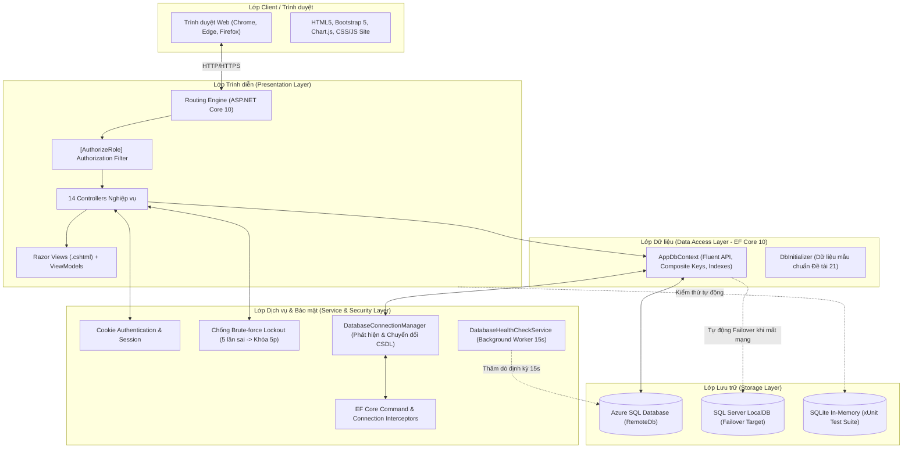

### Chi tiết vai trò từng thư mục:
- **[`Controllers/`](Controllers/):** Tầng điều khiển tiếp nhận HTTP Request, gọi DbContext xử lý dữ liệu và trả về Razor View hoặc JSON. Toàn bộ action được bảo vệ bằng thuộc tính `[AuthorizeRole("Admin")]` hoặc danh sách vai trò cho phép.
- **[`Models/`](Models/):** Chứa 15 lớp ánh xạ CSDL với Data Annotations (`[Key]`, `[Required]`, `[Range]`, `[StringLength]`). Bảng `TonKho` sử dụng khóa chính phức hợp `(MaKho, MaHang)`.
- **[`ViewModels/`](ViewModels/):** Đóng gói dữ liệu hiển thị đặc thù (`LoginViewModel`, `DashboardViewModel`, `CapNhatProfileViewModel`, `DoiMatKhauViewModel`).
- **[`Views/`](Views/):** Hơn 65 giao diện Razor (.cshtml) chuẩn Bootstrap 5 responsive, layout dùng chung [`_Layout.cshtml`](Views/Shared/_Layout.cshtml), hiển thị badge máy chủ DB.
- **[`Data/`](Data/):** [`AppDbContext.cs`](Data/AppDbContext.cs) (Fluent API) và [`DbInitializer.cs`](Data/DbInitializer.cs) (Tự động Migrate và Seed sẵn dữ liệu chuẩn).
- **[`Filters/`](Filters/):** [`AuthorizeRoleAttribute.cs`](Filters/AuthorizeRoleAttribute.cs) chặn truy cập trái phép ở cấp độ Controller và điều hướng tới `/Home/AccessDenied`.
- **[`Services/`](Services/):** Hệ thống High-Availability Failover gồm [`DatabaseConnectionManager.cs`](Services/DatabaseConnectionManager.cs), [`DatabaseFailoverInterceptor.cs`](Services/DatabaseFailoverInterceptor.cs) và [`DatabaseHealthCheckService.cs`](Services/DatabaseHealthCheckService.cs).
- **[`Tests/`](Tests/):** Bộ kiểm thử tự động xUnit sử dụng `WebApplicationFactory` và SQLite In-Memory, đối soát theo file Excel [`TestCase_QuanLyKhoHang_ASPNetCore10.xlsx`](TestCase_QuanLyKhoHang_ASPNetCore10.xlsx).
- **[`wwwroot/`](wwwroot/):** Tệp tĩnh phía client (CSS, JavaScript, Bootstrap 5, jQuery, Chart.js).
- **[`docs/screenshots/`](docs/screenshots/):** Lưu trữ 13 ảnh chụp giao diện chất lượng cao phục vụ tài liệu minh họa.

---

# PHÂN CHIA THEO CÁC MODULE


---

### SƠ ĐỒ QUAN HỆ THỰC THỂ CSDL (ERD - ENTITY RELATIONSHIP DIAGRAM)

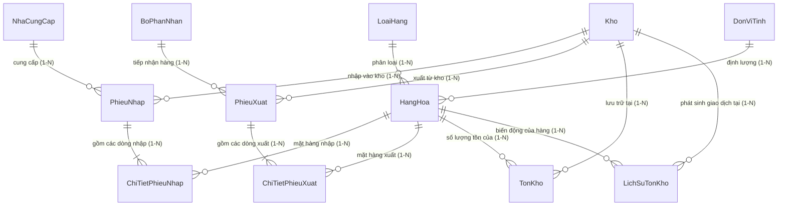

---

# CHI TIẾT CÁC CHỨC NĂNG CỦA MODULE

---

## MODULE 1: TÀI KHOẢN, XÁC THỰC, PHÂN QUYỀN, PROFILE & DANH MỤC CƠ SỞ
**Sinh viên phụ trách:** Trần Xuân Hải

### 1. Bảng đặc tả chức năng & Endpoints
| Chức năng | Tuyến đường (Endpoint) | HTTP Method | Quyền truy cập | Mô tả nghiệp vụ |
| :--- | :--- | :---: | :---: | :--- |
| **Đăng nhập** | `/login` hoặc `/TaiKhoans/DangNhap` | `GET`, `POST` | Công khai | Xác thực danh tính, kiểm tra lockout (khóa 5 phút nếu sai quá 5 lần), cấp Cookie xác thực và lưu Session. |
| **Ghi nhớ đăng nhập** | `/TaiKhoans/DangNhap` | `POST` | Công khai | Tích chọn "Ghi nhớ tài khoản", Cookie sẽ lưu thông tin với thời hạn dài (Remember Me). |
| **Đăng xuất** | `/logout` hoặc `/TaiKhoans/DangXuat` | `GET`, `POST` | Đã đăng nhập | Thu hồi Cookie xác thực `SignOutAsync()`, xóa toàn bộ phiên làm việc `Session.Clear()`, đưa về trang đăng nhập. |
| **Hồ sơ cá nhân** | `/TaiKhoans/Profile` | `GET` | Đã đăng nhập | Hiển thị thông tin cá nhân: Họ tên, Tên đăng nhập, Email, Vai trò phân quyền, Trạng thái hoạt động. |
| **Cập nhật hồ sơ** | `/TaiKhoans/CapNhatProfile` | `GET`, `POST` | Đã đăng nhập | Tự cập nhật Họ tên, Email cá nhân. Khóa sửa đổi Tên đăng nhập và Quyền hạn để tránh leo thang đặc quyền. |
| **Đổi mật khẩu** | `/TaiKhoans/DoiMatKhau` | `GET`, `POST` | Đã đăng nhập | Xác thực mật khẩu cũ trước khi đổi, kiểm tra mật khẩu mới và xác nhận mật khẩu mới phải khớp nhau. |
| **Quản lý tài khoản** | `/TaiKhoans/Index` | `GET` | **Admin** | Danh sách tất cả tài khoản, tìm kiếm, lọc theo vai trò (Admin, NhanVienKho, BoPhanNhan), lọc trạng thái. |
| **Thêm / Sửa / Xóa tài khoản** | `/TaiKhoans/Create`, `Edit`, `Delete` | `GET`, `POST` | **Admin** | CRUD tài khoản. Kiểm tra duy nhất `TenDangNhap`, ngăn chặn xóa tài khoản Admin đang đăng nhập. |
| **Quản lý Loại hàng** | `/LoaiHangs/Index` (CRUD) | `GET`, `POST` | **Admin**, **NhanVienKho** | Danh mục ngành hàng. Tên không để trống, không trùng lặp, chặn xóa vật lý nếu đã có hàng hóa liên kết. |
| **Quản lý Đơn vị tính** | `/DonViTinhs/Index` (CRUD) | `GET`, `POST` | **Admin**, **NhanVienKho** | Danh mục đơn vị chuẩn (Cái, Thùng, Hộp). Chặn trùng tên, chặn xóa vật lý nếu đã có hàng hóa liên kết. |
| **Trang từ chối quyền** | `/Home/AccessDenied` | `GET` | Mọi người dùng | Hiển thị thông báo khi người dùng không đủ quyền truy cập (HTTP 403 Forbidden). |

### 2. Sơ đồ tuần tự Xác thực Đăng nhập & Brute-force Lockout
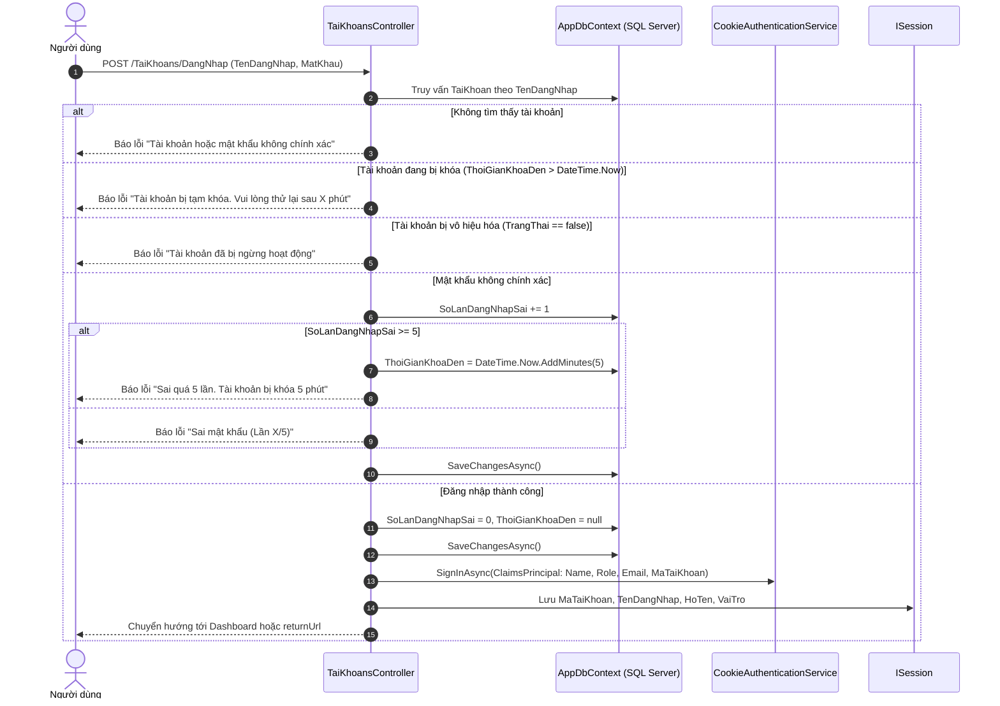

### 3. Hình ảnh chụp chương trình thực tế (Module 1)
| Màn hình Đăng nhập hệ thống | Quản lý Danh sách Tài khoản (Dành cho Admin) |
| :---: | :---: |
| 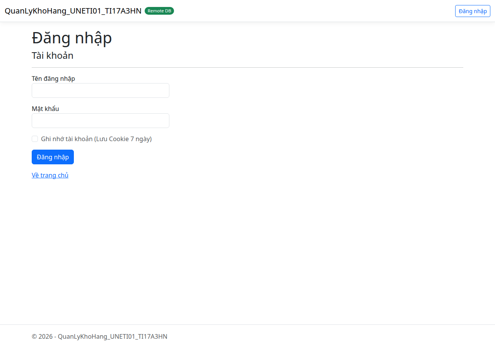 | 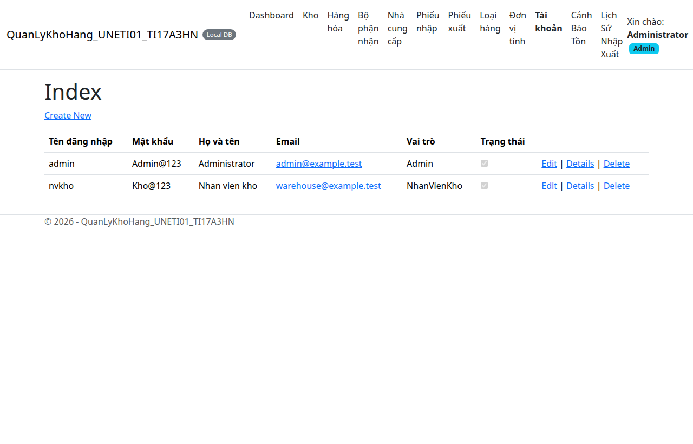 |

---

## MODULE 2: KHO HÀNG, HÀNG HÓA & BỘ TRA CỨU LINQ ĐA TIÊU CHÍ
**Sinh viên phụ trách:** Nguyễn Thị Cúc

### 1. Bảng đặc tả chức năng & Endpoints
| Chức năng | Tuyến đường (Endpoint) | HTTP Method | Quyền truy cập | Mô tả nghiệp vụ |
| :--- | :--- | :---: | :---: | :--- |
| **Danh mục Kho hàng** | `/Khoes/Index` | `GET` | Admin, Nhân viên kho | Hiển thị danh sách kho bãi, địa điểm vật lý, ghi chú và trạng thái Hoạt động / Ngừng hoạt động. |
| **Thêm / Sửa / Xóa Kho** | `/Khoes/Create`, `Edit`, `Delete` | `GET`, `POST` | **Admin** | Quản lý kho. Tên kho bắt buộc; Kho đã có phiếu nhập/xuất bị chặn xóa vật lý để giữ vẹn nguyên lịch sử. |
| **Danh mục Hàng hóa** | `/HangHoas/Index` | `GET` | Mọi vai trò đã login | Danh sách sản phẩm kèm mã hàng, tên loại, đơn vị tính, giá nhập tham khảo, mức tồn tối thiểu. |
| **Bộ tìm kiếm LINQ** | `/HangHoas/Index?searchString=...` | `GET` | Đã đăng nhập | Tìm kiếm tức thì theo Tên hàng, Mã hàng, Tên loại hàng hoặc Tên kho bằng câu lệnh LINQ `.Where()`. |
| **Bộ lọc đa tiêu chí** | `/HangHoas/Index?maLoaiHang=...&giaTu=...&giaDen=...` | `GET` | Đã đăng nhập | Lọc kết hợp nhiều tiêu chí: Nhóm loại hàng, Đơn vị tính, Kho lưu trữ, Khoảng giá từ - đến. |
| **Phân trang Server-side** | `/HangHoas/Index?page=...` | `GET` | Đã đăng nhập | Phân trang hiệu năng cao bằng `.Skip().Take()`, giữ nguyên toàn bộ query string khi chuyển trang. |
| **Xem chi tiết hàng hóa** | `/HangHoas/Details/{id}` | `GET` | Đã đăng nhập | Hiển thị thông số sản phẩm và **bảng tổng hợp tồn kho thực tế tại từng kho riêng biệt** từ bảng `TonKho`. |

### 2. Sơ đồ xử lý Tra cứu & Lọc đa tiêu chí bằng LINQ
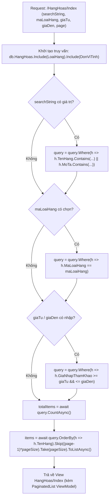

### 3. Hình ảnh chụp chương trình thực tế (Module 2)
| Danh sách Hàng hóa & Bộ lọc đa tiêu chí | Chi tiết hàng hóa & Bảng phân bổ tồn từng kho |
| :---: | :---: |
| 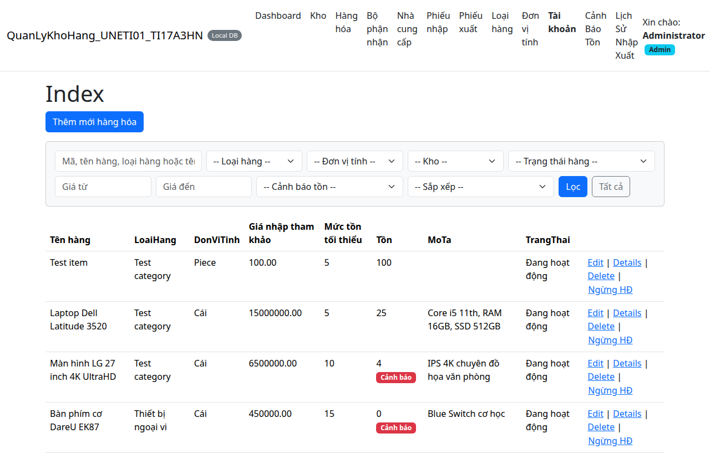 | 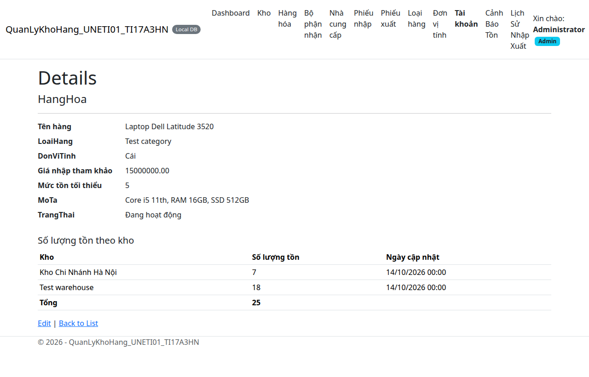 |

| Quản lý danh mục Kho bãi |
| :---: |
| 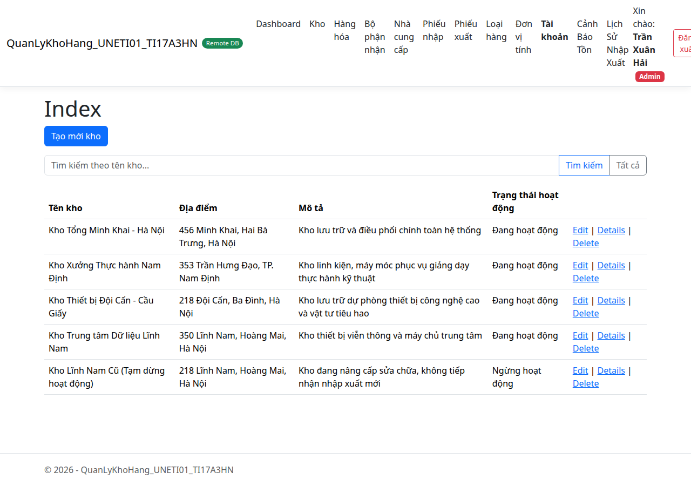 |

---

## MODULE 3: NHÀ CUNG CẤP & NGHIỆP VỤ NHẬP KHO (INBOUND LOGISTICS)
**Sinh viên phụ trách:** Lê Văn Hùng

### 1. Bảng đặc tả chức năng & Endpoints
| Chức năng | Tuyến đường (Endpoint) | HTTP Method | Quyền truy cập | Mô tả nghiệp vụ |
| :--- | :--- | :---: | :---: | :--- |
| **Danh mục Nhà cung cấp** | `/NhaCungCaps/Index` (CRUD) | `GET`, `POST` | Admin, Nhân viên kho | Quản lý đối tác cung ứng: Tên nhà cung cấp, Số điện thoại, Email, Địa chỉ, Trạng thái hoạt động. |
| **Danh sách Phiếu nhập** | `/PhieuNhaps/Index` | `GET` | Admin, Nhân viên kho | Danh sách các phiếu nhập hàng kèm bộ lọc trạng thái: `0: Nháp`, `1: Chờ xác nhận`, `2: Đã hoàn tất`, `3: Đã hủy`. |
| **Lập phiếu nhập mới** | `/PhieuNhaps/Create` | `GET`, `POST` | Nhân viên kho, Admin | Chọn Nhà cung cấp, Kho nhập hàng, Ngày nhập, Người lập, Ghi chú. Khởi tạo ở trạng thái Nháp. |
| **Quản lý Chi tiết phiếu** | `/ChiTietPhieuNhaps/Create`, `Edit`, `Delete` | `GET`, `POST` | Nhân viên kho, Admin | Thêm các món hàng vào phiếu nhập: Chọn mặt hàng, Số lượng nhập ($> 0$), Đơn giá nhập ($\ge 0$). Tự động tính thành tiền. |
| **Hóa đơn phiếu nhập** | `/PhieuNhaps/Details/{id}` | `GET` | Đã đăng nhập | Xem chi tiết phiếu nhập dạng hóa đơn hoàn chỉnh: Đối tác, kho nhập, danh sách bảng hàng hóa và tổng tiền. |
| **Hoàn tất phiếu nhập** | `/PhieuNhaps/HoanTat/{id}` | `POST` | **Admin**, **Nhân viên kho** | Kích hoạt Database Transaction: Kiểm tra trạng thái phiếu, cộng dồn tồn kho vào bảng `TonKho`, ghi nhật ký `LichSuTonKho`, chuyển trạng thái sang `Đã hoàn tất`. Chống cộng trùng lặp. |
| **Hủy phiếu nhập** | `/PhieuNhaps/HuyPhieu/{id}` | `POST` | Admin, Nhân viên kho | Hủy phiếu nhập đang ở trạng thái Nháp hoặc Chờ xác nhận, không làm biến động số lượng tồn kho. |

### 2. Sơ đồ tuần tự Hoàn tất Phiếu Nhập & Cộng dồn Tồn kho
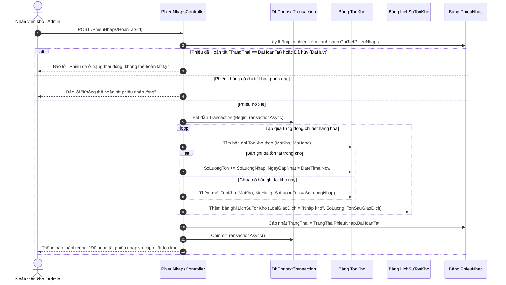

### 3. Hình ảnh chụp chương trình thực tế (Module 3)
| Danh sách Phiếu nhập kho đa trạng thái | Chi tiết Hóa đơn phiếu nhập hàng |
| :---: | :---: |
| 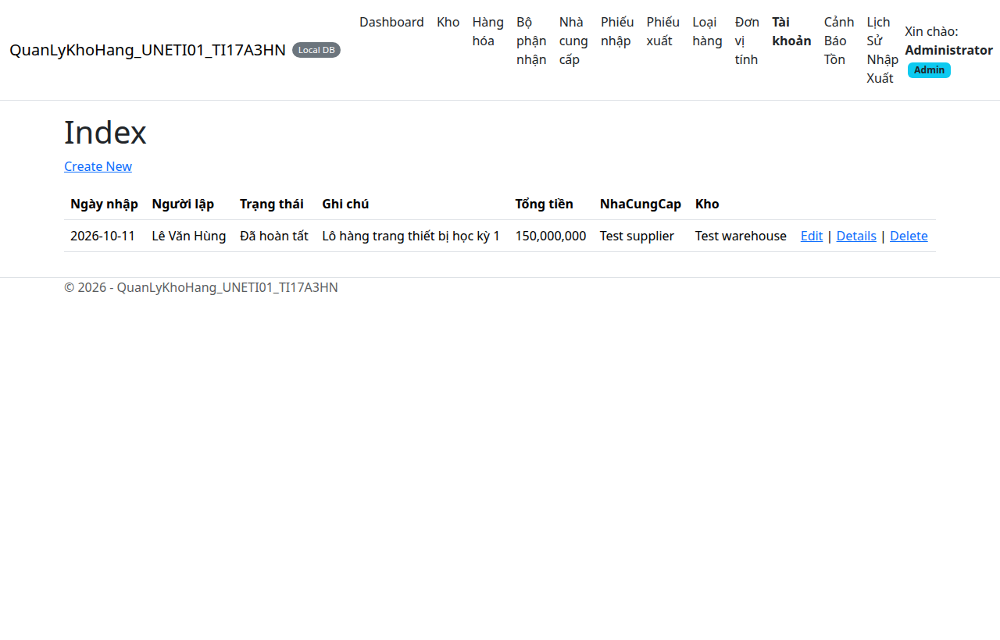 | 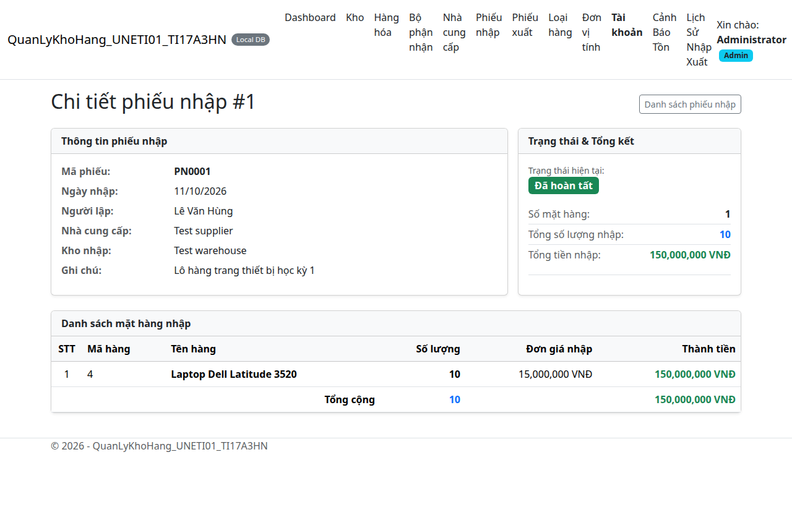 |

---

## MODULE 4: BỘ PHẬN NHẬN, XUẤT KHO & KIỂM THỬ TỰ ĐỘNG
**Sinh viên phụ trách:** Nguyễn Việt Dũng

### 1. Bảng đặc tả chức năng & Endpoints
| Chức năng | Tuyến đường (Endpoint) | HTTP Method | Quyền truy cập | Mô tả nghiệp vụ |
| :--- | :--- | :---: | :---: | :--- |
| **Quản lý Bộ phận nhận** | `/BoPhanNhans/Index` (CRUD) | `GET`, `POST` | Admin, Nhân viên kho | Danh sách khách hàng, phòng ban nhận hàng: Tên bộ phận, Người đại diện, Số điện thoại, Mô tả, Trạng thái. |
| **Danh sách Phiếu xuất** | `/PhieuXuats/Index` | `GET` | Admin, Nhân viên kho, Bộ phận nhận | Danh sách phiếu xuất với 4 trạng thái: Nháp, Chờ xác nhận, Đã hoàn tất, Đã hủy. |
| **Lập phiếu xuất mới** | `/PhieuXuats/Create` | `GET`, `POST` | Nhân viên kho, Admin | Chọn Bộ phận nhận, Kho nguồn xuất hàng, Ngày xuất, Người lập, Ghi chú. |
| **Quản lý Chi tiết phiếu xuất** | `/ChiTietPhieuXuats/Create`, `Edit`, `Delete` | `GET`, `POST` | Nhân viên kho, Admin | Thêm sản phẩm cần xuất: Chọn mặt hàng, Số lượng xuất ($> 0$), Đơn giá tham chiếu. |
| **Kiểm tra tồn kho khả dụng** | `ChiTietPhieuXuats/Create` | `POST` | Nhân viên kho, Admin | **Ràng buộc nghiệp vụ bắt buộc:** $\text{SoLuongXuat} \le \text{SoLuongTon}$. Nếu xuất vượt quá tồn hoặc hàng hết ($\text{Ton} = 0$), hệ thống lập tức chặn lại và báo lỗi `ModelError`. |
| **Hoàn tất phiếu xuất** | `/PhieuXuats/HoanTat/{id}` | `POST` | **Admin**, **Nhân viên kho** | Kích hoạt Database Transaction: Khóa bản ghi, trừ số lượng trong `TonKho`, ghi nhật ký `LichSuTonKho`, chuyển trạng thái phiếu sang `Đã hoàn tất`. Chống trừ âm và chống trừ lặp. |
| **Hủy phiếu xuất** | `/PhieuXuats/HuyPhieu/{id}` | `POST` | Admin, Nhân viên kho | Hủy phiếu xuất chưa hoàn tất. Khóa không cho phép sửa/xóa đối với phiếu đã hoàn tất. |
| **Bộ kiểm thử tự động xUnit** | `dotnet test` hoặc `Run-Tests.ps1` | CLI | Developer / Tester | 10 kịch bản Integration Tests tự động xác thực danh tính, phân quyền và toàn vẹn quy trình nhập - xuất kho. |

### 2. Sơ đồ tuần tự Kiểm tra Tồn kho & Hoàn tất Phiếu Xuất
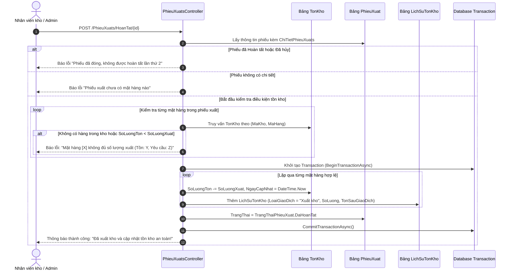

### 3. Hình ảnh chụp chương trình thực tế (Module 4)
| Danh sách Phiếu xuất kho | Chi tiết Biên bản phiếu xuất kho |
| :---: | :---: |
| 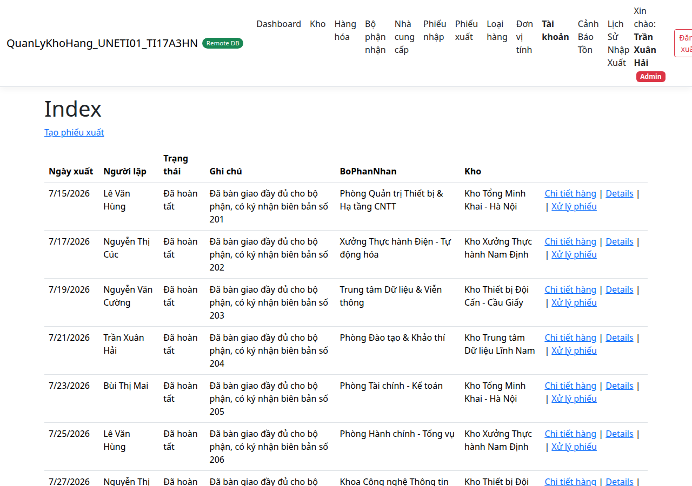 | 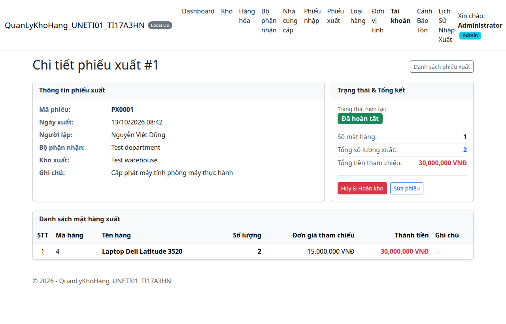 |

---

## MODULE 5: QUẢN LÝ TỒN KHO, CẢNH BÁO, LỊCH SỬ BIẾN ĐỘNG & DASHBOARD
**Sinh viên phụ trách:** Nguyễn Văn Cường

### 1. Bảng đặc tả chức năng & Endpoints
| Chức năng | Tuyến đường (Endpoint) | HTTP Method | Quyền truy cập | Mô tả nghiệp vụ |
| :--- | :--- | :---: | :---: | :--- |
| **Cảnh báo hạn mức tồn** | `/TonKho/CanhBao` | `GET` | Đã đăng nhập | Tự động phân loại 2 mức cảnh báo nguy cấp: **Hàng hết** ($\text{Ton} = 0$) và **Hàng sắp hết** ($0 < \text{Ton} \le \text{MucTonToiThieu}$). Giúp thủ kho kịp thời đề xuất nhập hàng. |
| **Nhật ký biến động kho** | `/TonKho/LichSu` | `GET` | Đã đăng nhập | Bảng Audit Trail ghi nhận toàn bộ biến động: Ngày phát sinh, Loại giao dịch (Nhập/Xuất), Mã phiếu, Số lượng thay đổi, Tồn sau giao dịch, Người thực hiện, Ghi chú. |
| **Dashboard KPIs** | `/ThongKe/Dashboard` | `GET` | Admin, Nhân viên kho | Bảng điều khiển trung tâm: 4 thẻ KPI (Tổng số kho, Tổng mặt hàng, Phiếu nhập hôm nay, Phiếu xuất hôm nay, Số hàng báo động), biểu đồ cơ cấu hàng hóa theo loại. |
| **Biểu đồ trực quan Chart.js** | `/ThongKe/Dashboard` | `GET` | Admin, Nhân viên kho | Tích hợp thư viện `Chart.js`, hiển thị biểu đồ tròn (Doughnut / Pie Chart) phân bố cơ cấu sản phẩm theo từng nhóm ngành hàng. |
| **Báo cáo Nhập - Xuất - Tồn** | `/ThongKe/BaoCaoNhapXuat` | `GET` | Admin, Nhân viên kho | Thống kê nâng cao bằng LINQ theo khoảng thời gian (`TuNgay` đến `DenNgay`). Tính tổng nhập, tổng xuất và đối soát số liệu chuẩn. |

### 2. Sơ đồ xử lý Thống kê & Phân loại Cảnh báo Tồn kho
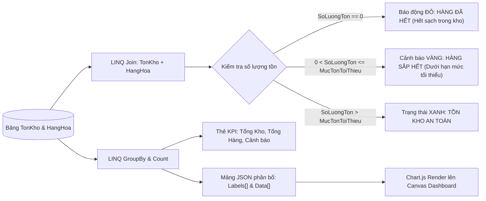

### 3. Hình ảnh chụp chương trình thực tế (Module 5)
| Dashboard KPIs & Biểu đồ trực quan | Cảnh báo hạn mức tồn kho (Hết hàng & Sắp hết) |
| :---: | :---: |
| 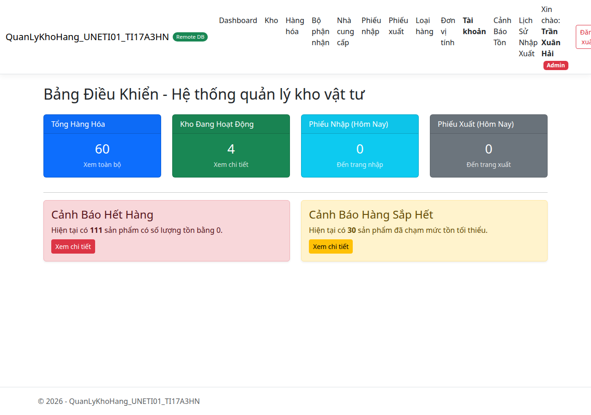 | 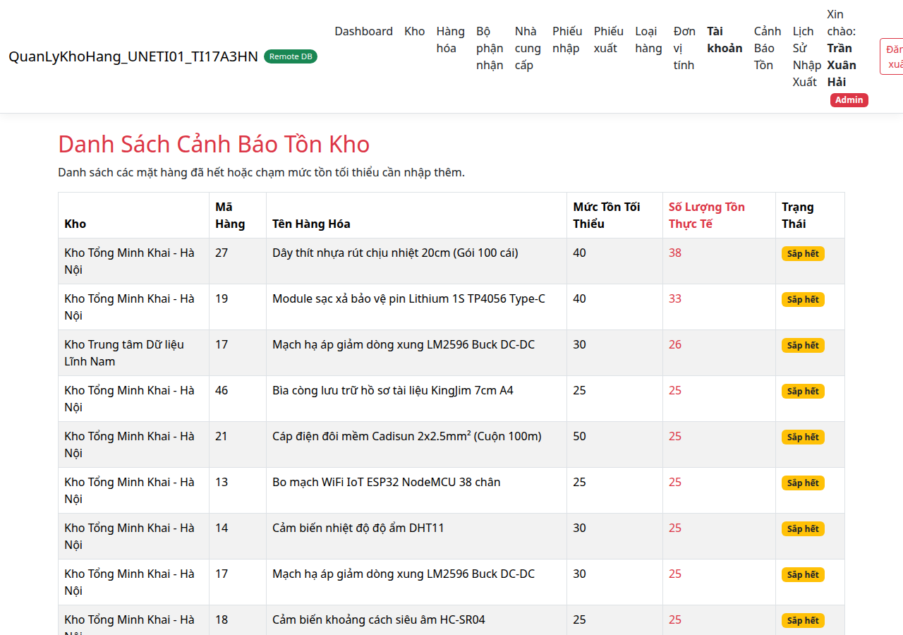 |

| Nhật ký lịch sử biến động nhập - xuất kho | Báo cáo tổng hợp Nhập - Xuất - Tồn |
| :---: | :---: |
| 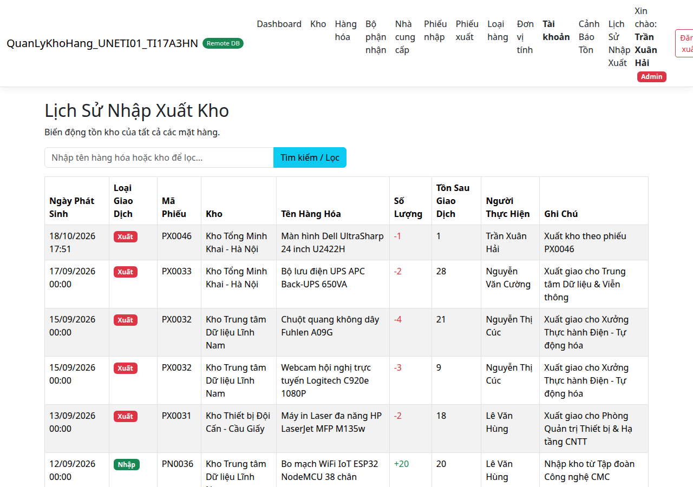 | 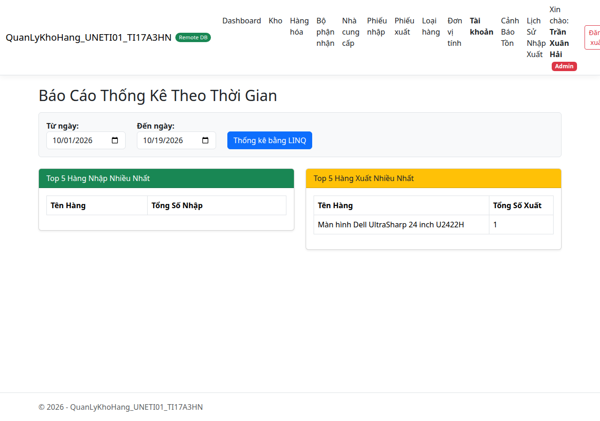 |

---

# MA TRẬN PHÂN QUYỀN TRUY CẬP (ROLE-BASED ACCESS CONTROL)

Hệ thống phân định 3 vai trò người dùng chuẩn mực, được bảo vệ bằng thuộc tính `[AuthorizeRole(...)]`:

| Khu vực chức năng | Mã chức năng / Tuyến đường | Admin (Quản trị viên) | NhanVienKho (Thủ kho) | BoPhanNhan (Khách / Bộ phận) |
| :--- | :--- | :---: | :---: | :---: |
| **Đăng nhập / Đăng xuất** | `/login`, `/logout` | Có quyền | Có quyền | Có quyền |
| **Hồ sơ cá nhân / Đổi mật khẩu** | `/TaiKhoans/Profile`, `DoiMatKhau` | Có quyền | Có quyền | Có quyền |
| **Quản lý Tài khoản người dùng** | `/TaiKhoans/*` (CRUD) | **Toàn quyền** | Chặn (403) | Chặn (403) |
| **Quản lý Loại hàng & Đơn vị tính**| `/LoaiHangs/*`, `/DonViTinhs/*` | Toàn quyền | Xem / Thêm / Sửa | Chặn (403) |
| **Quản lý Kho bãi** | `/Khoes/*` | Toàn quyền | Chỉ xem | Chặn (403) |
| **Quản lý Danh mục Hàng hóa** | `/HangHoas/*` | Toàn quyền | Toàn quyền | Chỉ xem |
| **Quản lý Nhà cung cấp** | `/NhaCungCaps/*` | Toàn quyền | Xem / Thêm / Sửa | Chặn (403) |
| **Quản lý Bộ phận nhận** | `/BoPhanNhans/*` | Toàn quyền | Xem / Thêm / Sửa | Xem thông tin đơn vị |
| **Lập & Hoàn tất Phiếu nhập** | `/PhieuNhaps/*`, `/ChiTietPhieuNhaps/*` | Duyệt & Hoàn tất | Lập & Hoàn tất | Chặn (403) |
| **Lập & Hoàn tất Phiếu xuất** | `/PhieuXuats/*`, `/ChiTietPhieuXuats/*` | Duyệt & Hoàn tất | Lập & Hoàn tất | Xem phiếu liên quan |
| **Xem Cảnh báo tồn & Lịch sử kho**| `/TonKho/CanhBao`, `/TonKho/LichSu` | Toàn quyền | Toàn quyền | Chặn (403) |
| **Dashboard & Báo cáo Thống kê** | `/ThongKe/Dashboard`, `BaoCaoNhapXuat` | Toàn quyền | Xem báo cáo | Chặn (403) |

---

# HƯỚNG DẪN CÀI ĐẶT, KHỞI CHẠY & BỘ KIỂM THỬ TỰ ĐỘNG

### 1. Yêu cầu môi trường
- **.NET SDK:** Phiên bản `.NET 10.0` (được cấu hình trong [`global.json`](global.json)).
- **Hệ quản trị CSDL:** Microsoft SQL Server (LocalDB hoặc Remote Azure SQL) hoặc SQLite In-Memory khi chạy test.

### 2. Các gói thư viện kiểm thử đã tích hợp
Dự án đã được cấu hình đầy đủ các gói xUnit phục vụ kiểm thử tự động:
- `xunit`
- `xunit.runner.visualstudio`
- `Microsoft.NET.Test.Sdk`
- `Microsoft.AspNetCore.Mvc.Testing`
- `Microsoft.EntityFrameworkCore.Sqlite`

### 3. Khởi chạy ứng dụng Web
Mở cửa sổ terminal tại thư mục gốc của dự án:

```bash
# Khôi phục các gói thư viện NuGet
dotnet restore

# Biên dịch toàn bộ Solution
dotnet build

# Khởi chạy ứng dụng Web
dotnet run
```
Truy cập trình duyệt: `http://localhost:5000` (hoặc cổng hiển thị trên console).

### 4. Tài khoản đăng nhập mẫu sẵn có (Seed Data)
| Tên đăng nhập | Mật khẩu mặc định | Vai trò (Role) | Chú thích người dùng |
| :--- | :--- | :--- | :--- |
| `admin` | `Admin@123` | **Admin** | Quản trị viên tối cao (Trần Xuân Hải) |
| `nvkho_hung` | `123456` | **NhanVienKho** | Thủ kho số 1 (Lê Văn Hùng) |
| `nvkho_cuc` | `123456` | **NhanVienKho** | Thủ kho số 2 (Nguyễn Thị Cúc) |
| `nvkho_cuong` | `123456` | **NhanVienKho** | Thủ kho số 3 (Nguyễn Văn Cường) |
| `bophan_dung` | `123456` | **BoPhanNhan** | Đại diện Phòng CNTT (Nguyễn Việt Dũng) |

### 5. Hướng dẫn chạy bộ kiểm thử tự động (Automation Testing Commands)

```bash
# Chạy toàn bộ test suite (Tất cả các module)
dotnet test

# Liệt kê tất cả các test case mà xUnit đã phát hiện
dotnet test -t

# Lọc chạy theo tên hàm C# cụ thể
dotnet test --filter "FullyQualifiedName~Admin_can_login_reach_protected_page_and_logout"

# Lọc chạy toàn bộ test case thuộc một lớp Test (Class)
dotnet test --filter "FullyQualifiedName~AuthenticationIntegrationTests"
dotnet test --filter "FullyQualifiedName~InboundWorkflowIntegrationTests"
dotnet test --filter "FullyQualifiedName~OutboundWorkflowIntegrationTests"

# Lọc theo Mã Test Case trong DisplayName / Trait
dotnet test --filter "DisplayName~TC_M1_001"
dotnet test --filter "DisplayName~TC_M3_001"
dotnet test --filter "DisplayName~TC_M4_001"

# Lọc theo từ khóa mô tả chức năng
dotnet test --filter "DisplayName~Đăng nhập"
dotnet test --filter "DisplayName~Xuất kho"

# Chạy thông qua script PowerShell đối soát với file Excel kịch bản kiểm thử:
pwsh ./Tests/Run-Tests.ps1
pwsh ./Tests/Show-TestcaseCoverage.ps1
```
