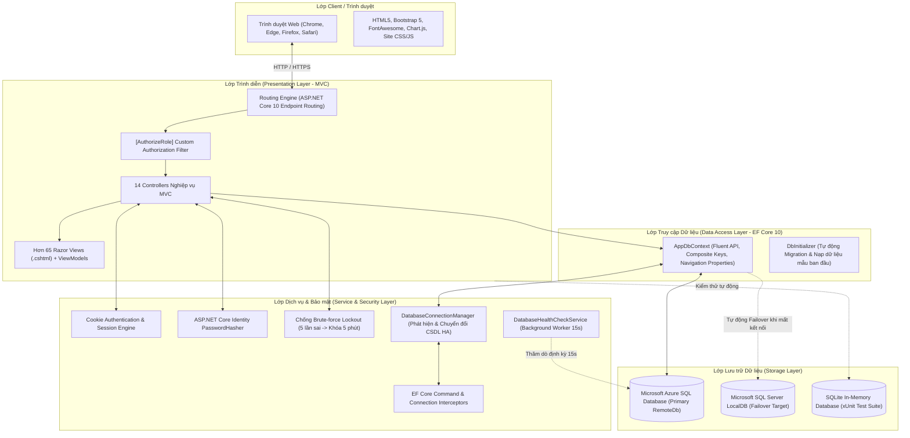

# KIẾN TRÚC HỆ THỐNG & CẤU TRÚC THƯ MỤC DỰ ÁN

> **Dự án:** Hệ thống Quản Lý Kho Hàng UNETI (ASP.NET Core 10 MVC)  
> **Kiến trúc sư:** Trần Xuân Hải (Nhóm trưởng)  
> **Trở về:** [Xem README Tổng quan](../README.md)

---

## 1. SƠ ĐỒ KIẾN TRÚC HỆ THỐNG 5 TẦNG (5-TIER ARCHITECTURE)

Hệ thống được thiết kế theo kiến trúc phân tầng chuẩn mực của ASP.NET Core MVC 10, phân định rành mạch giữa giao diện, bảo mật, nghiệp vụ và dữ liệu:



---

## 2. CHI TIẾT VAI TRÒ TỪNG THƯ MỤC TRONG DỰ ÁN

| Thư mục | Vai trò và trách nhiệm trong kiến trúc |
| :--- | :--- |
| **`Controllers/`** | Tiếp nhận HTTP Request từ Client, điều phối quy trình xử lý, gọi `AppDbContext` truy vấn hoặc cập nhật CSDL, đóng gói dữ liệu vào ViewModel và kết xuất ra Razor View hoặc JSON. Toàn bộ các action quan trọng đều được phân quyền chặt chẽ bằng `[AuthorizeRole("Admin")]` hoặc danh sách vai trò cho phép. |
| **`Models/`** | Chứa 15 lớp ánh xạ CSDL với Data Annotations (`[Key]`, `[Required]`, `[Range]`, `[StringLength]`). Bảng `TonKho` sử dụng khóa chính phức hợp `(MaKho, MaHang)`. Các entity được thiết kế ràng buộc quan hệ 1-N chặt chẽ. |
| **`ViewModels/`** | Đóng gói dữ liệu hiển thị đặc thù (`LoginViewModel`, `DashboardViewModel`, `CapNhatProfileViewModel`, `DoiMatKhauViewModel`), tách biệt hoàn toàn giữa dữ liệu Entity CSDL và dữ liệu giao diện. |
| **`Views/`** | Hơn 65 giao diện Razor (.cshtml) chuẩn Bootstrap 5 responsive, layout dùng chung [`_Layout.cshtml`](../Views/Shared/_Layout.cshtml), hiển thị badge máy chủ DB và menu động theo vai trò. |
| **`Data/`** | Chứa [`AppDbContext.cs`](../Data/AppDbContext.cs) (Fluent API) và [`DbInitializer.cs`](../Data/DbInitializer.cs) (Tự động Migrate và Seed sẵn dữ liệu chuẩn Đề tài 21). |
| **`Filters/`** | Chứa [`AuthorizeRoleAttribute.cs`](../Filters/AuthorizeRoleAttribute.cs) chặn truy cập trái phép ở cấp độ Controller và điều hướng tới `/Home/AccessDenied`. |
| **`Services/`** | Hệ thống High-Availability Failover gồm [`DatabaseConnectionManager.cs`](../Services/DatabaseConnectionManager.cs), [`DatabaseFailoverInterceptor.cs`](../Services/DatabaseFailoverInterceptor.cs) và [`DatabaseHealthCheckService.cs`](../Services/DatabaseHealthCheckService.cs). |
| **`Tests/`** | Bộ kiểm thử tự động xUnit sử dụng `WebApplicationFactory` và SQLite In-Memory, đối soát theo file Excel [`TestCase_QuanLyKhoHang_ASPNetCore10.xlsx`](../TestCase_QuanLyKhoHang_ASPNetCore10.xlsx). |
| **`wwwroot/`** | Tệp tĩnh phía client (CSS tùy biến `site.css`, JavaScript `site.js`, thư viện Bootstrap 5, jQuery, Chart.js). |
| **`docs/`** | Lưu trữ toàn bộ tài liệu hướng dẫn chuyên sâu, cẩm nang cài đặt, ma trận phân quyền và 13 ảnh chụp giao diện chất lượng cao tại `docs/screenshots/`. |

---

## 3. CÂY THƯ MỤC MÃ NGUỒN TOÀN DIỆN

```text
.                                                  # Thư mục gốc giải pháp Quản lý Kho hàng ASP.NET Core 10 MVC
├── appsettings.Development.json                   # Cấu hình môi trường phát triển (chuỗi kết nối LocalDB / RemoteDb test)
├── appsettings.json                               # Cấu hình chính hệ thống (ConnectionStrings, Logging, AllowedHosts)
├── Controllers                                    # Tầng điều khiển tiếp nhận HTTP Request & điều phối xử lý MVC
│   ├── BoPhanNhansController.cs                   # Quản lý khách hàng / bộ phận nhận hàng xuất kho (CRUD)
│   ├── ChiTietPhieuNhapsController.cs             # Quản lý dòng hàng chi tiết của phiếu nhập, đơn giá & số lượng
│   ├── ChiTietPhieuXuatsController.cs             # Quản lý chi tiết phiếu xuất, kiểm tra tồn kho khả dụng trước khi xuất
│   ├── DonViTinhsController.cs                    # Quản lý danh mục đơn vị tính hàng hóa (Hộp, Thùng, Chiếc, Bộ...)
│   ├── HangHoasController.cs                      # Quản lý danh mục hàng hóa, tra cứu đa tiêu chí LINQ & phân trang
│   ├── HomeController.cs                          # Trang chủ điều hướng và xử lý màn hình báo lỗi 403 AccessDenied
│   ├── KhoesController.cs                         # Quản lý danh mục hệ thống kho bãi vật lý và địa điểm lưu trữ
│   ├── LoaiHangsController.cs                     # Quản lý danh mục nhóm phân loại ngành hàng hóa
│   ├── NhaCungCapsController.cs                   # Quản lý danh mục đối tác nhà cung cấp hàng hóa
│   ├── PhieuNhapsController.cs                    # Quy trình lập, duyệt & hoàn tất phiếu nhập (cộng tồn trong Transaction)
│   ├── PhieuXuatsController.cs                    # Quy trình lập, duyệt & hoàn tất phiếu xuất (kiểm tra tồn & trừ tồn kho)
│   ├── TaiKhoansController.cs                     # Quản lý tài khoản, xác thực Cookie, brute-force lockout & profile
│   ├── ThongKeController.cs                       # Thống kê báo cáo Nhập-Xuất-Tồn theo kỳ, KPIs & biểu đồ Chart.js
│   └── TonKhoController.cs                        # Theo dõi tồn kho tức thời, cảnh báo hết/sắp hết & lịch sử biến động
├── Data                                           # Tầng truy cập dữ liệu và cấu hình Entity Framework Core
│   ├── AppDbContext.cs                            # DbContext chính, cấu hình Fluent API, khóa phức hợp & quan hệ bảng
│   └── DbInitializer.cs                           # Tự động chạy Migration & nạp sẵn dữ liệu ban đầu (Seed Data)
├── docs                                           # Tài liệu hướng dẫn và hình ảnh chụp minh chứng đồ án
│   ├── modules                                    # Tài liệu chi tiết bóc tách cho từng Module 1 - 5
│   │   ├── MODULE_01_TAI_KHOAN_XAC_THUC.md        # Tài liệu Module 1 (Trần Xuân Hải)
│   │   ├── MODULE_02_KHO_HANG_HOA.md              # Tài liệu Module 2 (Nguyễn Thị Cúc)
│   │   ├── MODULE_03_NHA_CUNG_CAP_NHAP_KHO.md     # Tài liệu Module 3 (Lê Văn Hùng)
│   │   ├── MODULE_04_BO_PHAN_NHAN_XUAT_KHO.md     # Tài liệu Module 4 (Nguyễn Việt Dũng)
│   │   ├── MODULE_05_TON_KHO_DASHBOARD.md         # Tài liệu Module 5 (Nguyễn Văn Cường)
│   │   └── README.md                              # Index mục lục điều hướng các module
│   ├── DATABASE_SETUP.md                          # Hướng dẫn cấu hình kết nối CSDL Remote & Auto-Failover
│   ├── ARCHITECTURE_AND_STRUCTURE.md              # Kiến trúc hệ thống 5 tầng & cây thư mục
│   ├── RBAC_SECURITY.md                           # Ma trận phân quyền RBAC & chính sách bảo mật
│   ├── INSTALLATION_AND_TESTING.md                # Cẩm nang cài đặt, khởi chạy & kiểm thử tự động
│   └── screenshots                                # Thư mục ảnh chụp màn hình minh chứng 13 chức năng thực tế
│       ├── 01_dang_nhap.png                       # Ảnh chụp: Giao diện xác thực đăng nhập & bảo vệ brute-force
│       ├── 02_dashboard.png                       # Ảnh chụp: Bảng điều khiển trung tâm KPIs & biểu đồ Chart.js
│       ├── 03_hang_hoa.png                        # Ảnh chụp: Danh mục hàng hóa, bộ lọc LINQ đa tiêu chí & phân trang
│       ├── 04_chi_tiet_hang_hoa.png               # Ảnh chụp: Chi tiết hàng hóa & số lượng tồn theo từng kho
│       ├── 05_kho_hang.png                        # Ảnh chụp: Danh mục hệ thống kho bãi lưu trữ hàng hóa
│       ├── 06_phieu_nhap.png                      # Ảnh chụp: Danh sách phiếu nhập kho và trạng thái chứng từ
│       ├── 07_chi_tiet_phieu_nhap.png             # Ảnh chụp: Chi tiết phiếu nhập & quy trình cộng dồn tồn kho
│       ├── 08_phieu_xuat.png                      # Ảnh chụp: Danh sách phiếu xuất kho và trạng thái giao hàng
│       ├── 09_chi_tiet_phieu_xuat.png             # Ảnh chụp: Chi tiết phiếu xuất, kiểm tra tồn khả dụng & trừ tồn
│       ├── 10_canh_bao_ton_kho.png                # Ảnh chụp: Màn hình cảnh báo hàng hết & hàng sắp hết mức tối thiểu
│       ├── 11_lich_su_ton_kho.png                 # Ảnh chụp: Nhật ký lịch sử biến động kho (Audit Trail)
│       ├── 12_bao_cao_nhap_xuat.png               # Ảnh chụp: Báo cáo tổng hợp Nhập - Xuất - Tồn theo khoảng ngày
│       └── 13_quan_ly_tai_khoan.png               # Ảnh chụp: Quản trị tài khoản người dùng, phân quyền & khóa tài khoản
├── dotnet-tools.json                              # Cấu hình công cụ dòng lệnh .NET CLI cục bộ (dotnet-ef)
├── Filters                                        # Bộ lọc tùy biến Controller (Action Filters)
│   └── AuthorizeRoleAttribute.cs                  # Bộ lọc phân quyền truy cập theo vai trò (Admin, NhanVienKho, BoPhanNhan)
├── global.json                                    # Cố định phiên bản .NET SDK 10.0 cho môi trường xây dựng dự án
├── Migrations                                     # Các tệp quản lý lược đồ CSDL tự động (EF Core Migrations)
├── Models                                         # Tầng thực thể dữ liệu nghiệp vụ (Domain Entities & Models)
│   ├── BoPhanNhan.cs                              # Thực thể Khách hàng / Phòng ban nhận hàng xuất kho
│   ├── ChiTietPhieuNhap.cs                        # Thực thể Chi tiết dòng hàng nhập (Mã hàng, Số lượng, Đơn giá nhập)
│   ├── ChiTietPhieuXuat.cs                        # Thực thể Chi tiết dòng hàng xuất (Mã hàng, Số lượng, Đơn giá xuất)
│   ├── DatabaseInfo.cs                            # Model thông tin trạng thái máy chủ CSDL hiện tại (Local / Remote)
│   ├── DonViTinh.cs                               # Thực thể Đơn vị tính của hàng hóa (Hộp, Thùng, Chiếc, Kg...)
│   ├── ErrorViewModel.cs                          # Model đóng gói thông báo lỗi hệ thống và Request ID
│   ├── HangHoa.cs                                 # Thực thể Hàng hóa lưu kho, mức tồn tối thiểu & giá tham khảo
│   ├── Kho.cs                                     # Thực thể Kho hàng vật lý (Mã kho, Tên kho, Địa chỉ, Thủ kho)
│   ├── LichSuTonKho.cs                            # Thực thể Nhật ký biến động kho (Audit Trail cho mọi giao dịch nhập/xuất)
│   ├── LoaiHang.cs                                # Thực thể Danh mục phân loại nhóm ngành hàng
│   ├── NhaCungCap.cs                              # Thực thể Đối tác nhà cung cấp hàng hóa
│   ├── PhieuNhap.cs                               # Thực thể Phiếu nhập kho (Số phiếu, Ngày nhập, Nhà CC, Kho nhận)
│   ├── PhieuXuat.cs                               # Thực thể Phiếu xuất kho (Số phiếu, Ngày xuất, Bộ phận nhận, Kho)
│   ├── TaiKhoan.cs                                # Thực thể Tài khoản người dùng, mật khẩu băm, vai trò & khóa tài khoản
│   └── TonKho.cs                                  # Thực thể Tồn kho tức thời với khóa chính phức hợp (MaKho, MaHang)
├── Program.cs                                     # Điểm khởi đầu ứng dụng, cấu hình DI, DbContext, Cookie Auth & Pipeline
├── Properties                                     # Cấu hình môi trường khởi chạy Visual Studio / .NET CLI
│   └── launchSettings.json                        # Cấu hình profile khởi chạy (URL localhost, Port, Biến môi trường)
├── QuanLyKhoHang_UNETI01_TI17A3HN.csproj          # Tệp dự án ASP.NET Core MVC .NET 10.0, danh sách NuGet packages
├── QuanLyKhoHang_UNETI01_TI17A3HN.slnx            # Tệp Solution định dạng mới (.slnx) của .NET / Visual Studio
├── README.md                                      # Tài liệu tổng quan dự án & cổng điều hướng
├── Services                                       # Tầng dịch vụ nghiệp vụ & Hệ thống High-Availability Failover CSDL
│   ├── DatabaseConnectionManager.cs               # Quản lý kết nối CSDL động, kiểm tra kết nối & failover tức thì
│   ├── DatabaseFailoverInterceptor.cs             # EF Core Interceptor bắt lỗi kết nối SQL để tự động kích hoạt failover
│   └── DatabaseHealthCheckService.cs              # Background Service chạy ngầm định kỳ kiểm tra & tự phục hồi RemoteDb
├── Tests                                          # Thư mục chứa bộ kiểm thử tự động xUnit & script điều phối
│   ├── QuanLyKhoHang.Tests                        # Dự án kiểm thử tích hợp (Integration Tests) với xUnit & SQLite
│   │   ├── AuthenticationIntegrationTests.cs      # Test case kiểm thử xác thực đăng nhập, phân quyền & lockout
│   │   ├── InboundWorkflowIntegrationTests.cs     # Test case quy trình lập phiếu nhập, cộng tồn kho & chống cộng lặp
│   │   ├── Infrastructure                         # Thư mục hạ tầng test fixture và mock WebApplicationFactory
│   │   │   ├── WarehouseIntegrationTest.cs        # Lớp cơ sở tích hợp fixture kiểm thử và mock DbContext
│   │   │   └── WarehouseWebApplicationFactory.cs  # Custom WebApplicationFactory khởi tạo máy chủ test với SQLite In-Memory
│   │   ├── OutboundWorkflowIntegrationTests.cs    # Test case quy trình xuất kho, kiểm tra tồn khả dụng & chống xuất âm
│   │   └── QuanLyKhoHang.Tests.csproj             # Tệp cấu hình dự án test xUnit (.NET 10.0, FluentAssertions...)
│   ├── Run-Tests.ps1                              # Script PowerShell tự động chạy toàn bộ test & sinh báo cáo
│   └── Show-TestcaseCoverage.ps1                  # Script PowerShell đối soát độ phủ test case với file Excel đặc tả
├── ViewModels                                     # Các lớp Model đóng gói dữ liệu phục vụ giao diện (View Models)
│   ├── CapNhatProfileViewModel.cs                 # ViewModel form cập nhật thông tin cá nhân người dùng
│   ├── DashboardViewModel.cs                      # ViewModel đóng gói số liệu 4 thẻ KPI & mảng dữ liệu biểu đồ Chart.js
│   ├── DoiMatKhauViewModel.cs                     # ViewModel xử lý form đổi mật khẩu (Mật khẩu cũ, mới, xác nhận)
│   └── LoginViewModel.cs                          # ViewModel phục vụ form đăng nhập (Tài khoản, Mật khẩu, Ghi nhớ)
├── Views                                          # Tầng giao diện Razor (.cshtml) chuẩn Bootstrap 5 responsive
│   ├── BoPhanNhans                                # Views CRUD bộ phận nhận hàng xuất kho
│   ├── ChiTietPhieuNhaps                          # Views chi tiết mặt hàng phiếu nhập
│   ├── ChiTietPhieuXuats                          # Views chi tiết mặt hàng phiếu xuất
│   ├── DonViTinhs                                 # Views CRUD danh mục đơn vị tính
│   ├── HangHoas                                   # Views CRUD hàng hóa & bộ lọc LINQ
│   ├── Home                                       # Trang chủ & thông báo 403 AccessDenied
│   ├── Khoes                                      # Views CRUD hệ thống kho bãi
│   ├── LoaiHangs                                  # Views CRUD danh mục loại hàng
│   ├── NhaCungCaps                                # Views CRUD đối tác nhà cung cấp
│   ├── PhieuNhaps                                 # Views lập & duyệt phiếu nhập kho
│   ├── PhieuXuats                                 # Views lập & duyệt phiếu xuất kho
│   ├── Shared                                     # Khung giao diện chung (_Layout, Error, Scripts)
│   ├── TaiKhoans                                  # Views đăng nhập, hồ sơ cá nhân & quản trị người dùng
│   ├── ThongKe                                    # Views Dashboard KPIs & Báo cáo tổng hợp
│   └── TonKho                                     # Views Cảnh báo tồn & Sổ cái nhật ký Audit Trail
└── wwwroot                                        # Thư mục chứa tài nguyên tĩnh phục vụ trình duyệt
    ├── css                                        # Định kiểu CSS giao diện (site.css)
    └── js                                         # JavaScript tùy biến (site.js)
```
