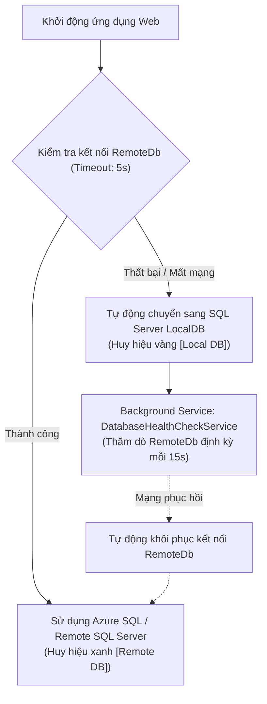

# HƯỚNG DẪN CẤU HÌNH KẾT NỐI CƠ SỞ DỮ LIỆU (REMOTE & LOCAL FAILOVER)

> **Dự án:** Hệ thống Quản Lý Kho Hàng UNETI (ASP.NET Core 10 MVC)  
> **Tác giả:** Trần Xuân Hải (Nhóm trưởng / Kiến trúc sư hệ thống)  
> **Trở về:** [Xem README Tổng quan](../README.md)

---

## 1. TỔNG QUAN HỆ THỐNG KẾT NỐI CSDL DỰ ÁN

Hệ thống quản lý kho hàng được trang bị giải pháp **High-Availability (HA) & Dynamic Database Failover** thông qua dịch vụ [`DatabaseConnectionManager`](../Services/DatabaseConnectionManager.cs) và [`DatabaseHealthCheckService`](../Services/DatabaseHealthCheckService.cs):



- **Ưu tiên kết nối RemoteDb:** Khi khởi động, hệ thống kiểm tra kết nối tới `RemoteDb` với timeout 5 giây. Nếu thành công, ứng dụng sẽ chạy trực tiếp trên CSDL Remote và hiển thị huy hiệu xanh `[Remote DB]` trên thanh Header.
- **Tự động Failover sang LocalDB:** Nếu mất kết nối Internet hoặc Remote SQL Server gặp sự cố, hệ thống tự động chuyển tiếp truy vấn sang CSDL `LocalDb` cục bộ mà không làm crash ứng dụng.
- **Tự phục hồi (Auto-Recovery):** [`DatabaseHealthCheckService`](../Services/DatabaseHealthCheckService.cs) chạy nền kiểm tra RemoteDb mỗi 15 giây để tự động kết nối lại khi mạng ổn định.

---

## 2. CẤU TRÚC CHUỖI KẾT NỐI & PLACEHOLDER CHUNG

### Mẫu chuỗi kết nối Microsoft SQL Server từ xa (Dedicated / VPS / On-Premise):
```
Server=<REMOTE_SERVER_HOST_OR_IP>,<PORT>;Database=<DATABASE_NAME>;User Id=<DATABASE_USERNAME>;Password=<DATABASE_PASSWORD>;TrustServerCertificate=True;MultipleActiveResultSets=true;Connect Timeout=15;
```

### Mẫu chuỗi kết nối Microsoft Azure SQL Database:
```
Server=tcp:<YOUR_AZURE_SERVER>.database.windows.net,1433;Initial Catalog=<DATABASE_NAME>;Persist Security Info=False;User ID=<DATABASE_USERNAME>;Password=<DATABASE_PASSWORD>;MultipleActiveResultSets=False;Encrypt=True;TrustServerCertificate=True;Connection Timeout=30;
```

### Bảng giải thích các thông số Placeholder:
| Tham số Placeholder | Ý nghĩa | Giá trị mẫu |
| :--- | :--- | :--- |
| `<REMOTE_SERVER_HOST_OR_IP>` | Địa chỉ IP máy chủ hoặc tên miền máy chủ CSDL. | `14.225.204.15` hoặc `db.uneti.edu.vn` |
| `<PORT>` | Cổng dịch vụ SQL Server (mặc định là `1433`). | `1433` |
| `<DATABASE_NAME>` | Tên cơ sở dữ liệu trên máy chủ. | `QuanLyKhoHang_UNETI` |
| `<DATABASE_USERNAME>` | Tên tài khoản đăng nhập SQL Server. | `sa` hoặc `sqladmin` |
| `<DATABASE_PASSWORD>` | Mật khẩu của tài khoản SQL Server. | `P@ssw0rdKhoHang2026` |
| `TrustServerCertificate=True` | **Bắt buộc** để tránh lỗi bắt tay chứng chỉ SSL (SSL Handshake Error) khi kết nối từ Linux, macOS hoặc máy phát triển. | `True` |
| `MultipleActiveResultSets=true` | Cho phép chạy nhiều truy vấn đồng thời trên cùng một connection (MARS). | `true` |

---

## 3. HƯỚNG DẪN DÀNH CHO NGƯỜI DÙNG WINDOWS

### A. Sử dụng Visual Studio (Visual Studio 2022 / 2026)

#### Cách 1: Sử dụng Manage User Secrets (Khuyến nghị số 1 – An toàn nhất, không lo lộ pass lên Git):
1. Trong cửa sổ **Solution Explorer**, nhấp chuột phải vào dự án `QuanLyKhoHang_UNETI01_TI17A3HN`.
2. Chọn **Manage User Secrets** (Tệp `secrets.json` sẽ tự động mở ra trên IDE).
3. Dán cấu hình sau vào tệp và lưu lại (`Ctrl + S`):
```json
{
  "ConnectionStrings": {
    "RemoteDb": "Server=<REMOTE_SERVER_HOST_OR_IP>,1433;Database=<DATABASE_NAME>;User Id=<DATABASE_USERNAME>;Password=<DATABASE_PASSWORD>;TrustServerCertificate=True;MultipleActiveResultSets=true;"
  }
}
```
*(Tệp `secrets.json` được lưu riêng tại `%APPDATA%\Microsoft\UserSecrets\<UserSecretsId>\secrets.json`, hoàn toàn nằm ngoài Git).*

#### Cách 2: Cấu hình qua tệp `appsettings.Development.json`:
1. Mở tệp `appsettings.Development.json` (dùng riêng cho môi trường lập trình nội bộ).
2. Bổ sung chuỗi kết nối vào khối `ConnectionStrings`:
```json
{
  "ConnectionStrings": {
    "RemoteDb": "Server=<REMOTE_SERVER_HOST_OR_IP>,1433;Database=<DATABASE_NAME>;User Id=<DATABASE_USERNAME>;Password=<DATABASE_PASSWORD>;TrustServerCertificate=True;MultipleActiveResultSets=true;"
  }
}
```

#### Kiểm tra kết nối trước khi chạy (SQL Server Object Explorer):
1. Vào menu **View** $\rightarrow$ **SQL Server Object Explorer** (hoặc tổ hợp phím `Ctrl + \`, `Ctrl + S`).
2. Nhấn nút **Add SQL Server** (icon dấu cộng màu xanh).
3. Điền các thông số:
   - Server name: `<REMOTE_SERVER_HOST_OR_IP>,1433`
   - Authentication: **SQL Server Authentication**
   - User name: `<DATABASE_USERNAME>`
   - Password: `<DATABASE_PASSWORD>`
   - Đánh dấu chọn **Trust server certificate**.
4. Nhấn **Connect** để đảm bảo máy tính đã thông mạng tới SQL Server.
5. **Khởi chạy chương trình:** Nhấn `F5` (Debug) hoặc `Ctrl + F5` (Start Without Debugging).

---

### B. Sử dụng Visual Studio Code (VS Code) trên Windows

#### Cách 1: Cấu hình qua Terminal PowerShell với `dotnet user-secrets`:
```powershell
dotnet user-secrets set "ConnectionStrings:RemoteDb" "Server=<REMOTE_SERVER_HOST_OR_IP>,1433;Database=<DATABASE_NAME>;User Id=<DATABASE_USERNAME>;Password=<DATABASE_PASSWORD>;TrustServerCertificate=True;MultipleActiveResultSets=true;"
```

#### Cách 2: Thiết lập biến môi trường tạm thời trong PowerShell:
```powershell
$env:ConnectionStrings__RemoteDb="Server=<REMOTE_SERVER_HOST_OR_IP>,1433;Database=<DATABASE_NAME>;User Id=<DATABASE_USERNAME>;Password=<DATABASE_PASSWORD>;TrustServerCertificate=True;MultipleActiveResultSets=true;"
dotnet run
```

#### Cách 3: Cấu hình qua `.vscode/launch.json`:
Thêm biến môi trường vào khối cấu hình:
```json
{
  "configurations": [
    {
      "name": ".NET Core Launch (web)",
      "type": "coreclr",
      "request": "launch",
      "preLaunchTask": "build",
      "program": "${workspaceFolder}/bin/Debug/net10.0/QuanLyKhoHang_UNETI01_TI17A3HN.dll",
      "args": [],
      "cwd": "${workspaceFolder}",
      "stopAtEntry": false,
      "env": {
        "ASPNETCORE_ENVIRONMENT": "Development",
        "ConnectionStrings__RemoteDb": "Server=<REMOTE_SERVER_HOST_OR_IP>,1433;Database=<DATABASE_NAME>;User Id=<DATABASE_USERNAME>;Password=<DATABASE_PASSWORD>;TrustServerCertificate=True;MultipleActiveResultSets=true;"
      }
    }
  ]
}
```

---

## 4. HƯỚNG DẪN DÀNH CHO NGƯỜI DÙNG LINUX (Ubuntu, Debian, Fedora, Arch, WSL2)

### A. Sử dụng Visual Studio Code trên Linux
1. Mở cửa sổ Terminal tại thư mục dự án và mở VS Code:
   ```bash
   code .
   ```
2. Thiết lập User Secrets trong terminal tích hợp (`Ctrl + ~`):
   ```bash
   dotnet user-secrets set "ConnectionStrings:RemoteDb" "Server=<REMOTE_SERVER_HOST_OR_IP>,1433;Database=<DATABASE_NAME>;User Id=<DATABASE_USERNAME>;Password=<DATABASE_PASSWORD>;TrustServerCertificate=True;MultipleActiveResultSets=true;"
   ```
   *(Trên Linux, User Secrets được lưu an toàn tại `~/.microsoft/usersecrets/<UserSecretsId>/secrets.json`)*.
3. Chạy ứng dụng: Nhấn `F5` hoặc chạy `dotnet run`.

### B. Sử dụng Terminal Linux CLI (Không cần IDE / Server)
1. **Thiết lập biến môi trường:**
   ```bash
   export ConnectionStrings__RemoteDb="Server=<REMOTE_SERVER_HOST_OR_IP>,1433;Database=<DATABASE_NAME>;User Id=<DATABASE_USERNAME>;Password=<DATABASE_PASSWORD>;TrustServerCertificate=True;MultipleActiveResultSets=true;"
   ```
2. **Khởi chạy ứng dụng:**
   ```bash
   dotnet run
   ```

---

## 5. DẤU HIỆU NHẬN BIẾT KẾT NỐI CSDL THÀNH CÔNG

1. **Trên màn hình Console / Terminal:**
   ```text
   [Database] Đã kết nối thành công tới RemoteDb (<REMOTE_SERVER_HOST_OR_IP>).
   [DatabaseHealthCheck] RemoteDb đang hoạt động ổn định (Ping: 42ms).
   ```
2. **Trên giao diện Web:**
   - Trên thanh Header (góc trên bên phải cạnh tên người dùng) xuất hiện huy hiệu màu xanh: `[Remote DB]`.
   - Nếu máy mất kết nối Internet hoặc SQL Server Remote bị sập, hệ thống chuyển sang huy hiệu màu vàng: `[Local DB]`.
