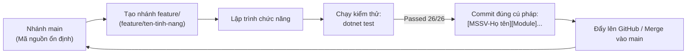

# QUY TRÌNH THỦ TỤC LÀM VIỆC NHÓM VỚI GIT & QUY ƯỚC COMMIT

> **Dự án:** Hệ thống Quản Lý Kho Hàng UNETI (ASP.NET Core 10 MVC)  
> **Nhóm thực hiện:** Nhóm 1 - ĐHTI17A3HN  
> **Trở về:** [Xem README Tổng quan](../README.md)

---

## 1. QUY ƯỚC ĐẶT TÊN COMMIT (COMMIT MESSAGE CONVENTION)

Tất cả các thành viên trong nhóm bắt buộc tuân thủ đúng định dạng commit message sau để phục vụ chấm điểm và truy vết lịch sử:

```
[<Mã_Sinh_Viên>-<Họ_Và_Tên>][<Module>] <Mô tả tóm tắt nội dung thay đổi>
```

### Ví dụ hợp lệ:
- `[23103100135-Trần Xuân Hải][Module 1] Hoàn thành CV1.1 và CV1.2: Đồng bộ menu _Layout theo vai trò và mã hóa mật khẩu ASP.NET Identity`
- `[23103100178-Nguyễn Thị Cúc][Module 2] Bổ sung bảng tồn kho chi tiết theo từng kho trong HangHoas/Details`
- `[23103100177-Lê Văn Hùng][Module 3] Bổ sung kiểm tra chống hoàn tất trùng lặp cho phiếu nhập kho`
- `[23103100127-Nguyễn Việt Dũng][Module 4] Bổ sung ràng buộc kiểm tra tồn kho trước khi lập chi tiết phiếu xuất`
- `[23103100132-Nguyễn Văn Cường][Module 5] Tối ưu hóa truy vấn LINQ cho báo cáo Nhập - Xuất - Tồn`

---

## 2. QUY TRÌNH PHÁT TRIỂN & ĐẨY MÃ NGUỒN (WORKFLOW)



### Các bước thực hiện cụ thể:
1. **Trước khi bắt đầu code:** Cập nhật mã nguồn mới nhất từ remote:
   ```bash
   git checkout main
   git pull origin main
   ```
2. **Thực hiện thay đổi & Kiểm tra cục bộ:**
   - Biên dịch và chạy thử ứng dụng: `dotnet run`
   - **Bắt buộc:** Chạy toàn bộ bộ kiểm thử tự động để bảo đảm không làm vỡ tính năng cũ:
     ```bash
     dotnet test
     ```
3. **Commit mã nguồn:**
   ```bash
   git add .
   git commit -m "[<MSSV>-<Họ và tên>][<Module>] <Nội dung commit>"
   ```
4. **Đẩy lên máy chủ từ xa:**
   ```bash
   git push origin main
   ```
