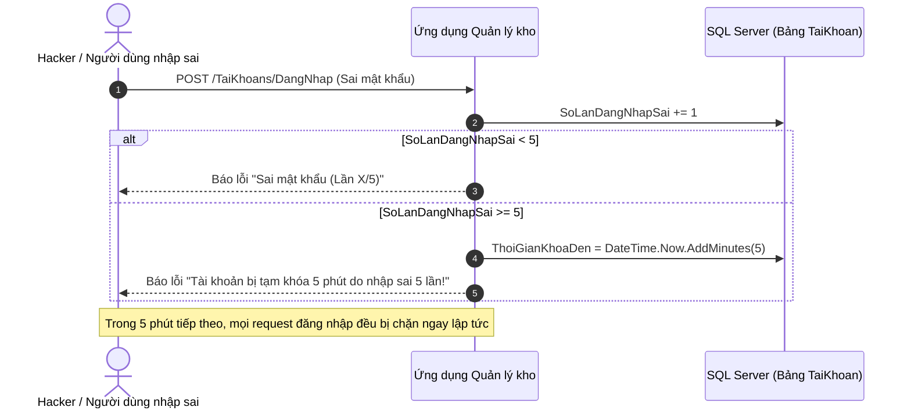

# MA TRẬN PHÂN QUYỀN TRUY CẬP (RBAC) & KIẾN TRÚC BẢO MẬT HỆ THỐNG

> **Dự án:** Hệ thống Quản Lý Kho Hàng UNETI (ASP.NET Core 10 MVC)  
> **Kiến trúc sư Bảo mật:** Trần Xuân Hải (Nhóm trưởng)  
> **Trở về:** [Xem README Tổng quan](../README.md)

---

## 1. TỔNG QUAN PHÂN ĐỊNH VAI TRÒ (3 TIERS OF ROLES)

Hệ thống quản lý kho vận định nghĩa chuẩn mực 3 vai trò người dùng riêng biệt nhằm bảo đảm nguyên tắc **đặc quyền tối thiểu (Principle of Least Privilege)**:

1. **`Admin` (Quản trị viên hệ thống):**
   - Nắm toàn quyền quản trị cao nhất trên toàn hệ thống.
   - Quản lý tài khoản người dùng, phân quyền vai trò, mở khóa tài khoản bị lockout.
   - Toàn quyền cấu hình danh mục cơ sở (Kho hàng, Loại hàng, Đơn vị tính).
   - Duyệt và hoàn tất các phiếu nhập kho, phiếu xuất kho.
   - Xem toàn bộ các chỉ số Dashboard, Báo cáo thống kê, Cảnh báo hạn mức và Sổ cái Audit Trail.

2. **`NhanVienKho` (Thủ kho / Nhân viên tác nghiệp kho bãi):**
   - Đảm nhiệm trực tiếp chu trình vận hành hàng ngày: Quản lý hàng hóa, Lập & duyệt phiếu nhập từ Nhà cung cấp, Lập & duyệt phiếu xuất cho các bộ phận.
   - Giám sát mức độ an toàn của tồn kho, tiếp nhận cảnh báo hàng hết / sắp hết để kịp thời đề xuất nhập hàng.
   - Tra cứu sổ cái lịch sử biến động kho và xem các báo cáo tổng hợp.
   - Bị chặn hoàn toàn khỏi khu vực Quản trị tài khoản người dùng và Cấu hình kho bãi.

3. **`BoPhanNhan` (Đại diện phòng ban nội bộ / Khách hàng nhận hàng):**
   - Tra cứu danh mục hàng hóa (tên, đơn vị tính, quy cách).
   - Xem hồ sơ thông tin đơn vị mình và danh sách các phiếu xuất kho liên quan đến đơn vị mình.
   - Bị chặn hoàn toàn khỏi toàn bộ các chức năng quản trị, nhập kho, cảnh báo tồn và báo cáo tài chính.

---

## 2. MA TRẬN PHÂN QUYỀN TRUY CẬP CHI TIẾT (RBAC MATRIX)

Mọi tuyến đường (Route) trong hệ thống đều được bảo vệ nghiêm ngặt bằng thuộc tính tùy biến `[AuthorizeRole("Admin", "NhanVienKho", ...)]`:

| STT | Khu vực chức năng | Mã chức năng / Tuyến đường (Route) | HTTP Method | Admin (Quản trị viên) | NhanVienKho (Thủ kho) | BoPhanNhan (Bộ phận nhận) | Khách chưa đăng nhập |
| :---: | :--- | :--- | :---: | :---: | :---: | :---: | :---: |
| 1 | **Đăng nhập hệ thống** | `/login` hoặc `/TaiKhoans/DangNhap` | `GET`, `POST` | Cho phép | Cho phép | Cho phép | Cho phép (Public) |
| 2 | **Đăng xuất an toàn** | `/logout` hoặc `/TaiKhoans/DangXuat` | `GET`, `POST` | Cho phép | Cho phép | Cho phép | Chuyển hướng Login |
| 3 | **Hồ sơ cá nhân & Đổi mật khẩu** | `/TaiKhoans/Profile`, `DoiMatKhau` | `GET`, `POST` | Cho phép | Cho phép | Cho phép | Chuyển hướng Login |
| 4 | **Quản lý Tài khoản người dùng** | `/TaiKhoans/*` (Index, Create, Edit, Delete) | `GET`, `POST` | **Toàn quyền** | 403 Forbidden | 403 Forbidden | Chuyển hướng Login |
| 5 | **Quản lý Danh mục Loại hàng** | `/LoaiHangs/*` (Index, Create, Edit, Delete) | `GET`, `POST` | **Toàn quyền** | Xem / Thêm / Sửa | 403 Forbidden | Chuyển hướng Login |
| 6 | **Quản lý Danh mục Đơn vị tính** | `/DonViTinhs/*` (Index, Create, Edit, Delete) | `GET`, `POST` | **Toàn quyền** | Xem / Thêm / Sửa | 403 Forbidden | Chuyển hướng Login |
| 7 | **Quản lý Kho bãi vật lý** | `/Khoes/*` (Index, Create, Edit, Delete) | `GET`, `POST` | **Toàn quyền** | Chỉ xem (Index) | 403 Forbidden | Chuyển hướng Login |
| 8 | **Quản lý Danh mục Hàng hóa** | `/HangHoas/*` (Index, Details, CRUD) | `GET`, `POST` | **Toàn quyền** | **Toàn quyền** | Chỉ xem & tra cứu | Chuyển hướng Login |
| 9 | **Quản lý Đối tác Nhà cung cấp** | `/NhaCungCaps/*` (Index, CRUD) | `GET`, `POST` | **Toàn quyền** | Xem / Thêm / Sửa | 403 Forbidden | Chuyển hướng Login |
| 10 | **Quản lý Bộ phận nhận hàng** | `/BoPhanNhans/*` (Index, CRUD) | `GET`, `POST` | **Toàn quyền** | Xem / Thêm / Sửa | Xem đơn vị mình | Chuyển hướng Login |
| 11 | **Lập & Hoàn tất Phiếu nhập kho** | `/PhieuNhaps/*`, `/ChiTietPhieuNhaps/*` | `GET`, `POST` | Duyệt & Hoàn tất | Lập & Hoàn tất | 403 Forbidden | Chuyển hướng Login |
| 12 | **Lập & Hoàn tất Phiếu xuất kho** | `/PhieuXuats/*`, `/ChiTietPhieuXuats/*` | `GET`, `POST` | Duyệt & Hoàn tất | Lập & Hoàn tất | Xem phiếu liên quan | Chuyển hướng Login |
| 13 | **Cảnh báo tồn kho & Sổ cái Audit Trail** | `/TonKho/CanhBao`, `/TonKho/LichSu` | `GET` | **Toàn quyền** | **Toàn quyền** | 403 Forbidden | Chuyển hướng Login |
| 14 | **Dashboard KPIs & Báo cáo thống kê** | `/ThongKe/Dashboard`, `BaoCaoNhapXuat` | `GET` | **Toàn quyền** | Xem báo cáo | 403 Forbidden | Chuyển hướng Login |
| 15 | **Trang từ chối quyền truy cập** | `/Home/AccessDenied` | `GET` | Cho phép | Cho phép | Cho phép | Cho phép |

---

## 3. CÁC CƠ CHẾ BẢO MẬT TRỌNG TÂM ĐÃ TRIỂN KHAI

### 3.1. Xác thực đồng bộ Cookie Authentication & Session
- Hệ thống sử dụng Cookie Authentication chuẩn của ASP.NET Core kết hợp với Distributed Memory Session.
- Cookie được bảo vệ bởi các cờ an toàn: `HttpOnly = true` (chống tấn công XSS đánh cắp cookie), `SameSite = SameSiteMode.Lax` (chống CSRF) và `SecurePolicy = CookieSecurePolicy.SameAsRequest`.
- Hỗ trợ tính năng **Remember Me (Ghi nhớ đăng nhập):** Nếu người dùng tích chọn, AuthenticationTicket được lưu trữ lâu dài với `IsPersistent = true`.

### 3.2. Mã hóa mật khẩu chuẩn công nghiệp (ASP.NET Core Identity PasswordHasher)
- Mật khẩu người dùng được băm qua `IPasswordHasher<TaiKhoan>` sử dụng thuật toán **PBKDF2 với HMAC-SHA256, Salt ngẫu nhiên 128-bit và 10,000 vòng lặp**.
- **Cơ chế Auto-Migration thông minh:** Tự động nhận diện mật khẩu cũ (plaintext hoặc SHA-256) khi người dùng đăng nhập lần đầu, tự động băm lại theo chuẩn Identity và lưu vào CSDL mà không gây gián đoạn trải nghiệm người dùng.

### 3.3. Cơ chế chống Brute-force Lockout

### 3.4. Bộ lọc ủy quyền tùy biến `[AuthorizeRoleAttribute]`
- Kế thừa từ `ActionFilterAttribute` kiểm tra `context.HttpContext.User.Identity.IsAuthenticated`.
- Nếu chưa đăng nhập $\rightarrow$ Chuyển hướng về `/login?ReturnUrl=...`.
- Nếu đã đăng nhập nhưng không có vai trò hợp lệ $\rightarrow$ Chuyển hướng tức thì về `/Home/AccessDenied` (HTTP 403 Forbidden).

### 3.5. Đồng bộ Menu hiển thị động trên `_Layout.cshtml`
- Thanh điều hướng tự động ẩn/hiện các menu chức năng dựa theo hàm `User.IsInRole(...)`.
- Góc phải thanh Header hiển thị họ tên người dùng cùng Badge màu đại diện cho vai trò:
  - `Admin`: Huy hiệu đỏ `bg-danger`
  - `NhanVienKho`: Huy hiệu xanh dương `bg-primary`
  - `BoPhanNhan`: Huy hiệu xanh lá `bg-success`
