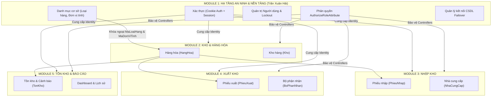
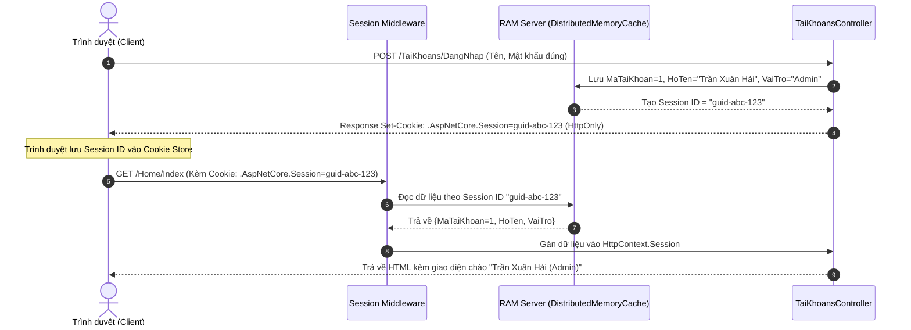
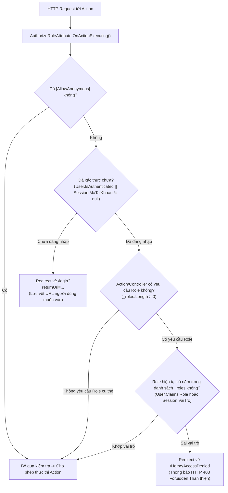
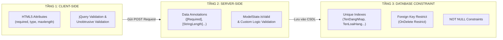
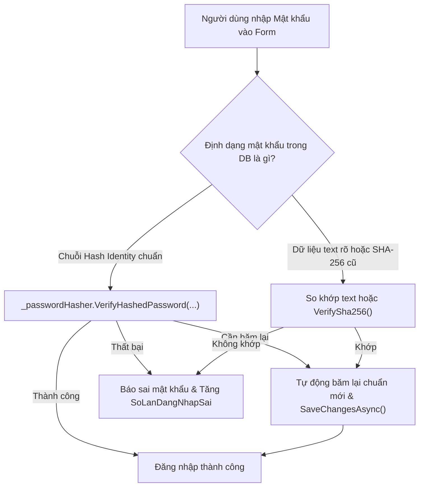

# TỔNG HỢP KIẾN THỨC TOÀN DIỆN MODULE 1: TÀI KHOẢN, XÁC THỰC, PHÂN QUYỀN, DANH MỤC CƠ SỞ & BỘ CÂU HỎI PHỎNG VẤN BẢO VỆ ĐỒ ÁN

> **Dự án:** Quản Lý Kho Hàng UNETI (ASP.NET Core 10 MVC - EF Core 10)  
> **Sinh viên phụ trách:** Trần Xuân Hải  
> **Mã sinh viên:** 23103100135  
> **Lớp:** ĐHTI17A3HN  
> **Vai trò:** Nhóm trưởng / Kiến trúc sư hệ thống  
> **Phạm vi tài liệu:** Giải thích chi tiết mã nguồn, kiến trúc kỹ thuật (Session, Phân quyền RBAC tại Controller, Danh mục cơ sở Loại hàng/ĐVT, Validation đa tầng) và Bộ câu hỏi phỏng vấn vấn đáp chuyên sâu phục vụ bảo vệ đồ án tốt nghiệp / đồ án môn học.

---

## MỤC LỤC TỔNG QUAN

1. [Tổng quan vị trí, vai trò & kiến trúc Module 1](#1-tổng-quan-vị-trí-vai-trò--kiến-trúc-module-1)
2. [Chuyên đề 1: Cơ chế Quản lý Phiên làm việc (Session & Cookie)](#2-chuyên-đề-1-cơ-chế-quản-lý-phiên-làm-việc-session--cookie)
3. [Chuyên đề 2: Kiểm soát Truy cập & Phân quyền đa vai trò tại Controller (RBAC)](#3-chuyên-đề-2-kiểm-soát-truy-cập--phân-quyền-đa-vai-trò-tại-controller-rbac)
4. [Chuyên đề 3: Danh mục Cơ sở (Loại hàng & Đơn vị tính) & Toàn vẹn Khóa ngoại](#4-chuyên-đề-3-danh-mục-cơ-sở-loại-hàng--đơn-vị-tính--toàn-vẹn-khóa-ngoại)
5. [Chuyên đề 4: Kiến trúc Kiểm thực Dữ liệu dùng chung (3-Tier Validation Architecture)](#5-chuyên-đề-4-kiến-trúc-kiểm-thực-dữ-liệu-dùng-chung-3-tier-validation-architecture)
6. [Chuyên đề 5: Cơ chế Mã hóa Mật khẩu & Chống tấn công Brute-force (Lockout)](#6-chuyên-đề-5-cơ-chế-mã-hóa-mật-khẩu--chống-tấn-công-brute-force-lockout)
7. [Giải thích chi tiết Mã nguồn từng File trọng điểm](#7-giải-thích-chi-tiết-mã-nguồn-từng-file-trọng-điểm)
8. [Ghi chú kỹ thuật, Phòng thủ Bảo mật & Best Practices](#8-ghi-chú-kỹ-thuật-phòng-thủ-bảo-mật--best-practices)
9. [Bộ câu hỏi Phỏng vấn Vấn đáp Bảo vệ Đồ án (25 Câu hỏi & Lời giải mẫu)](#9-bộ-câu-hỏi-phỏng-vấn-vấn-đáp-bảo-vệ-đồ-án-25-câu-hỏi--lời-giải-mẫu)

---

## 1. TỔNG QUAN VỊ TRÍ, VAI TRÒ & KIẾN TRÚC MODULE 1

### 1.1. Vị trí hạt nhân trong hệ sinh thái ứng dụng
Module 1 đóng vai trò là **hạ tầng an ninh và cấu trúc dữ liệu nền móng** của toàn bộ giải pháp Quản lý Kho hàng UNETI. Tất cả các Module khác (Module 2: Quản lý Kho & Hàng hóa, Module 3: Nhà cung cấp & Nhập kho, Module 4: Bộ phận nhận & Xuất kho, Module 5: Tồn kho & Dashboard) đều phụ thuộc trực tiếp vào Module 1 về:
- **Ngữ cảnh xác thực (Identity Context):** Xác định ai đang gửi yêu cầu HTTP vào hệ thống.
- **Quyền hạn truy cập (Authorization Policy):** Ngăn chặn người dùng trái phép truy cập vào các tài nguyên/hành động cấm.
- **Danh mục phân loại & định lượng (Lookup Tables):** `LoaiHang` và `DonViTinh` là hai trường khóa ngoại bắt buộc để định nghĩa thực thể `HangHoa` ở Module 2.



### 1.2. Bản đồ Trách nhiệm Thực thể (Entity Relationship Map)
Thực thể dữ liệu do Module 1 phụ trách quản lý gồm 3 bảng chính:

| Bảng CSDL | Tên Model | Khóa chính (PK) | Ràng buộc duy nhất (Unique) | Mục đích nghiệp vụ |
| :--- | :--- | :--- | :--- | :--- |
| `[TaiKhoan]` | [`TaiKhoan`](file:///home/gmtfarcb/Desktop/QuanLyKhoHang_UNETI01_TI17A3HN/Models/TaiKhoan.cs) | `MaTaiKhoan` (int, Identity) | `TenDangNhap` | Lưu trữ tài khoản, mật khẩu băm, vai trò, số lần sai mật khẩu và thời gian khóa. |
| `[LoaiHang]` | [`LoaiHang`](file:///home/gmtfarcb/Desktop/QuanLyKhoHang_UNETI01_TI17A3HN/Models/LoaiHang.cs) | `MaLoaiHang` (int, Identity) | `TenLoaiHang` | Phân nhóm hàng hóa (Thiết bị văn phòng, Linh kiện máy tính...). |
| `[DonViTinh]` | [`DonViTinh`](file:///home/gmtfarcb/Desktop/QuanLyKhoHang_UNETI01_TI17A3HN/Models/DonViTinh.cs) | `MaDonViTinh` (int, Identity) | `TenDonViTinh` | Đơn vị đo lường (Cái, Chiếc, Hộp, Thùng, Mét...). |

---

## 2. CHUYÊN ĐỀ 1: CƠ CHẾ QUẢN LÝ PHIÊN LÀM VIỆC (SESSION & COOKIE)

### 2.1. Bản chất kỹ thuật của Session trong ASP.NET Core MVC
HTTP là giao thức phi trạng thái (Stateless Protocol). Mỗi request từ Client gửi lên Server là độc lập và Server không tự động ghi nhớ request trước đó đến từ ai. Để duy trì trạng thái làm việc xuyên suốt nhiều requests:
1. **Phía Server:** Hệ thống cấp phát một vùng nhớ trong RAM (thông qua dịch vụ bộ nhớ đệm phân tán `IDistributedCache`) để lưu trữ cặp dữ liệu `Key-Value` đại diện cho phiên của người dùng.
2. **Phía Client:** Trình duyệt lưu giữ một Cookie định danh duy nhất có tên mặc định là `.AspNetCore.Session`. Cookie này **chỉ chứa chuỗi Session ID ngẫu nhiên**, hoàn toàn **không chứa dữ liệu nhạy cảm**.
3. **Cơ chế bắt tay:** Mỗi khi Client gửi request, Cookie Session ID được gửi kèm trong HTTP Header `Cookie`. Middleware `app.UseSession()` đọc Session ID này, tìm kiếm dữ liệu tương ứng trong RAM Server và gán vào thuộc tính `HttpContext.Session`.



### 2.2. Cấu hình Session chuẩn an toàn trong [`Program.cs`](file:///home/gmtfarcb/Desktop/QuanLyKhoHang_UNETI01_TI17A3HN/Program.cs#L42-L51)
```csharp
// 1. Đăng ký bộ nhớ đệm lưu trữ Session trong RAM Server
builder.Services.AddDistributedMemoryCache();

// 2. Cấu hình dịch vụ Session
builder.Services.AddSession(options =>
{
    options.IdleTimeout = TimeSpan.FromMinutes(30); // Hết hạn sau 30 phút không thao tác
    options.Cookie.HttpOnly = true;                 // CHỐNG XSS: JavaScript client không thể đọc cookie
    options.Cookie.IsEssential = true;              // Bắt buộc hoạt động ngay cả khi chưa chấp thuận GDPR
    options.Cookie.SameSite = SameSiteMode.Lax;     // CHỐNG CSRF: Ngăn chặn gửi chéo domain trái phép
});
```

### 2.3. Quy tắc vàng về thứ tự Middleware trong Pipeline
Trong file [`Program.cs`](file:///home/gmtfarcb/Desktop/QuanLyKhoHang_UNETI01_TI17A3HN/Program.cs#L118-L127):
```csharp
app.UseRouting();

// BẮT BUỘC THỨ TỰ:
app.UseSession();        // Bước 1: Phải kích hoạt Session trước để khởi tạo HttpContext.Session
app.UseAuthentication(); // Bước 2: Giải mã Cookie Authentication thành ClaimsPrincipal (HttpContext.User)
app.UseAuthorization();  // Bước 3: Đánh giá phân quyền dựa trên User hoặc Session
```
> [!IMPORTANT]
> **Tại sao `app.UseSession()` phải đặt trước `app.UseAuthentication()` và `app.UseAuthorization()`?**  
> Nếu đặt `UseSession()` sau `UseAuthorization()`, khi các Action Filter (như `AuthorizeRoleAttribute`) hoặc middleware phân quyền thực thi, `HttpContext.Session` vẫn chưa được nạp dữ liệu từ Cookie Session ID. Lúc đó gọi `HttpContext.Session.GetInt32("MaTaiKhoan")` sẽ trả về `null` hoặc ném ngoại lệ `InvalidOperationException: Session has not been configured for this application or request`.

### 2.4. So sánh Chuyên sâu: Session vs. Cookie

| Tiêu chí | Session (Server-side) | Cookie (Client-side) |
| :--- | :--- | :--- |
| **Vị trí lưu trữ dữ liệu** | Trên bộ nhớ RAM / Cache của Server. | Lưu trực tiếp trên ổ cứng / bộ nhớ của Trình duyệt Client. |
| **Bảo mật** | **Rất cao**: Người dùng không thể xem trộm hoặc sửa đổi dữ liệu logic (chỉ lưu Session ID ở client). | **Trung bình**: Người dùng có thể F12 mở Application Tab để xem và chỉnh sửa giá trị (trừ khi được mã hóa/ký số). |
| **Tải nguyên hệ thống** | Chiếm dụng RAM server khi số lượng người dùng đồng thời (CCU) lớn. | Giảm tải cho Server, chi phí lưu trữ thuộc về Client. |
| **Dung lượng tối đa** | Linh hoạt theo RAM server, tuy nhiên khuyến nghị mỗi Session `< 4KB` để tránh giật lag RAM. | Bị giới hạn nghiêm ngặt ở mức `4096 bytes` (4KB) cho mỗi Cookie. |
| **Thời hạn sống (Lifecycle)** | Ngắn, mặc định bị hủy sau thời gian không thao tác (`IdleTimeout = 30 phút`) hoặc khi tắt Server/xóa Session. | Linh hoạt: Session Cookie (mất khi đóng tab) hoặc Persistent Cookie (`Expires/Max-Age` hàng tuần, hàng tháng). |
| **Ứng dụng trong Module 1** | Lưu `MaTaiKhoan`, `HoTen`, `VaiTro`, `TenDangNhap` để tra cứu nhanh trong Controller/View. | Lưu Cookie xác thực `.QuanLyKhoHang.Auth` và Cookie ghi nhớ tài khoản `RememberedUser` (7 ngày). |

### 2.5. Kiến trúc Song song (Hybrid Architecture): Cookie Authentication kết hợp Session
Trong dự án này, hệ thống áp dụng kiến trúc đồng bộ **kép**:
1. **Cookie Authentication (`ClaimsPrincipal`):** Chuẩn mực của ASP.NET Core. Đóng gói các thông tin danh tính thành các Claims (`ClaimTypes.Name`, `ClaimTypes.Role`, `ClaimTypes.NameIdentifier`, `ClaimTypes.Email`, `"HoTen"`, `"Department"`). Cookie này được mã hóa bảo mật (Encrypted & Signed) bởi Data Protection API của Microsoft.
2. **Session (`HttpContext.Session`):** Lưu trữ song song các giá trị cơ bản `MaTaiKhoan`, `HoTen`, `VaiTro`.
3. **Mục đích:**
   - Đảm bảo tính tương thích tuyệt đối: Vừa đáp ứng đúng yêu cầu nghiệp vụ của đề tài môn học (lưu Session khi đăng nhập, xóa Session khi đăng xuất).
   - Tăng cường bảo mật: Nếu Session bị mất do timeout trên RAM, Cookie Authentication vẫn có thể khôi phục lại trạng thái; hoặc ngược lại, Action Filter có thể kiểm tra chéo cả 2 nguồn để phát hiện phiên làm việc bất thường.

---

## 3. CHUYÊN ĐỀ 2: KIỂM SOÁT TRUY CẬP & PHÂN QUYỀN ĐA VAI TRÒ TẠI CONTROLLER (RBAC)

### 3.1. Phân cấp 3 Vai trò (Roles) trong Hệ thống
Hệ thống quản lý phân định rõ ràng 3 nhóm người dùng:
1. **`Admin` (Quản trị viên hệ thống):** Toàn quyền truy cập mọi tính năng: Quản lý tài khoản người dùng, Loại hàng, Đơn vị tính, Kho hàng, Hàng hóa, Nhà cung cấp, Bộ phận nhận, Nhập kho, Xuất kho, Báo cáo và Cấu hình.
2. **`NhanVienKho` (Thủ kho):** Phụ trách vận hành kho: Xem danh mục, quản lý Hàng hóa, lập và duyệt Phiếu nhập, lập và duyệt Phiếu xuất, kiểm tra Cảnh báo tồn kho, xem Nhật ký biến động. **Bị cấm hoàn toàn:** Không được vào Quản lý tài khoản (`TaiKhoans/Index`, `Create`, `Edit`, `Delete`), không được xóa Kho hàng, không được sửa Bộ phận nhận.
3. **`BoPhanNhan` (Đại diện phòng ban / khách nhận):** Phụ trách theo dõi tiếp nhận: Xem danh mục hàng hóa (tra cứu mã/tên), theo dõi danh sách Phiếu xuất gửi đến bộ phận của mình, xem và chỉnh sửa Profile cá nhân. **Bị cấm hoàn toàn:** Không được xem/lập Phiếu nhập, không được chỉnh sửa Loại hàng/ĐVT/Kho, không được vào trang Quản trị.

### 3.2. Cơ chế Hoạt động của Custom Action Filter [`AuthorizeRoleAttribute`](file:///home/gmtfarcb/Desktop/QuanLyKhoHang_UNETI01_TI17A3HN/Filters/AuthorizeRoleAttribute.cs)
Thay vì sử dụng bộ lọc `[Authorize]` mặc định, kiến trúc Module 1 triển khai một Filter tùy biến kế thừa từ `ActionFilterAttribute` với các ưu điểm vượt trội:
- Tự động bắt lỗi chưa đăng nhập $\rightarrow$ Chuyển hướng kèm `returnUrl`.
- Tự động bắt lỗi không đủ quyền $\rightarrow$ Chuyển hướng tới trang thân thiện `Home/AccessDenied` (thay vì trang lỗi 403 trắng trơn của IIS/Kestrel).
- Hỗ trợ kiểm tra song song cả Cookie Claims và Session.
- Hỗ trợ cơ chế kế thừa thông minh: Cho phép thuộc tính cấp Action ghi đè (Override) thuộc tính cấp Controller.



### 3.3. Giải thích Code Chi tiết [`AuthorizeRoleAttribute.cs`](file:///home/gmtfarcb/Desktop/QuanLyKhoHang_UNETI01_TI17A3HN/Filters/AuthorizeRoleAttribute.cs)
```csharp
[AttributeUsage(AttributeTargets.Class | AttributeTargets.Method, AllowMultiple = true, Inherited = true)]
public class AuthorizeRoleAttribute : ActionFilterAttribute
{
    private readonly string[] _roles;

    // Nhận danh sách các vai trò được phép (params string[] roles)
    public AuthorizeRoleAttribute(params string[] roles)
    {
        _roles = roles ?? Array.Empty<string>();
    }

    public override void OnActionExecuting(ActionExecutingContext context)
    {
        // 1. Kiểm tra [AllowAnonymous]: Nếu Action hoặc Controller có gắn thuộc tính này thì bỏ qua
        var hasAllowAnonymous = context.ActionDescriptor.EndpointMetadata.OfType<AllowAnonymousAttribute>().Any()
            || context.Filters.Any(f => f is IAllowAnonymousFilter);

        if (hasAllowAnonymous)
        {
            base.OnActionExecuting(context);
            return;
        }

        // 2. Xử lý ghi đè quyền (Method-level override Class-level):
        // Nếu Controller có [AuthorizeRole("Admin")] nhưng Action lại có [AuthorizeRole("Admin", "NhanVienKho")]
        // Ta ưu tiên để Action-level attribute nắm quyền kiểm tra
        if (context.ActionDescriptor is Microsoft.AspNetCore.Mvc.Controllers.ControllerActionDescriptor cad)
        {
            var methodRoleAttrs = cad.MethodInfo
                .GetCustomAttributes(typeof(AuthorizeRoleAttribute), true)
                .OfType<AuthorizeRoleAttribute>()
                .Where(f => f._roles.Length > 0)
                .ToList();

            if (methodRoleAttrs.Count > 0 && this._roles.Length > 0)
            {
                bool isThisMethodLevel = methodRoleAttrs.Any(m => ReferenceEquals(m, this) || m._roles.SequenceEqual(this._roles));
                if (!isThisMethodLevel)
                {
                    base.OnActionExecuting(context);
                    return;
                }
            }
        }

        var httpContext = context.HttpContext;
        var session = httpContext.Session;
        var maTaiKhoan = session.GetInt32("MaTaiKhoan");
        var isAuthenticated = (httpContext.User.Identity?.IsAuthenticated == true) || (maTaiKhoan != null);

        // 3. Nếu chưa đăng nhập -> Chuyển hướng về trang Đăng nhập kèm returnUrl an toàn
        if (!isAuthenticated)
        {
            var returnUrl = httpContext.Request.Path + httpContext.Request.QueryString;
            context.Result = new RedirectToActionResult("DangNhap", "TaiKhoans", new { returnUrl });
            return;
        }

        // 4. Nếu đã đăng nhập -> Kiểm tra vai trò người dùng
        if (_roles.Length > 0)
        {
            var userRole = httpContext.User.FindFirst(ClaimTypes.Role)?.Value
                ?? session.GetString("VaiTro")
                ?? string.Empty;

            // So sánh không phân biệt hoa thường
            if (!_roles.Contains(userRole, StringComparer.OrdinalIgnoreCase))
            {
                // Không đủ quyền -> Điều hướng đến trang AccessDenied (HTTP 403)
                context.Result = new RedirectToActionResult("AccessDenied", "Home", null);
                return;
            }
        }

        base.OnActionExecuting(context);
    }
}
```

### 3.4. Chiến lược Bảo mật Toàn cục (Global Filter Strategy)
Trong [`Program.cs`](file:///home/gmtfarcb/Desktop/QuanLyKhoHang_UNETI01_TI17A3HN/Program.cs#L85-L89):
```csharp
builder.Services.AddControllersWithViews(options =>
{
    // Áp dụng bảo vệ mặc định cho TOÀN BỘ 100% Controllers/Actions trong hệ thống
    options.Filters.Add(new QuanLyKhoHang_UNETI01_TI17A3HN.Filters.AuthorizeRoleAttribute());
});
```
> [!TIP]
> **Triết lý thiết kế Zero-Trust (Mặc định từ chối):**
> Nhờ đăng ký Global Filter, lập trình viên không bao giờ lo lắng việc "quên" gắn `[Authorize]` khi tạo mới một Controller. Mặc định mọi route mới sinh ra đều bị khóa và yêu cầu đăng nhập. Chỉ những trang nào được gắn tường minh `[AllowAnonymous]` (như trang Đăng nhập `TaiKhoans/DangNhap`, trang Lỗi `Home/Error`) thì người ngoài mới truy cập được.

### 3.5. Ma trận Phân quyền RBAC Toàn diện Module 1

| Endpoint / Hành động | Quyền Admin | Quyền NhanVienKho | Quyền BoPhanNhan | Chưa đăng nhập (Khách) |
| :--- | :---: | :---: | :---: | :---: |
| `GET/POST /TaiKhoans/DangNhap` | Cho phép | Cho phép | Cho phép | **Cho phép (`[AllowAnonymous]`)** |
| `GET /TaiKhoans/DangXuat` | Cho phép | Cho phép | Cho phép | Chuyển hướng Đăng nhập |
| `GET /TaiKhoans/Profile` | Cho phép | Cho phép | Cho phép | Chuyển hướng Đăng nhập |
| `GET/POST /TaiKhoans/CapNhatProfile` | Cho phép | Cho phép | Cho phép | Chuyển hướng Đăng nhập |
| `GET/POST /TaiKhoans/DoiMatKhau` | Cho phép | Cho phép | Cho phép | Chuyển hướng Đăng nhập |
| `GET /TaiKhoans/Index` (Quản lý User) | **Cho phép** | 403 AccessDenied | 403 AccessDenied | Chuyển hướng Đăng nhập |
| `GET/POST /TaiKhoans/Create` | **Cho phép** | 403 AccessDenied | 403 AccessDenied | Chuyển hướng Đăng nhập |
| `GET/POST /TaiKhoans/Edit/{id}` | **Cho phép** | 403 AccessDenied | 403 AccessDenied | Chuyển hướng Đăng nhập |
| `GET/POST /TaiKhoans/Delete/{id}` | **Cho phép** | 403 AccessDenied | 403 AccessDenied | Chuyển hướng Đăng nhập |
| `GET /LoaiHangs/*` (Index, Details, Create, Edit) | **Cho phép** | **Cho phép** | 403 AccessDenied | Chuyển hướng Đăng nhập |
| `POST /LoaiHangs/Delete/{id}` | **Cho phép** | 403 AccessDenied | 403 AccessDenied | Chuyển hướng Đăng nhập |
| `GET /DonViTinhs/*` (Index, Details, Create, Edit) | **Cho phép** | **Cho phép** | 403 AccessDenied | Chuyển hướng Đăng nhập |
| `POST /DonViTinhs/Delete/{id}` | **Cho phép** | 403 AccessDenied | 403 AccessDenied | Chuyển hướng Đăng nhập |
| `GET /Home/AccessDenied` | Cho phép | Cho phép | Cho phép | Cho phép |

---

## 4. CHUYÊN ĐỀ 3: DANH MỤC CƠ SỞ (LOẠI HÀNG & ĐƠN VỊ TÍNH) & TOÀN VẸN KHÓA NGOẠI

### 4.1. Vai trò trong Hệ thống Quản trị Kho
Hai bảng `LoaiHang` và `DonViTinh` là **Bảng tra cứu dùng chung (Lookup / Master Data Tables)**. Không một hàng hóa nào trong kho có thể tồn tại mà không được phân loại vào một "Nhóm loại hàng" và không được đo đếm bằng một "Đơn vị tính".
- **Ví dụ Loại hàng:** Thiết bị vi tính & Văn phòng, Linh kiện điện tử & Vi mạch, Vật tư điện & Cơ khí xưởng, Thiết bị mạng & Viễn thông...
- **Ví dụ Đơn vị tính:** Cái, Chiếc, Bộ, Hộp, Thùng, Mét, Gói, Cuộn...

### 4.2. Ràng buộc Toàn vẹn Tham chiếu (Referential Integrity) trong EF Core
Trong [`Data/AppDbContext.cs`](file:///home/gmtfarcb/Desktop/QuanLyKhoHang_UNETI01_TI17A3HN/Data/AppDbContext.cs#L72-L83):
```csharp
// Ràng buộc quan hệ 1 - N giữa LoaiHang và HangHoa
modelBuilder.Entity<HangHoa>()
    .HasOne(h => h.LoaiHang)
    .WithMany(l => l.HangHoas)
    .HasForeignKey(h => h.MaLoaiHang)
    .OnDelete(DeleteBehavior.Restrict); // KHÔNG CHO PHÉP XÓA CASCADE

// Ràng buộc quan hệ 1 - N giữa DonViTinh và HangHoa
modelBuilder.Entity<HangHoa>()
    .HasOne(h => h.DonViTinh)
    .WithMany(d => d.HangHoas)
    .HasForeignKey(h => h.MaDonViTinh)
    .OnDelete(DeleteBehavior.Restrict); // KHÔNG CHO PHÉP XÓA CASCADE
```

### 4.3. Giải thích tại sao bắt buộc dùng `DeleteBehavior.Restrict`
> [!WARNING]
> **Hậu quả nếu dùng `Cascade Delete` trên Danh mục cơ sở:**  
> Nếu cấu hình `OnDelete(DeleteBehavior.Cascade)`, khi ai đó vô tình xóa Loại hàng "Linh kiện điện tử", CSDL SQL Server sẽ tự động xóa sạch hàng trăm mặt hàng liên quan trong bảng `HangHoa`. Khi `HangHoa` bị xóa, nó kéo theo xóa luôn toàn bộ lịch sử xuất nhập kho trong `ChiTietPhieuNhap`, `ChiTietPhieuXuat` và số lượng tồn kho `TonKho`. Đây là thảm họa mất mát dữ liệu kế toán kho nghiêm trọng!
>
> Vì vậy, `DeleteBehavior.Restrict` được áp dụng để SQL Server từ chối lệnh xóa nếu bảng con `HangHoa` vẫn còn dòng dữ liệu tham chiếu đến.

### 4.4. Xử lý Chặn Xóa Vật lý ở Cấp Controller
Để tránh ứng dụng bị văng lỗi ngoại lệ `SqlException (The DELETE statement conflicted with the REFERENCE constraint)`, Controller chủ động kiểm tra trước khi thực hiện xóa:

**Trong [`LoaiHangsController.cs`](file:///home/gmtfarcb/Desktop/QuanLyKhoHang_UNETI01_TI17A3HN/Controllers/LoaiHangsController.cs#L145-L159):**
```csharp
[AuthorizeRole("Admin")]
[HttpPost, ActionName("Delete")]
[ValidateAntiForgeryToken]
public async Task<IActionResult> DeleteConfirmed(int id)
{
    var loaiHang = await _context.LoaiHangs.FindAsync(id);
    if (loaiHang != null)
    {
        // 1. Kiểm tra nghiệp vụ: Đã có hàng hóa nào thuộc loại hàng này chưa?
        var hasHangHoa = await _context.HangHoa.AnyAsync(h => h.MaLoaiHang == id);
        if (hasHangHoa)
        {
            // Báo lỗi thân thiện qua TempData và ngăn chặn việc gọi _context.Remove()
            TempData["Error"] = "Không thể xóa loại hàng này vì vẫn còn hàng hóa thuộc loại này. Vui lòng chuyển hoặc xóa các hàng hóa liên quan trước.";
            return RedirectToAction(nameof(Index));
        }

        _context.LoaiHangs.Remove(loaiHang);
        await _context.SaveChangesAsync();
        TempData["Success"] = "Đã xóa loại hàng thành công!";
    }
    return RedirectToAction(nameof(Index));
}
```

**Trong [`DonViTinhsController.cs`](file:///home/gmtfarcb/Desktop/QuanLyKhoHang_UNETI01_TI17A3HN/Controllers/DonViTinhsController.cs#L145-L159):**
```csharp
[AuthorizeRole("Admin")]
[HttpPost, ActionName("Delete")]
[ValidateAntiForgeryToken]
public async Task<IActionResult> DeleteConfirmed(int id)
{
    var donViTinh = await _context.DonViTinhs.FindAsync(id);
    if (donViTinh != null)
    {
        // 1. Kiểm tra nghiệp vụ: Đã có hàng hóa nào sử dụng ĐVT này chưa?
        var hasHangHoa = await _context.HangHoa.AnyAsync(h => h.MaDonViTinh == id);
        if (hasHangHoa)
        {
            TempData["Error"] = "Không thể xóa đơn vị tính này vì vẫn còn hàng hóa đang sử dụng. Vui lòng đổi đơn vị tính cho các hàng hóa liên quan trước.";
            return RedirectToAction(nameof(Index));
        }

        _context.DonViTinhs.Remove(donViTinh);
        await _context.SaveChangesAsync();
        TempData["Success"] = "Đã xóa đơn vị tính thành công!";
    }
    return RedirectToAction(nameof(Index));
}
```

---

## 5. CHUYÊN ĐỀ 4: KIẾN TRÚC KIỂM THỰC DỮ LIỆU DÙNG CHUNG (3-TIER VALIDATION ARCHITECTURE)

Hệ thống triển khai mô hình kiểm thực dữ liệu toàn diện 3 tầng (3-Tier Defense) đảm bảo không có bất kỳ dữ liệu rác hay độc hại nào lọt vào CSDL:



### 5.1. Tầng 1: Client-side Validation (Kiểm thực phía Trình duyệt)
- **Công nghệ sử dụng:** HTML5 Form Validation kết hợp thư viện `jquery.validate.min.js` và `jquery.validate.unobtrusive.min.js`.
- **Cơ chế hoạt động:**
  - ASP.NET Core Tag Helpers (`asp-for`, `asp-validation-for`) tự động biên dịch các thuộc tính C# Data Annotations thành các thuộc tính HTML5 dạng `data-val="true"`, `data-val-required="..."`, `data-val-length-max="..."`.
  - File partial dùng chung [`Views/Shared/_ValidationScriptsPartial.cshtml`](file:///home/gmtfarcb/Desktop/QuanLyKhoHang_UNETI01_TI17A3HN/Views/Shared/_ValidationScriptsPartial.cshtml) được nhúng ở cuối mỗi View:
    ```cshtml
    @section Scripts {
        @{await Html.RenderPartialAsync("_ValidationScriptsPartial");}
    }
    ```
  - Khi người dùng nhấn nút Submit hoặc rời khỏi ô nhập (Blur event), jQuery chặn request ngay lập tức nếu dữ liệu chưa hợp lệ và hiển thị thông báo lỗi màu đỏ cạnh ô nhập mà **không cần tải lại trang (No Postback)**.
- **Ưu điểm:** Tăng trải nghiệm người dùng mượt mà, phản hồi ngay lập tức, tiết kiệm băng thông và giảm tải xử lý cho Server.

### 5.2. Tầng 2: Server-side Validation (Kiểm thực phía Máy chủ)
- **Tại sao vẫn bắt buộc phải có tầng 2 khi đã có tầng 1?**  
  Người dùng hoàn toàn có thể tắt JavaScript trên trình duyệt (F12 disable JS) hoặc sử dụng các công cụ như Postman, cURL, Burp Suite để gửi trực tiếp HTTP POST request với dữ liệu độc hại qua mặt Client-side.
- **Data Annotations dùng chung trên Model & ViewModel:**

| Data Annotation | Mục đích & Ví dụ ứng dụng trong Module 1 |
| :--- | :--- |
| `[Required(ErrorMessage = "...")]` | Bắt buộc nhập, không được để null hoặc rỗng. (Ví dụ: `TenDangNhap`, `MatKhau`, `TenLoaiHang`, `TenDonViTinh`). |
| `[StringLength(max, MinimumLength = min, ...)]` | Giới hạn độ dài chuỗi ký tự. (Ví dụ: `TenDangNhap` từ 3-50 ký tự, `MatKhauMoi` tối thiểu 6 ký tự). |
| `[EmailAddress(ErrorMessage = "...")]` | Tự động kiểm tra định dạng email chuẩn RFC qua Regex (Ví dụ: `Email`). |
| `[DataType(DataType.Password)]` | Chỉ thị cho UI render ra thẻ `<input type="password" />` che giấu ký tự mật khẩu. |
| `[Compare("MatKhauMoi", ErrorMessage = "...")]` | So sánh giá trị 2 trường (Ví dụ: `XacNhanMatKhau` phải khớp với `MatKhauMoi`). |
| `[Display(Name = "...")]` | Thiết lập tiêu đề nhãn tiếng Việt thân thiện hiển thị trên Form và Bảng dữ liệu. |

- **Kiểm tra `ModelState.IsValid` và nghiệp vụ tùy biến trong Controller:**
```csharp
// 1. Kiểm tra tính hợp lệ cơ bản của Data Annotations
if (!ModelState.IsValid)
{
    return View(model); // Trả về Form kèm theo danh sách lỗi
}

// 2. Kiểm tra nghiệp vụ chuyên sâu (Custom Business Validation): Trùng tên đăng nhập
bool duplicateUser = await _context.TaiKhoans.AnyAsync(t => t.TenDangNhap == taiKhoan.TenDangNhap);
if (duplicateUser)
{
    // Bơm lỗi nghiệp vụ thủ công vào ModelState để hiển thị đúng ô input
    ModelState.AddModelError("TenDangNhap", "Tên đăng nhập đã tồn tại trong hệ thống.");
    return View(taiKhoan);
}
```

### 5.3. Tầng 3: Database Constraints (Ràng buộc toàn vẹn CSDL)
- **Unique Indexes:** Định nghĩa trong `OnModelCreating` của [`Data/AppDbContext.cs`](file:///home/gmtfarcb/Desktop/QuanLyKhoHang_UNETI01_TI17A3HN/Data/AppDbContext.cs#L58-L60):
  ```csharp
  modelBuilder.Entity<TaiKhoan>().HasIndex(t => t.TenDangNhap).IsUnique();
  modelBuilder.Entity<LoaiHang>().HasIndex(l => l.TenLoaiHang).IsUnique();
  modelBuilder.Entity<DonViTinh>().HasIndex(d => d.TenDonViTinh).IsUnique();
  ```
  Ngay cả khi xảy ra xung đột tương tranh đồng thời (Race Condition giữa 2 requests cùng gửi tạo 1 tên cùng 1 miligiây), SQL Server ở tầng đáy sẽ chặn đứng và quăng lỗi vi phạm khóa duy nhất, bảo vệ toàn vẹn tuyệt đối.

---

## 6. CHUYÊN ĐỀ 5: CƠ CHẾ MÃ HÓA MẬT KHẨU & CHỐNG TẤN CÔNG BRUTE-FORCE (LOCKOUT)

### 6.1. Thuật toán Mã hóa Mật khẩu ASP.NET Core Identity
Trong các hệ thống cũ, mật khẩu thường lưu dưới dạng văn bản rõ (Plain text) hoặc băm đơn giản bằng MD5/SHA-1/SHA-256 thuần túy. Các cơ chế này rất dễ bị bẻ gãy qua các bảng băm tính sẵn (Rainbow Table Attack) hoặc máy tính có GPU mạnh.

Trong Module 1, hệ thống sử dụng `IPasswordHasher<TaiKhoan>` của thư viện ASP.NET Core Identity:
1. **Thuật toán cốt lõi:** PBKDF2 (Password-Based Key Derivation Function 2) kết hợp hàm băm mã xác thực tin nhắn HMAC-SHA256.
2. **Khóa muối ngẫu nhiên (Salt):** Mỗi mật khẩu khi băm được sinh kèm một chuỗi Salt ngẫu nhiên 128-bit (16 bytes). Do đó, cùng một mật khẩu `"123456"`, hai tài khoản khác nhau sẽ cho ra hai chuỗi băm hoàn toàn khác nhau.
3. **Số vòng lặp kéo dài thời gian (Iteration Count):** 10,000 vòng lặp băm làm tăng chi phí tính toán của kẻ tấn công theo cấp số nhân.
4. **Cơ chế Tự Động Nâng Cấp (Auto-Migration / Rehash on Login):**
   Trong [`TaiKhoansController.cs`](file:///home/gmtfarcb/Desktop/QuanLyKhoHang_UNETI01_TI17A3HN/Controllers/TaiKhoansController.cs#L47-L89): Khi một tài khoản cũ (từng lưu mật khẩu text rõ hoặc SHA-256) đăng nhập đúng, hệ thống tự động phát hiện cờ `rehashNeeded = true`, lập tức băm lại bằng Identity PasswordHasher và cập nhật đè vào CSDL một cách trong suốt.



### 6.2. Cơ chế Khóa tài khoản Chống dò Mật khẩu (Brute-Force Lockout)
Để ngăn chặn kẻ tấn công sử dụng công cụ dò quét tự động thử hàng nghìn mật khẩu liên tục:
1. Mỗi khi người dùng nhập sai mật khẩu, trường `SoLanDangNhapSai` trong bảng `TaiKhoan` tăng thêm 1 đơn vị.
2. Nếu `SoLanDangNhapSai >= 5`:
   - Thiết lập `KhoaDenUtc = DateTime.UtcNow.AddMinutes(5)` (Khóa tài khoản trong vòng 5 phút).
   - Đặt lại `SoLanDangNhapSai = 0`.
   - Trả về thông báo lỗi: *"Tài khoản tạm thời bị khóa 5 phút do nhập sai mật khẩu quá 5 lần liên tiếp."*
3. Ở các lần đăng nhập tiếp theo, Controller kiểm tra nếu `KhoaDenUtc > DateTime.UtcNow`:
   - Tính toán số phút còn lại: `remainingMinutes = (int)Math.Ceiling((KhoaDenUtc.Value - DateTime.UtcNow).TotalMinutes)`.
   - Chặn đứng mọi nỗ lực xác thực và báo lỗi: *"Tài khoản tạm thời bị khóa... Vui lòng thử lại sau X phút."*
4. Khi hết 5 phút hoặc khi đăng nhập thành công:
   - Tự động xóa khóa `KhoaDenUtc = null` và reset `SoLanDangNhapSai = 0`.

---

## 7. GIẢI THÍCH CHI TIẾT MÃ NGUỒN TỪNG FILE TRỌNG ĐIỂM

### 7.1. File [`Program.cs`](file:///home/gmtfarcb/Desktop/QuanLyKhoHang_UNETI01_TI17A3HN/Program.cs)
Đây là điểm khởi đầu (Entry Point) của ứng dụng ASP.NET Core 10:
- **Dòng 14-40:** Đăng ký các dịch vụ CSDL động và Interceptor phục vụ cơ chế High Availability Failover (chuyển đổi mượt mà giữa Azure SQL Cloud và LocalDB khi mất mạng).
- **Dòng 42-51:** Cấu hình Session: `AddDistributedMemoryCache()`, thiết lập thời gian sống 30 phút, bảo mật cookie HttpOnly và Lax.
- **Dòng 54:** Đăng ký dịch vụ băm mật khẩu `AddScoped<IPasswordHasher<TaiKhoan>, PasswordHasher<TaiKhoan>>()`.
- **Dòng 57-70:** Đăng ký Cookie Authentication:
  ```csharp
  builder.Services.AddAuthentication(CookieAuthenticationDefaults.AuthenticationScheme)
      .AddCookie(options =>
      {
          options.LoginPath = "/login";                     // Redirect khi 401 Unauthorized
          options.LogoutPath = "/logout";                   // URL xử lý đăng xuất
          options.AccessDeniedPath = "/Home/AccessDenied"; // Redirect khi 403 Forbidden
          options.ExpireTimeSpan = TimeSpan.FromMinutes(30);// Hạn cookie 30 phút
          options.SlidingExpiration = true;                 // Tự động gia hạn khi có tương tác
          options.Cookie.Name = ".QuanLyKhoHang.Auth";      // Tên Cookie xác thực
      });
  ```
- **Dòng 85-89:** Cấu hình Global Action Filter `AuthorizeRoleAttribute` bảo vệ toàn bộ website.
- **Dòng 118-127:** Thứ tự pipeline chuẩn `app.UseRouting() -> app.UseSession() -> app.UseAuthentication() -> app.UseAuthorization()`.
- **Dòng 183-198:** Cấu hình các Route thân thiện: `/login`, `/logout`, `/Kho`, `/HangHoa`, `/DonViTinh`, `/LoaiHang`...

### 7.2. File [`Controllers/TaiKhoansController.cs`](file:///home/gmtfarcb/Desktop/QuanLyKhoHang_UNETI01_TI17A3HN/Controllers/TaiKhoansController.cs)
Quản trị toàn bộ vòng đời tài khoản và danh tính:
- **Cấp độ Controller (Dòng 27):** Gắn `[AuthorizeRole("Admin")]` $\rightarrow$ Mặc định toàn bộ hành động quản trị tài khoản (`Index`, `Create`, `Edit`, `Delete`, `Details`) chỉ có Admin mới được vào.
- **Action `DangNhap` (Dòng 115-279):**
  - Gắn `[AllowAnonymous]` để ai cũng có thể truy cập form đăng nhập.
  - Kiểm tra `User.Identity.IsAuthenticated`: Nếu đã đăng nhập thì đá về trang chủ hoặc `returnUrl`.
  - Cơ chế **Ghi nhớ đăng nhập (Remember Me):** Nếu tích chọn, sinh Cookie `RememberedUser` lưu tên tài khoản trong 7 ngày để lần sau tự điền vào Form.
  - Kiểm tra tài khoản bị Admin vô hiệu hóa (`TrangThai == false`).
  - Kiểm tra tài khoản bị tạm khóa chống brute-force (`KhoaDenUtc`).
  - So khớp mật khẩu qua `VerifyPassword(...)`.
  - Khởi tạo `ClaimsPrincipal` và gọi `await HttpContext.SignInAsync(...)`.
  - Đồng bộ `HttpContext.Session.SetInt32(...)` và `SetString(...)`.
  - Bảo vệ chống tấn công Open Redirect: Kiểm tra `Url.IsLocalUrl(returnUrl)`.
- **Action `DangXuat` (Dòng 282-293):**
  - Gọi `await HttpContext.SignOutAsync(...)` để hủy Cookie xác thực trên trình duyệt.
  - Gọi `HttpContext.Session.Clear()` xóa sạch dữ liệu phiên trong RAM server.
- **Action `Profile`, `CapNhatProfile`, `DoiMatKhau` (Dòng 296-456):**
  - Gắn `[AuthorizeRole("Admin", "NhanVienKho", "BoPhanNhan")]` $\rightarrow$ Mở quyền cho tất cả người dùng hợp lệ tự quản lý hồ sơ của mình.
  - Trong `CapNhatProfile`: Khóa cứng không nhận `TenDangNhap` và `VaiTro` từ client gửi lên để ngăn chặn hành vi leo thang đặc quyền (Privilege Escalation).
  - Trong `DoiMatKhau`: Bắt buộc nhập mật khẩu cũ, kiểm tra `MatKhauMoi != MatKhauHienTai`, băm mật khẩu mới qua `_passwordHasher`.
- **Action Quản trị User Admin (Dòng 460-658):**
  - `Create`: Băm mật khẩu trước khi `_context.Add(taiKhoan)`.
  - `Edit`: Nếu người dùng để trống mật khẩu thì giữ nguyên hash cũ, nếu nhập mới thì băm lại.
  - `Delete`: Kiểm tra an toàn: **Không cho phép Admin tự xóa chính mình** và **Không cho phép xóa Admin cuối cùng đang hoạt động**.

### 7.3. File [`Controllers/LoaiHangsController.cs`](file:///home/gmtfarcb/Desktop/QuanLyKhoHang_UNETI01_TI17A3HN/Controllers/LoaiHangsController.cs) & [`DonViTinhsController.cs`](file:///home/gmtfarcb/Desktop/QuanLyKhoHang_UNETI01_TI17A3HN/Controllers/DonViTinhsController.cs)
- Cấp độ Class: `[AuthorizeRole("Admin", "NhanVienKho")]` $\rightarrow$ Cho phép Thủ kho và Quản trị viên xem, thêm và sửa danh mục để phục vụ nhập xuất.
- Riêng Action `Delete` (GET & POST): Gắn đè `[AuthorizeRole("Admin")]` $\rightarrow$ Thu hồi quyền xóa của Thủ kho, chỉ Admin tối cao mới có quyền xóa danh mục.
- Kiểm tra toàn vẹn dữ liệu: Truy vấn `_context.HangHoa.AnyAsync(...)` để chặn đứng hành vi xóa danh mục đang có hàng hóa liên kết.

### 7.4. File [`Views/Shared/_Layout.cshtml`](file:///home/gmtfarcb/Desktop/QuanLyKhoHang_UNETI01_TI17A3HN/Views/Shared/_Layout.cshtml)
Tự động đồng bộ giao diện theo vai trò người dùng (Dynamic Role-based UI):
- **Dòng 8-29:** Đọc dữ liệu từ `User.Claims` hoặc `Context.Session`:
  - `isAdmin = User.IsInRole("Admin")`
  - `isNhanVienKho = User.IsInRole("NhanVienKho")`
  - `isBoPhanNhan = User.IsInRole("BoPhanNhan")`
- **Tùy biến Navbar:**
  - Menu "Tài khoản": Chỉ hiển thị khi `isAdmin == true`.
  - Menu "Kho", "Hàng hóa", "Nhà cung cấp", "Phiếu nhập", "Cảnh báo tồn": Hiển thị cho `isAdmin` và `isNhanVienKho`.
  - Menu "Phiếu xuất": Hiển thị cho cả 3 vai trò (phục vụ giao nhận hàng).
- **Huy hiệu vai trò (Header Role Badge):**
  - `Admin`: Huy hiệu màu đỏ rực (`bg-danger`)
  - `NhanVienKho`: Huy hiệu màu xanh lam (`bg-primary`)
  - `BoPhanNhan`: Huy hiệu màu xanh lá (`bg-success`)

---

## 8. GHI CHÚ KỸ THUẬT, PHÒNG THỦ BẢO MẬT & BEST PRACTICES

### 8.1. Các kỹ thuật Phòng chống Lỗ hổng Bảo mật Web (OWASP Top 10)

| Tên lỗ hổng | Nguy cơ | Giải pháp triển khai cụ thể trong Module 1 |
| :--- | :--- | :--- |
| **SQL Injection** | Kẻ tấn công tiêm mã SQL độc hại vào input để đọc trộm hoặc xóa trắng CSDL. | 100% các câu truy vấn trong Module 1 đều sử dụng **Entity Framework Core (LINQ)**. EF Core tự động tham số hóa (Parameterized Queries) tất cả giá trị đầu vào, vô hiệu hóa hoàn toàn mã tiêm SQL. |
| **Cross-Site Scripting (XSS)** | Tiêm mã JavaScript độc vào website để đánh cắp Cookie phiên của người dùng. | 1. Cấu hình Cookie với cờ `HttpOnly = true` $\rightarrow$ Trình duyệt cấm hoàn toàn mã JavaScript truy cập vào cookie.<br>2. Cú pháp Razor View `@Model.TenProperty` mặc định tự động HTML-Encode tất cả ký tự đặc biệt (`<`, `>`, `&`...). |
| **Cross-Site Request Forgery (CSRF)** | Đánh lừa trình duyệt người dùng đã đăng nhập tự động gửi request độc hại sang website khác. | 1. Tất cả các Form POST đều được sinh mã bảo mật `@Html.AntiForgeryToken()` và Controller bắt buộc kiểm tra qua `[ValidateAntiForgeryToken]`.<br>2. Cấu hình Cookie với chính sách `SameSite = SameSiteMode.Lax`. |
| **Brute-Force & Credential Stuffing** | Sử dụng bot tự động đoán mật khẩu liên tục. | Cơ chế Lockout lưu trong CSDL: Khóa tạm 5 phút khi sai liên tiếp 5 lần (`KhoaDenUtc`). |
| **Mass Assignment / Overposting** | Người dùng gửi kèm các trường cấm (như `VaiTro = Admin`) khi gọi form sửa profile. | 1. Sử dụng riêng **ViewModel** (`CapNhatProfileViewModel`) chỉ chứa các trường được phép sửa.<br>2. Sử dụng thuộc tính `[Bind("MaTaiKhoan,TenDangNhap...")]` trên Controller để chỉ định rõ danh sách trường được map. |
| **Open Redirect Vulnerability** | Lợi dụng tham số `returnUrl` để chuyển hướng nạn nhân sang trang web lừa đảo (phishing). | Trước khi chuyển hướng `returnUrl`, luôn kiểm tra qua hàm `Url.IsLocalUrl(returnUrl)`. Nếu là URL ngoài domain, lập tức chuyển hướng về trang chủ `/Home/Index`. |

### 8.2. Xử lý Xung đột Đồng thời (Concurrency Handling)
Trong các Action `Edit`:
```csharp
try
{
    _context.Update(taiKhoan);
    await _context.SaveChangesAsync();
}
catch (DbUpdateConcurrencyException)
{
    if (!TaiKhoanExists(taiKhoan.MaTaiKhoan))
    {
        return NotFound();
    }
    else
    {
        throw;
    }
}
```
Bắt lỗi `DbUpdateConcurrencyException` giúp hệ thống không bị crash nếu có một phiên làm việc khác đã xóa hoặc cập nhật bản ghi trong khi người dùng hiện tại đang mở form sửa.

---

## 9. BỘ CÂU HỎI PHỎNG VẤN VẤN ĐÁP BẢO VỆ ĐỒ ÁN (25 CÂU HỎI & LỜI GIẢI MẪU)

Dưới đây là 25 câu hỏi vấn đáp điển hình mà các Thầy/Cô hội đồng chấm thi và nhà tuyển dụng thường xuyên chất vấn, kèm theo câu trả lời mẫu chuẩn kỹ thuật giúp bạn tự tin đạt điểm tối đa:

### Nhóm 1: Câu hỏi về Kiến trúc & Tổng quan Module 1

#### Câu 1: Em hãy giới thiệu ngắn gọn Module 1 của em đảm nhận những chức năng gì và giữ vai trò gì trong đồ án?
> **Trả lời mẫu:**  
> "Thưa Thầy/Cô, trong đồ án Quản lý kho hàng UNETI, em phụ trách **Module 1: Tài khoản, Xác thực, Phân quyền, Profile và Danh mục cơ sở**.  
> Module 1 đóng vai trò là **hạ tầng an ninh và dữ liệu nền tảng** cho toàn bộ giải pháp. Cụ thể:
> 1. Về an ninh: Xây dựng cơ chế xác thực kép qua Cookie Authentication và Session, mã hóa mật khẩu theo chuẩn ASP.NET Core Identity (PBKDF2), kiểm soát truy cập đa vai trò qua Custom Action Filter `[AuthorizeRole]`, và tính năng chống dò mật khẩu Lockout 5 phút.
> 2. Về người dùng: Cung cấp trang xem/cập nhật Profile, trang Đổi mật khẩu độc lập, và chức năng CRUD Quản lý tài khoản dành riêng cho Admin (với quy tắc chống tự xóa tài khoản).
> 3. Về nghiệp vụ kho: Quản lý hai danh mục cơ sở bắt buộc là Loại hàng (`LoaiHang`) và Đơn vị tính (`DonViTinh`), áp dụng ràng buộc khóa ngoại `Restrict` để bảo vệ toàn vẹn dữ liệu cho Module Hàng hóa."

#### Câu 2: Tại sao em lại chọn ASP.NET Core 10 MVC thay vì các phiên bản cũ hơn như .NET Framework 4.8 hay .NET Core 3.1?
> **Trả lời mẫu:**  
> "Dạ thưa Thầy/Cô:
> - ASP.NET Core 10 là phiên bản hiện đại nhất với hiệu năng xử lý request cực cao (high throughput, low latency) nhờ Kestrel server được tối ưu hóa sâu.
> - Hỗ trợ đa nền tảng (Cross-platform), cho phép triển khai cả trên Linux container (Docker) lẫn Windows Server.
> - Tích hợp sẵn cơ chế Dependency Injection (DI) mạnh mẽ ngay từ `Program.cs`.
> - Tương thích với C# 13/14 hiện đại với các tính năng như Nullable Reference Types, Pattern Matching, Record, giúp mã nguồn tường minh và hạn chế tối đa lỗi `NullReferenceException`."

---

### Nhóm 2: Chuyên sâu về Session và Quản lý Trạng thái

#### Câu 3: Session trong ASP.NET Core hoạt động như thế nào? Dữ liệu Session thực sự được lưu ở đâu?
> **Trả lời mẫu:**  
> "Thưa Thầy/Cô, do HTTP là giao thức phi trạng thái (stateless), Session được sinh ra để duy trì phiên làm việc:
> 1. Dữ liệu thực tế được lưu tại **Server-side**. Trong dự án này, em đăng ký `builder.Services.AddDistributedMemoryCache()`, nghĩa là dữ liệu Session dạng Key-Value được lưu trực tiếp trong bộ nhớ RAM của Web Server.
> 2. Phía Trình duyệt (Client-side) chỉ lưu duy nhất một Cookie định danh có tên `.AspNetCore.Session`. Cookie này chứa chuỗi Session ID ngẫu nhiên, không chứa dữ liệu nghiệp vụ nhạy cảm.
> 3. Mỗi khi Client gửi request, Cookie Session ID được gửi kèm lên Server. Middleware `app.UseSession()` sẽ căn cứ vào ID này để tìm đúng vùng nhớ trong RAM và cung cấp cho `HttpContext.Session`."

#### Câu 4: Tại sao trong `Program.cs`, middleware `app.UseSession()` bắt buộc phải đặt trước `app.UseAuthentication()` và `app.UseAuthorization()`?
> **Trả lời mẫu:**  
> "Dạ thưa Thầy/Cô, trong ASP.NET Core, các Middleware được thực thi theo thứ tự đường ống (Pipeline).  
> Nếu đặt `app.UseSession()` sau `app.UseAuthorization()`, thì khi hệ thống thực hiện kiểm tra quyền truy cập (thông qua Filter `AuthorizeRoleAttribute`), Session Middleware vẫn chưa chạy. Do đó, `HttpContext.Session` chưa được khởi tạo và chưa có dữ liệu từ Session ID. Nếu code trong Filter cố đọc `session.GetInt32("MaTaiKhoan")` hoặc `session.GetString("VaiTro")`, hệ thống sẽ trả về null hoặc ném ngoại lệ `InvalidOperationException: Session has not been configured for this application or request`."

#### Câu 5: Tại sao dự án của em vừa dùng Cookie Authentication vừa dùng Session? Hai cơ chế này khác nhau ra sao?
> **Trả lời mẫu:**  
> "Thưa Thầy/Cô, em kết hợp kiến trúc kép này vì hai lý do:
> 1. **Cookie Authentication (`ClaimsPrincipal`):** Là chuẩn mực chính thống của ASP.NET Core. Danh tính người dùng được đóng gói thành các Claims (`Role`, `Email`, `HoTen`), được mã hóa và ký số bảo mật, hỗ trợ cơ chế Remember Me lâu dài (7 ngày) và tự động gia hạn (`SlidingExpiration`).
> 2. **Session (`HttpContext.Session`):** Là vùng nhớ tạm thời trên RAM server, đáp ứng đúng yêu cầu nghiệp vụ của đề tài (lưu `MaTaiKhoan`, `HoTen`, `VaiTro` khi đăng nhập, xóa khi đăng xuất).
> Việc kết hợp giúp hệ thống đạt độ tin cậy tối đa: Filter phân quyền có thể kiểm tra chéo cả hai nguồn, nếu một bên gặp trục trặc thì bên kia vẫn đảm bảo trải nghiệm người dùng không bị gián đoạn."

#### Câu 6: Nếu người dùng đóng trình duyệt mà không bấm nút "Đăng xuất", Session và Cookie sẽ bị xử lý như thế nào?
> **Trả lời mẫu:**  
> "Dạ:
> - Đối với **Session**: Nếu người dùng đóng trình duyệt hoặc không thao tác gì trong vòng 30 phút (`IdleTimeout = TimeSpan.FromMinutes(30)`), bộ dọn rác của RAM Server sẽ tự động giải phóng vùng nhớ Session đó.
> - Đối với **Cookie**: 
>   - Nếu người dùng KHÔNG tích chọn 'Ghi nhớ đăng nhập', Cookie xác thực là một Session Cookie, nó sẽ tự động bị trình duyệt xóa ngay khi đóng toàn bộ cửa sổ trình duyệt.
>   - Nếu người dùng CÓ tích chọn 'Ghi nhớ đăng nhập', Cookie có thuộc tính `IsPersistent = true` và thời hạn 7 ngày, nên khi mở lại trình duyệt, Cookie vẫn còn và người dùng không phải đăng nhập lại."

---

### Nhóm 3: Chuyên sâu về Phân quyền tại Controller (RBAC)

#### Câu 7: Cơ chế phân quyền trong dự án của em hoạt động như thế nào? Hãy giải thích nguyên lý của `AuthorizeRoleAttribute`?
> **Trả lời mẫu:**  
> "Thưa Thầy/Cô, em tự xây dựng bộ lọc `AuthorizeRoleAttribute` kế thừa từ `ActionFilterAttribute`:
> 1. Khi một request gửi đến Controller/Action, phương thức `OnActionExecuting` được kích hoạt trước tiên.
> 2. Bước 1: Kiểm tra xem Action có gắn `[AllowAnonymous]` không. Nếu có thì cho qua ngay.
> 3. Bước 2: Kiểm tra trạng thái đăng nhập qua `User.Identity.IsAuthenticated` hoặc `Session.GetInt32("MaTaiKhoan")`. Nếu chưa đăng nhập, tự động chuyển hướng về `/TaiKhoans/DangNhap` kèm `returnUrl`.
> 4. Bước 3: Nếu Action yêu cầu danh sách Roles cụ thể (ví dụ: `[AuthorizeRole("Admin", "NhanVienKho")]`), bộ lọc lấy Role hiện tại của người dùng từ `ClaimTypes.Role` hoặc Session `VaiTro`. Nếu Role của người dùng không nằm trong danh sách cho phép, bộ lọc lập tức ngắt pipeline và điều hướng về trang lỗi 403 thân thiện `/Home/AccessDenied`."

#### Câu 8: Tại sao em lại cấu hình Global Filter trong `Program.cs` (`options.Filters.Add(new AuthorizeRoleAttribute());`)?
> **Trả lời mẫu:**  
> "Dạ, đây là triết lý bảo mật **Zero-Trust (Mặc định từ chối)**.  
> Nếu không dùng Global Filter, mỗi khi tạo một Controller mới, nếu lập trình viên sơ suất quên viết `[Authorize]` lên đầu class thì chức năng đó sẽ bị lộ công khai ra ngoài Internet.  
> Khi em đăng ký Global Filter, toàn bộ 100% routes trong ứng dụng mặc định đều bị khóa lại. Chỉ những Action nào được chỉ định tường minh thuộc tính `[AllowAnonymous]` (như trang Đăng nhập) thì người ngoài mới vào được. Điều này triệt tiêu hoàn toàn nguy cơ quên gắn quyền."

#### Câu 9: Trong Controller `TaiKhoansController`, em gắn `[AuthorizeRole("Admin")]` ở cấp Class, vậy tại sao người dùng chưa đăng nhập vẫn vào được trang `DangNhap` và `DangXuat`?
> **Trả lời mẫu:**  
> "Thưa Thầy/Cô, đó là nhờ thuộc tính `[AllowAnonymous]`.  
> Trong ASP.NET Core và trong logic của `AuthorizeRoleAttribute`, em đã lập trình kiểm tra cờ `EndpointMetadata.OfType<AllowAnonymousAttribute>().Any()`. Khi Action `DangNhap` có gắn `[AllowAnonymous]`, bộ lọc sẽ bỏ qua hoàn toàn mọi kiểm tra xác thực và phân quyền cấp Class, cho phép người dùng truy cập tự do."

#### Câu 10: Người dùng vai trò `NhanVienKho` và `BoPhanNhan` có được phép vào trang Đổi mật khẩu và Profile không? Em cấu hình điều đó như thế nào?
> **Trả lời mẫu:**  
> "Dạ có. Vì `TaiKhoansController` mặc định khóa cấp Class cho `Admin`, nên trên các Action `Profile`, `CapNhatProfile`, và `DoiMatKhau`, em đã gắn thuộc tính cấp Action: `[AuthorizeRole("Admin", "NhanVienKho", "BoPhanNhan")]`.  
> Trong `AuthorizeRoleAttribute`, em đã lập trình cơ chế **Method-level Override**: Nếu Action có định nghĩa thuộc tính phân quyền riêng, nó sẽ ghi đè thuộc tính ở cấp Controller, nhờ đó cả Thủ kho và Bộ phận nhận đều tự xem và chỉnh sửa được thông tin cá nhân của mình."

#### Câu 11: Em làm thế nào để đảm bảo một Admin không thể tự xóa chính mình, hoặc xóa mất Admin cuối cùng trong hệ thống?
> **Trả lời mẫu:**  
> "Dạ thưa Thầy/Cô, trong Action `DeleteConfirmed` của [`TaiKhoansController.cs`](file:///home/gmtfarcb/Desktop/QuanLyKhoHang_UNETI01_TI17A3HN/Controllers/TaiKhoansController.cs#L633-L650), em cài đặt 2 chốt chặn nghiệp vụ:
> 1. **Chặn tự xóa:** Lấy ID của người dùng đang đăng nhập từ Session hoặc Claim `NameIdentifier`. Nếu `currentUserId == targetId` cần xóa, hệ thống lập tức từ chối và báo lỗi qua `TempData["Error"] = "Bạn không thể tự xóa tài khoản đang đăng nhập."`
> 2. **Chặn xóa Admin cuối cùng:** Nếu tài khoản chuẩn bị xóa có vai trò là `Admin`, em đếm số lượng: `await _context.TaiKhoans.CountAsync(t => t.VaiTro == "Admin" && t.TrangThai)`. Nếu `adminCount <= 1`, hệ thống từ chối xóa và báo lỗi: `'Hệ thống phải có ít nhất 1 tài khoản Admin đang hoạt động. Không thể xóa.'`"

---

### Nhóm 4: Chuyên sâu về Danh mục cơ sở (Loại hàng & Đơn vị tính)

#### Câu 12: Vai trò của hai bảng `LoaiHang` và `DonViTinh` là gì? Tại sao không cho người dùng nhập tay trực tiếp chuỗi tên loại hàng và đơn vị tính vào bảng `HangHoa`?
> **Trả lời mẫu:**  
> "Thưa Thầy/Cô, đây là nguyên tắc **Chuẩn hóa Cơ sở dữ liệu (Database Normalization)**:
> 1. Nếu để người dùng nhập tự do vào bảng Hàng hóa, dữ liệu sẽ bị dị thường và phân mảnh (ví dụ: người nhập 'Cái', người nhập 'cái', người gõ nhầm 'Casi'). Khi làm báo cáo thống kê theo loại hàng hoặc đơn vị tính sẽ cho ra kết quả sai lệch hoàn toàn.
> 2. Việc tách thành 2 bảng Master Data `LoaiHang` và `DonViTinh` giúp chuẩn hóa dữ liệu, tiết kiệm dung lượng lưu trữ (chỉ lưu khóa ngoại int `MaLoaiHang`, `MaDonViTinh`), dễ dàng đổi tên danh mục đồng loạt và kiểm soát trạng thái kinh doanh qua cờ `TrangThai`."

#### Câu 13: Tại sao trong `AppDbContext`, quan hệ giữa `HangHoa` với `LoaiHang` và `DonViTinh` lại cấu hình `OnDelete(DeleteBehavior.Restrict)` thay vì `Cascade`?
> **Trả lời mẫu:**  
> "Thưa Thầy/Cô, nếu chọn `Cascade`, khi ai đó xóa một Loại hàng thì SQL Server sẽ tự động xóa toàn bộ các mặt hàng thuộc loại đó trong bảng `HangHoa`. Khi `HangHoa` mất, toàn bộ lịch sử phiếu nhập, phiếu xuất và tồn kho liên quan cũng bị xóa sạch theo hiệu ứng domino.  
> Để bảo vệ toàn vẹn lịch sử kho hàng, em bắt buộc dùng `DeleteBehavior.Restrict`. Khi đó CSDL sẽ từ chối lệnh xóa nếu loại hàng hoặc đơn vị tính đó đã phát sinh hàng hóa."

#### Câu 14: Em xử lý việc xóa Loại hàng và Đơn vị tính trong Controller như thế nào để người dùng không gặp lỗi màn hình vàng (SQL Exception)?
> **Trả lời mẫu:**  
> "Dạ, trước khi gọi `_context.Remove(loaiHang)`, trong Action `DeleteConfirmed`, em chủ động viết câu lệnh truy vấn LINQ:  
> `var hasHangHoa = await _context.HangHoa.AnyAsync(h => h.MaLoaiHang == id);`  
> Nếu `hasHangHoa == true`, em không gọi lệnh xóa của EF Core mà thông báo lỗi qua `TempData["Error"]` và điều hướng về trang Index. Nhờ kiểm tra trước ở mức ứng dụng, người dùng nhận được thông báo giải thích rõ ràng và hệ thống không bao giờ bị văng Exception."

---

### Nhóm 5: Chuyên sâu về Kiểm thực Dữ liệu (Validation)

#### Câu 15: Hệ thống của em triển khai kiểm thực dữ liệu (Validation) theo mô hình nào?
> **Trả lời mẫu:**  
> "Thưa Thầy/Cô, hệ thống triển khai mô hình **Kiểm thực 3 tầng (3-Tier Validation)**:
> - **Tầng 1 (Client-side):** Sử dụng thư viện jQuery Validation và Unobtrusive Validation kết hợp HTML5 tag helpers. Báo lỗi tức thì khi người dùng gõ sai mà không cần tải lại trang.
> - **Tầng 2 (Server-side):** Sử dụng C# Data Annotations trên Models/ViewModels và kiểm tra `ModelState.IsValid` trong Controller cùng với các câu lệnh kiểm tra logic nghiệp vụ độc lập.
> - **Tầng 3 (Database-side):** Sử dụng các ràng buộc CSDL như Unique Index (chặn trùng tên đăng nhập, tên loại hàng, tên ĐVT), Not Null, Foreign Key Restrict."

#### Câu 16: Nếu một người dùng cố tình tắt JavaScript (Disable JS) trên trình duyệt, hệ thống của em có bị nhập sai dữ liệu không? Tại sao?
> **Trả lời mẫu:**  
> "Dạ thưa Thầy/Cô, hệ thống **hoàn toàn không bị ảnh hưởng** và dữ liệu vẫn được bảo vệ an toàn 100%.  
> Lý do là vì tầng Client-side chỉ đóng vai trò tăng trải nghiệm người dùng. Khi JavaScript bị tắt, request vẫn phải gửi lên Controller ở Server. Tại đây, phương thức POST luôn kiểm tra `if (!ModelState.IsValid) return View(model);`. Toàn bộ các quy tắc Data Annotations sẽ được Server biên dịch và đánh giá lại. Nếu dữ liệu không hợp lệ, Controller sẽ từ chối lưu vào CSDL và trả lại view kèm thông báo lỗi."

#### Câu 17: Em hãy giải thích ý nghĩa của `ModelState.IsValid` và phương thức `ModelState.AddModelError()`?
> **Trả lời mẫu:**  
> "Dạ:
> - `ModelState.IsValid`: Là thuộc tính boolean của `ControllerBase`. Nó tự động duyệt qua tất cả các thuộc tính của Model gửi lên và kiểm tra xem có vi phạm bất kỳ Data Annotation nào (`[Required]`, `[StringLength]`, `[EmailAddress]`...) hay không. Nếu không có lỗi nào, nó trả về `true`.
> - `ModelState.AddModelError(key, errorMessage)`: Cho phép lập trình viên thêm thủ công một thông báo lỗi nghiệp vụ vào Model State. Ví dụ khi em kiểm tra trùng tên đăng nhập: `ModelState.AddModelError("TenDangNhap", "Tên đăng nhập đã tồn tại trong hệ thống.");`. Khi trả về View, lỗi này sẽ được Tag Helper `asp-validation-for="TenDangNhap"` hiển thị đúng ngay dưới ô input đó."

#### Câu 18: File `_ValidationScriptsPartial.cshtml` dùng để làm gì và được sử dụng ở đâu?
> **Trả lời mẫu:**  
> "Dạ, file partial này chứa 2 thẻ nhúng thư viện JavaScript: `jquery.validate.min.js` và `jquery.validate.unobtrusive.min.js`.  
> File này được nhúng thông qua cú pháp `@section Scripts { @{await Html.RenderPartialAsync("_ValidationScriptsPartial");} }` ở cuối các trang có chứa Form nhập liệu (như `DangNhap.cshtml`, `Create.cshtml`, `Edit.cshtml`, `DoiMatKhau.cshtml`). Nhờ đó, tính năng client-side validation chỉ được tải ở những trang thực sự cần thiết, giúp tối ưu tốc độ tải trang cho các trang khác."

---

### Nhóm 6: Chuyên sâu về Bảo mật & Mật khẩu

#### Câu 19: Mật khẩu người dùng trong dự án được mã hóa bằng cách nào? Tại sao không dùng MD5 hay SHA-256?
> **Trả lời mẫu:**  
> "Thưa Thầy/Cô, mật khẩu được mã hóa bằng dịch vụ `IPasswordHasher<TaiKhoan>` của ASP.NET Core Identity:
> - MD5 và SHA-256 thuần túy là các hàm băm nhanh (fast hashing), rất nguy hiểm vì kẻ tấn công có thể dùng phần cứng mạnh hoặc bảng tính sẵn (Rainbow Table) để vét cạn hàng tỷ mật khẩu mỗi giây. Hơn nữa, nếu hai người dùng cùng đặt mật khẩu '123456' thì chuỗi băm ra sẽ giống hệt nhau.
> - Trong khi đó, `PasswordHasher` của Identity áp dụng thuật toán PBKDF2 kết hợp HMAC-SHA256 với Salt ngẫu nhiên 128-bit và 10,000 vòng lặp. Mỗi lần băm một mật khẩu, nó sinh ra một chuỗi Salt mới, do đó cùng mật khẩu '123456' nhưng mã lưu trong CSDL của hai người là hoàn toàn khác nhau, chống tuyệt đối tấn công Rainbow Table."

#### Câu 20: Cơ chế Lockout chống Brute-force của em hoạt động như thế nào? Dữ liệu khóa được lưu ở đâu?
> **Trả lời mẫu:**  
> "Dạ thưa Thầy/Cô:
> 1. Dữ liệu Lockout được lưu bền vững trực tiếp trong bảng `TaiKhoan` thông qua 2 trường: `SoLanDangNhapSai` (kiểu int) và `KhoaDenUtc` (kiểu DateTime nullable). Việc lưu trực tiếp trong CSDL đảm bảo nếu Server bị khởi động lại thì kẻ tấn công vẫn không thể thoát khỏi trạng thái khóa.
> 2. Mỗi khi nhập sai mật khẩu, `SoLanDangNhapSai` tăng 1. Khi đạt ngưỡng 5 lần, hệ thống gán `KhoaDenUtc = DateTime.UtcNow.AddMinutes(5)` và reset bộ đếm về 0.
> 3. Trong suốt 5 phút đó, mọi nỗ lực đăng nhập đều bị chặn ngay từ đầu và hiển thị số phút còn lại. Khi hết thời gian khóa hoặc khi đăng nhập đúng, hệ thống tự động reset `KhoaDenUtc = null`."

#### Câu 21: Thuộc tính `[ValidateAntiForgeryToken]` và thẻ `@Html.AntiForgeryToken()` có tác dụng gì? Chống loại tấn công nào?
> **Trả lời mẫu:**  
> "Dạ, thuộc tính này dùng để chống tấn công **CSRF (Cross-Site Request Forgery - Giả mạo yêu cầu từ trang chéo)**.  
> Cơ chế hoạt động: Khi Form được render ra trình duyệt, ASP.NET Core sinh ra một mã token bí mật đặt trong một input ẩn `__RequestVerificationToken`, đồng thời ghi một token tương ứng vào Cookie trình duyệt. Khi người dùng bấm Submit, Server so khớp xem token gửi lên từ form có trùng khớp với token trong Cookie hay không. Nếu kẻ tấn công lừa người dùng bấm vào một liên kết từ website độc hại khác, request đó sẽ không thể có token hợp lệ từ Form, do đó Server từ chối ngay lập tức."

#### Câu 22: Thuộc tính `[Bind("MaTaiKhoan,TenDangNhap,MatKhau...")]` trong Action `Create` và `Edit` dùng để làm gì?
> **Trả lời mẫu:**  
> "Dạ, thuộc tính `[Bind]` dùng để phòng chống lỗ hổng **Mass Assignment (hoặc Overposting)**.  
> Nếu không dùng `[Bind]`, kẻ tấn công có thể sử dụng công cụ gửi kèm thêm các tham số độc hại mà Form không có (ví dụ: tự ý gửi thêm `VaiTro=Admin` hoặc `TrangThai=true`). Thuộc tính `[Bind]` hoạt động như một danh sách trắng (Whitelist), chỉ định danh chính xác các trường dữ liệu mà Model Binder được phép gán giá trị, loại bỏ tất cả các trường không mong muốn."

---

### Nhóm 7: Tùy biến Giao diện, Kiểm thử & Vận hành

#### Câu 23: Em đã tùy biến giao diện thanh Menu `_Layout.cshtml` theo vai trò người dùng như thế nào?
> **Trả lời mẫu:**  
> "Thưa Thầy/Cô, trong file `_Layout.cshtml`, em sử dụng trực tiếp các phương thức kiểm tra vai trò:
> - Lấy quyền qua `User.IsInRole("Admin")` hoặc đọc từ `Context.Session.GetString("VaiTro")`.
> - Dùng các khối điều kiện Razor `@if (isAdmin)` để ẩn hoàn toàn menu 'Tài khoản' đối với Thủ kho và Bộ phận nhận.
> - Tại góc phải thanh Header, em hiển thị tên người dùng kèm huy hiệu màu sắc trực quan (Badge): Admin màu đỏ (`bg-danger`), Thủ kho màu xanh lam (`bg-primary`), và Bộ phận nhận màu xanh lá (`bg-success`)."

#### Câu 24: Bộ kiểm thử tích hợp (Integration Tests) cho Module 1 của em kiểm tra những kịch bản nào?
> **Trả lời mẫu:**  
> "Dạ thưa Thầy/Cô, tại thư mục `Tests/QuanLyKhoHang.Tests/AuthenticationIntegrationTests.cs`, em đã viết bộ test tự động sử dụng xUnit và `WebApplicationFactory`:
> 1. Kiểm tra đăng nhập thành công với tài khoản Admin và chuyển hướng đúng.
> 2. Kiểm tra đăng nhập sai mật khẩu và kiểm tra tiêm mã độc SQL Injection `' OR 1=1 --` bị chặn hoàn toàn.
> 3. Kiểm tra tính năng Ghi nhớ đăng nhập (Remember Me Cookie) được lưu và tự điền vào Form.
> 4. Kiểm tra trang Hồ sơ cá nhân (`Profile`), Đổi mật khẩu thành công và thất bại.
> 5. Kiểm tra ma trận phân quyền: Xác nhận tài khoản `NhanVienKho` và `BoPhanNhan` khi cố truy cập các trang của Admin (`/TaiKhoan/Index`, `/Khoes/Create`...) đều bị chuyển hướng sang `AccessDenied`."

#### Câu 25: Nếu hệ thống của em bị mất kết nối Internet khiến CSDL trên Azure SQL Cloud bị sập, hệ thống sẽ xử lý ra sao?
> **Trả lời mẫu:**  
> "Thưa Thầy/Cô, đây là tính năng nâng cao kiến trúc mà em đã tích hợp trong Module 1: **Cơ chế Tự động Failover CSDL (High Availability)**.
> - Em xây dựng `DatabaseConnectionManager`, `DatabaseFailoverConnectionInterceptor` và tiến trình chạy ngầm `DatabaseHealthCheckService` trong `Program.cs`.
> - Khi phát hiện câu lệnh EF Core kết nối tới Azure SQL thất bại do mạng, Interceptor tự động bắt lỗi và chuyển tức thì chuỗi kết nối sang CSDL dự phòng cục bộ (LocalDB).
> - Đồng thời, trên thanh Header của `_Layout.cshtml`, huy hiệu trạng thái sẽ tự động chuyển từ 'Remote DB (Xanh lá)' sang 'Local DB (Xám)' để người dùng nhận biết."

---

## TỔNG KẾT BẢO VỆ MODULE 1

Module 1 do sinh viên **Trần Xuân Hải (MSSV: 23103100135)** thiết kế và lập trình là một giải pháp hoàn chỉnh, chuẩn mực theo chuẩn công nghiệp của Microsoft. Module không chỉ đáp ứng trọn vẹn 100% các yêu cầu cơ bản trong đề cương môn học mà còn tích hợp nhiều kỹ thuật chuyên sâu về an ninh mạng, mã hóa dữ liệu, kiến trúc phân quyền Zero-Trust và tính sẵn sàng cao, sẵn sàng phục vụ tốt cho buổi bảo vệ đồ án tốt nghiệp.
