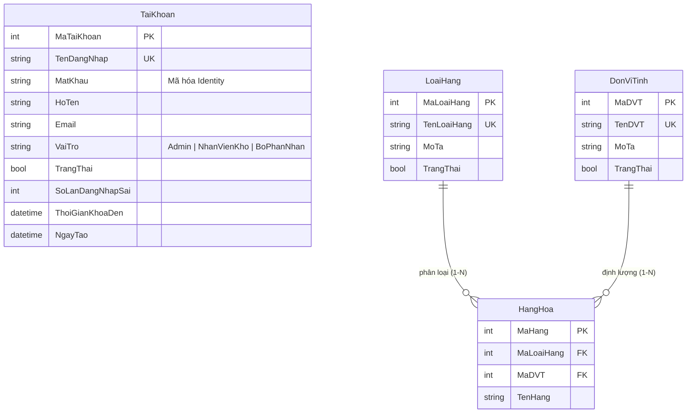
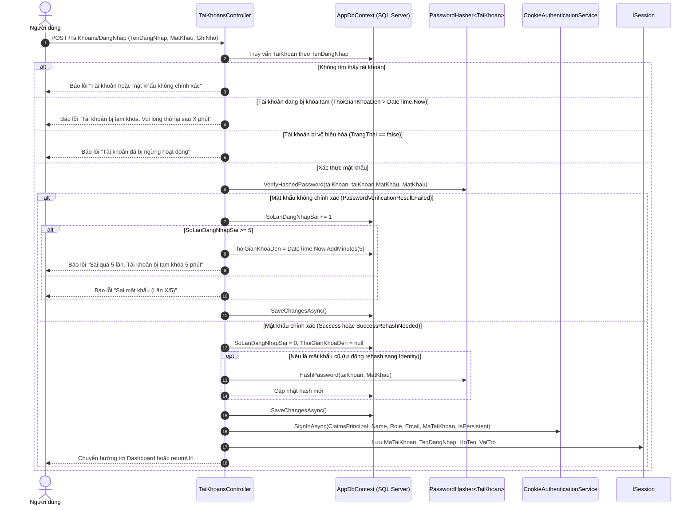

# TÀI LIỆU CHI TIẾT MODULE 1: TÀI KHOẢN, XÁC THỰC, PHÂN QUYỀN, PROFILE & DANH MỤC CƠ SỞ

> **Dự án:** Hệ thống Quản Lý Kho Hàng UNETI (ASP.NET Core 10 MVC)  
> **Sinh viên phụ trách:** Trần Xuân Hải  
> **Mã sinh viên:** 23103100135  
> **Lớp:** ĐHTI17A3HN  
> **Vai trò:** Nhóm trưởng / Kiến trúc sư hệ thống  
> **Trở về:** [Xem README Tổng quan](../../README.md)

---

## 1. TỔNG QUAN & PHẠM VI TRÁCH NHIỆM

Module 1 đóng vai trò là **nền tảng bảo mật và cấu trúc cốt lõi** của toàn bộ giải pháp Quản lý Kho hàng. Module chịu trách nhiệm:
1. **Xác thực danh tính (Authentication):** Triển khai cơ chế Cookie Authentication kết hợp lưu trữ Session an toàn, ghi nhớ đăng nhập (Remember Me).
2. **Bảo vệ chống tấn công dò mật khẩu (Brute-force Lockout):** Theo dõi số lần đăng nhập sai (`SoLanDangNhapSai`), tự động khóa tài khoản tạm thời 5 phút nếu sai quá 5 lần liên tiếp.
3. **Mã hóa mật khẩu chuẩn công nghiệp:** Ứng dụng `IPasswordHasher<TaiKhoan>` của ASP.NET Core Identity (PBKDF2 với HMAC-SHA256 và Salt ngẫu nhiên 128-bit) thay thế mật khẩu dạng text rõ.
4. **Phân quyền truy cập đa vai trò (Role-Based Access Control - RBAC):** Kiểm soát truy cập nghiêm ngặt dựa trên 3 vai trò: `Admin`, `NhanVienKho`, `BoPhanNhan` qua bộ lọc `[AuthorizeRole(...)]`.
5. **Đồng bộ giao diện theo quyền (Dynamic Role UI):** Tùy biến thanh điều hướng (Navbar) trên `_Layout.cshtml`, hiển thị Họ tên và huy hiệu (Badge) vai trò trên Header.
6. **Quản lý Hồ sơ cá nhân (Profile) & Đổi mật khẩu:** Cho phép người dùng tự quản lý thông tin cá nhân và thay đổi mật khẩu bảo mật độc lập.
7. **Quản trị Tài khoản người dùng (User Management - CRUD):** Dành riêng cho `Admin`, hỗ trợ tạo mới, cập nhật vai trò, khóa/mở khóa trạng thái hoạt động.
8. **Quản lý Danh mục cơ sở (Loại hàng & Đơn vị tính):** Cung cấp các bảng danh mục chuẩn hóa phục vụ phân loại và định lượng sản phẩm ở Module 2.
9. **Kiến trúc CSDL High-Availability:** Tích hợp bộ quản lý kết nối tự động Failover giữa Azure SQL Remote và LocalDB.

---

## 2. KIẾN TRÚC THỰC THỂ DỮ LIỆU (ENTITIES / DATA MODELS)

### 2.1. Sơ đồ quan hệ thực thể (ERD Trích đoạn Module 1)


### 2.2. Chi tiết các bảng CSDL thuộc Module 1

#### A. Bảng `TaiKhoan` (Quản lý tài khoản & Xác thực)
- **`MaTaiKhoan` (int, PK, Identity):** Khóa chính tự tăng định danh duy nhất người dùng.
- **`TenDangNhap` (nvarchar(50), Unique, Required):** Tên tài khoản dùng để đăng nhập, chặn trùng lặp.
- **`MatKhau` (nvarchar(255), Required):** Chuỗi hash mật khẩu bảo mật bằng ASP.NET Core Identity PasswordHasher.
- **`HoTen` (nvarchar(100), Required):** Họ và tên đầy đủ hiển thị trên giao diện và trong nhật ký giao dịch.
- **`Email` (nvarchar(100), EmailAddress):** Email liên lạc của người dùng.
- **`VaiTro` (nvarchar(20), Required):** Chuỗi vai trò (`Admin`, `NhanVienKho`, `BoPhanNhan`).
- **`TrangThai` (bool, Default: true):** Trạng thái kích hoạt (`true`: Hoạt động, `false`: Bị khóa / Vô hiệu hóa).
- **`SoLanDangNhapSai` (int, Default: 0):** Bộ đếm số lần nhập sai mật khẩu liên tiếp.
- **`ThoiGianKhoaDen` (datetime, Nullable):** Mốc thời gian tài khoản bị khóa tạm thời đến thời điểm này.
- **`NgayTao` (datetime, Default: GETDATE()):** Ngày tạo tài khoản.

#### B. Bảng `LoaiHang` (Danh mục phân loại ngành hàng)
- **`MaLoaiHang` (int, PK, Identity):** Mã định danh nhóm hàng.
- **`TenLoaiHang` (nvarchar(100), Unique, Required):** Tên phân loại (ví dụ: Điện tử, Gia dụng, Thực phẩm).
- **`MoTa` (nvarchar(255), Nullable):** Diễn giải đặc điểm của nhóm hàng.
- **`TrangThai` (bool, Default: true):** Trạng thái hoạt động (`true`: Đang kinh doanh, `false`: Tạm ngừng).

#### C. Bảng `DonViTinh` (Danh mục đơn vị đo lường)
- **`MaDVT` (int, PK, Identity):** Mã định danh đơn vị tính.
- **`TenDVT` (nvarchar(50), Unique, Required):** Tên đơn vị đo lường (ví dụ: Cái, Thùng, Hộp, Kg, Mét).
- **`MoTa` (nvarchar(255), Nullable):** Ghi chú quy cách đơn vị.
- **`TrangThai` (bool, Default: true):** Trạng thái kích hoạt.

---

## 3. BẢNG ĐẶC TẢ CHỨC NĂNG & ENDPOINTS

| STT | Chức năng | Tuyến đường (Endpoint) | HTTP Method | Quyền truy cập | Mô tả nghiệp vụ chi tiết |
| :---: | :--- | :--- | :---: | :---: | :--- |
| 1 | **Đăng nhập hệ thống** | `/login` hoặc `/TaiKhoans/DangNhap` | `GET`, `POST` | Công khai (Public) | Kiểm tra tài khoản, kiểm tra trạng thái khóa `ThoiGianKhoaDen`, xác thực mật khẩu qua `PasswordHasher`. Cấp Cookie xác thực và lưu Session. |
| 2 | **Ghi nhớ đăng nhập** | `/TaiKhoans/DangNhap` | `POST` | Công khai | Nếu tích chọn "Ghi nhớ tài khoản", thiết lập `IsPersistent = true` cho AuthenticationTicket với thời hạn lâu dài. |
| 3 | **Đăng xuất an toàn** | `/logout` hoặc `/TaiKhoans/DangXuat` | `GET`, `POST` | Đã đăng nhập | Thu hồi Cookie xác thực qua `HttpContext.SignOutAsync()`, xóa toàn bộ phiên làm việc `Session.Clear()`, xóa Session Cookie và chuyển hướng về trang Login. |
| 4 | **Xem hồ sơ cá nhân** | `/TaiKhoans/Profile` | `GET` | Đã đăng nhập | Truy xuất thông tin người dùng hiện tại từ Session/Claim: Họ tên, Tên đăng nhập, Email, Vai trò, Trạng thái hoạt động, Ngày tạo. |
| 5 | **Cập nhật hồ sơ** | `/TaiKhoans/CapNhatProfile` | `GET`, `POST` | Đã đăng nhập | Cho phép người dùng tự cập nhật Họ tên, Email. Khóa cứng không cho phép sửa đổi `TenDangNhap` và `VaiTro` để ngăn chặn hành vi leo thang đặc quyền. |
| 6 | **Đổi mật khẩu** | `/TaiKhoans/DoiMatKhau` | `GET`, `POST` | Đã đăng nhập | Xác thực mật khẩu cũ trước khi đổi; kiểm tra độ dài mật khẩu mới, kiểm tra mật khẩu xác nhận trùng khớp; băm mật khẩu mới bằng `PasswordHasher`. |
| 7 | **Quản lý danh sách tài khoản** | `/TaiKhoans/Index` | `GET` | **Admin** | Hiển thị toàn bộ người dùng, tìm kiếm theo tên/họ tên/email, lọc theo vai trò, lọc trạng thái hoạt động, hiển thị cảnh báo tài khoản bị khóa tạm. |
| 8 | **Thêm tài khoản mới** | `/TaiKhoans/Create` | `GET`, `POST` | **Admin** | Tạo mới tài khoản: Kiểm tra duy nhất `TenDangNhap`, mã hóa mật khẩu trước khi lưu CSDL, chỉ định vai trò truy cập. |
| 9 | **Chỉnh sửa tài khoản** | `/TaiKhoans/Edit/{id}` | `GET`, `POST` | **Admin** | Cập nhật thông tin tài khoản, thay đổi vai trò hoặc khóa/mở khóa trạng thái. Hỗ trợ đổi mật khẩu mới (nếu nhập) hoặc giữ nguyên hash cũ. |
| 10 | **Xóa / Khóa tài khoản** | `/TaiKhoans/Delete/{id}` | `GET`, `POST` | **Admin** | Chặn xóa tài khoản Admin đang trực tiếp đăng nhập. Xác nhận xóa tài khoản khỏi CSDL. |
| 11 | **Quản lý Loại hàng** | `/LoaiHangs/*` (CRUD) | `GET`, `POST` | **Admin**, **NhanVienKho** | Quản lý danh mục ngành hàng: Chặn trùng tên, chặn xóa vật lý nếu đã có hàng hóa liên kết để bảo vệ toàn vẹn khóa ngoại. |
| 12 | **Quản lý Đơn vị tính** | `/DonViTinhs/*` (CRUD) | `GET`, `POST` | **Admin**, **NhanVienKho** | Quản lý danh mục ĐVT: Chặn trùng tên đơn vị tính, chặn xóa vật lý nếu đã có mặt hàng sử dụng. |
| 13 | **Trang từ chối quyền** | `/Home/AccessDenied` | `GET` | Mọi người dùng | Hiển thị thông báo HTTP 403 Forbidden thân thiện khi tài khoản không có quyền thao tác trên action yêu cầu. |

---

## 4. SƠ ĐỒ TUẦN TỰ XÁC THỰC ĐĂNG NHẬP & CHỐNG BRUTE-FORCE LOCKOUT



---

## 5. CÁC QUY TẮC NGHIỆP VỤ & KỸ THUẬT NỔI BẬT

### 5.1. Cơ chế băm mật khẩu ASP.NET Core Identity
- Sử dụng `IPasswordHasher<TaiKhoan>` đăng ký qua Dependency Injection trong `Program.cs`.
- Mật khẩu lưu trữ luôn ở định dạng chuỗi hash an toàn chuẩn PBKDF2 HMAC-SHA256 với Salt 128-bit ngẫu nhiên và 10,000 vòng lặp.
- **Cơ chế Auto-Migration:** Nếu CSDL còn chứa mật khẩu dạng text cũ hoặc SHA-256 thuần, khi người dùng đăng nhập thành công, hệ thống tự động nhận diện và băm lại bằng Identity PasswordHasher rồi cập nhật vào CSDL.

### 5.2. Chính sách khóa Brute-force Lockout
- Khi người dùng nhập sai mật khẩu, biến `SoLanDangNhapSai` tăng 1 đơn vị.
- Đạt ngưỡng 5 lần sai liên tiếp $\rightarrow$ Thiết lập `ThoiGianKhoaDen = DateTime.Now.AddMinutes(5)`.
- Khi người dùng đăng nhập thành công $\rightarrow$ Đặt lại `SoLanDangNhapSai = 0` và `ThoiGianKhoaDen = null`.

### 5.3. Đồng bộ Menu Navbar theo vai trò người dùng (`_Layout.cshtml`)
- **Admin:** Hiển thị toàn bộ menu hệ thống (Bao gồm dropdown Quản trị: Quản lý tài khoản, Kho bãi, Loại hàng, Đơn vị tính, Đối tác, Khách hàng, Báo cáo).
- **NhanVienKho (Thủ kho):** Hiển thị menu Hàng hóa, Nhập kho, Xuất kho, Cảnh báo tồn, Nhật ký biến động kho, Báo cáo thống kê. Ẩn menu Quản lý tài khoản.
- **BoPhanNhan (Khách nhận hàng):** Ẩn hoàn toàn các chức năng quản trị kho, nhập kho, tồn kho; chỉ hiển thị Trang chủ, Danh mục tra cứu hàng hóa và Xem thông tin đơn vị mình.
- **Header Badge:** Hiển thị Họ tên người dùng đăng nhập kèm huy hiệu màu sắc tương ứng:
  - `Admin`: Badge Đỏ (`bg-danger`)
  - `NhanVienKho`: Badge Xanh dương (`bg-primary`)
  - `BoPhanNhan`: Badge Xanh lá (`bg-success`)

---

## 6. MA TRẬN PHÂN QUYỀN TRUY CẬP (RBAC CHO MODULE 1)

| Tuyến đường (Route) | Quyền Admin | Quyền NhanVienKho | Quyền BoPhanNhan | Chưa đăng nhập |
| :--- | :---: | :---: | :---: | :---: |
| `/login`, `/TaiKhoans/DangNhap` | Cho phép | Cho phép | Cho phép | Cho phép |
| `/logout`, `/TaiKhoans/DangXuat` | Cho phép | Cho phép | Cho phép | Chuyển hướng Login |
| `/TaiKhoans/Profile` | Cho phép | Cho phép | Cho phép | Chuyển hướng Login |
| `/TaiKhoans/CapNhatProfile` | Cho phép | Cho phép | Cho phép | Chuyển hướng Login |
| `/TaiKhoans/DoiMatKhau` | Cho phép | Cho phép | Cho phép | Chuyển hướng Login |
| `/TaiKhoans/Index` | **Cho phép** | ⛔ 403 Forbidden | ⛔ 403 Forbidden | Chuyển hướng Login |
| `/TaiKhoans/Create`, `Edit`, `Delete` | **Cho phép** | ⛔ 403 Forbidden | ⛔ 403 Forbidden | Chuyển hướng Login |
| `/LoaiHangs/*` (CRUD) | **Cho phép** | **Cho phép** | ⛔ 403 Forbidden | Chuyển hướng Login |
| `/DonViTinhs/*` (CRUD) | **Cho phép** | **Cho phép** | ⛔ 403 Forbidden | Chuyển hướng Login |
| `/Home/AccessDenied` | Cho phép | Cho phép | Cho phép | Cho phép |

---

## 7. CẤU TRÚC FILE MÃ NGUỒN CỦA MODULE 1

```
QuanLyKhoHang_UNETI01_TI17A3HN/
├── Controllers/
│   ├── TaiKhoansController.cs       # Điều khiển Xác thực, Lockout, Profile, CRUD User
│   ├── LoaiHangsController.cs       # Điều khiển danh mục Loại hàng
│   └── DonViTinhsController.cs      # Điều khiển danh mục Đơn vị tính
├── Models/
│   ├── TaiKhoan.cs                  # Entity tài khoản người dùng
│   ├── LoaiHang.cs                  # Entity danh mục nhóm loại hàng
│   └── DonViTinh.cs                 # Entity danh mục đơn vị tính
├── ViewModels/
│   ├── LoginViewModel.cs            # ViewModel đăng nhập & Remember Me
│   ├── CapNhatProfileViewModel.cs   # ViewModel cập nhật thông tin cá nhân
│   └── DoiMatKhauViewModel.cs       # ViewModel đổi mật khẩu
├── Filters/
│   └── AuthorizeRoleAttribute.cs    # Custom Action Filter chặn phân quyền và chuyển hướng 403
├── Services/
│   ├── DatabaseConnectionManager.cs # Quản lý kết nối CSDL và chuyển đổi Remote/Local
│   ├── DatabaseHealthCheckService.cs# Background service kiểm tra kết nối CSDL định kỳ 15s
│   └── DatabaseFailoverInterceptor.cs# EF Core Interceptor tự động bắt lỗi kết nối
├── Views/
│   ├── TaiKhoans/
│   │   ├── DangNhap.cshtml          # Giao diện đăng nhập
│   │   ├── Profile.cshtml           # Giao diện hồ sơ cá nhân
│   │   ├── CapNhatProfile.cshtml    # Giao diện sửa hồ sơ cá nhân
│   │   ├── DoiMatKhau.cshtml        # Giao diện đổi mật khẩu
│   │   ├── Index.cshtml             # Bảng quản lý tài khoản cho Admin
│   │   ├── Create.cshtml            # Form tạo tài khoản
│   │   ├── Edit.cshtml              # Form sửa tài khoản & vai trò
│   │   └── Delete.cshtml            # Form xác nhận xóa tài khoản
│   ├── LoaiHangs/                   # Các Views CRUD Loại hàng
│   ├── DonViTinhs/                  # Các Views CRUD Đơn vị tính
│   └── Shared/
│       ├── _Layout.cshtml           # Khung giao diện đồng bộ menu theo vai trò & badge
│       └── AccessDenied.cshtml      # Trang thông báo 403 Forbidden
└── Tests/
    └── QuanLyKhoHang.Tests/
        └── AuthenticationIntegrationTests.cs # Bộ kiểm thử tích hợp xác thực & phân quyền
```

---

## 8. HÌNH ẢNH CHƯƠNG TRÌNH THỰC TẾ

| Màn hình Đăng nhập hệ thống | Quản lý Danh sách Tài khoản (Admin) |
| :---: | :---: |
|  |  |

---

## 9. CÁC CA KIỂM THỬ TỰ ĐỘNG (INTEGRATION TESTS)

Bộ test tích hợp xUnit tại `Tests/QuanLyKhoHang.Tests/AuthenticationIntegrationTests.cs` xác nhận:
1. **TC-AUTH-01:** Đăng nhập thành công với tài khoản và mật khẩu chuẩn $\rightarrow$ Trả về Cookie xác thực `.AspNetCore.Cookies` và chuyển hướng 302.
2. **TC-AUTH-02:** Đăng nhập sai mật khẩu $\rightarrow$ Hiển thị thông báo lỗi, tăng bộ đếm số lần sai.
3. **TC-AUTH-03:** Đăng nhập sai 5 lần liên tiếp $\rightarrow$ Tài khoản chuyển sang trạng thái Lockout 5 phút.
4. **TC-AUTH-04:** Tài khoản bị vô hiệu hóa (`TrangThai == false`) cố đăng nhập $\rightarrow$ Chặn đăng nhập và báo tài khoản bị khóa.
5. **TC-AUTH-05:** Người dùng chưa đăng nhập truy cập trang nội bộ $\rightarrow$ Tự động chuyển hướng về `/login?ReturnUrl=...`.
6. **TC-AUTH-06:** Người dùng vai trò `NhanVienKho` cố truy cập `/TaiKhoans/Index` $\rightarrow$ Chặn và chuyển hướng về `/Home/AccessDenied`.
7. **TC-AUTH-07:** Đổi mật khẩu thành công $\rightarrow$ Mật khẩu cũ bị vô hiệu hóa, mật khẩu mới được băm và đăng nhập được bình thường.
