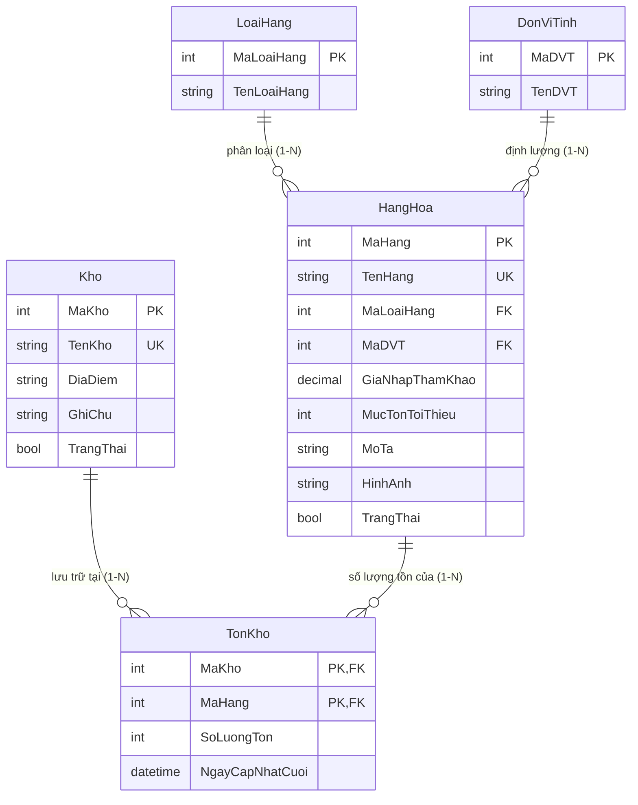
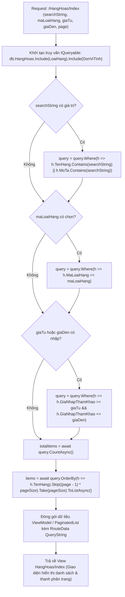

# TÀI LIỆU CHI TIẾT MODULE 2: KHO HÀNG, HÀNG HÓA & BỘ TRA CỨU LINQ ĐA TIÊU CHÍ

> **Dự án:** Hệ thống Quản Lý Kho Hàng UNETI (ASP.NET Core 10 MVC)  
> **Sinh viên phụ trách:** Nguyễn Thị Cúc  
> **Mã sinh viên:** 23103100178  
> **Lớp:** ĐHTI17A3HN  
> **Phạm vi trách nhiệm:** Quản lý Kho bãi, Danh mục Hàng hóa & Bộ lọc tra cứu đa tiêu chí LINQ  
> **Trở về:** [Xem README Tổng quan](../../README.md)

---

## 1. TỔNG QUAN & PHẠM VI TRÁCH NHIỆM

Module 2 phụ trách **quản lý thực thể vật lý cốt lõi của kho hàng và danh mục hàng hóa lưu kho**, đồng thời cung cấp công cụ tìm kiếm và lọc dữ liệu mạnh mẽ:
1. **Quản lý danh mục Kho hàng (Warehouses):** Quản lý toàn diện các địa điểm kho bãi vật lý (Tên kho, Địa điểm, Ghi chú, Trạng thái hoạt động).
2. **Quản lý danh mục Hàng hóa (Products):** Khai báo sản phẩm, quy cách đóng gói, đơn giá nhập tham khảo, mức tồn an toàn tối thiểu (`MucTonToiThieu`), hình ảnh đại diện, liên kết khóa ngoại với Loại hàng (Module 1) và Đơn vị tính (Module 1).
3. **Bộ tra cứu LINQ đa tiêu chí:** Cho phép người dùng tìm kiếm tức thì theo Tên hàng, Mã hàng, Mô tả hoặc kết hợp nhiều bộ lọc (Loại hàng, Đơn vị tính, Kho lưu trữ, Khoảng giá từ - đến).
4. **Phân trang dữ liệu Server-side (High Performance Pagination):** Tối ưu hóa hiệu năng truy vấn trên tập dữ liệu lớn bằng `.Skip().Take()`, bảo toàn toàn bộ Query Parameters khi chuyển trang.
5. **Hiển thị chi tiết tồn kho phân bổ theo từng kho riêng biệt:** Khi xem chi tiết một sản phẩm (`HangHoas/Details/{id}`), hệ thống tự động tổng hợp và hiển thị bảng số lượng tồn thực tế tại từng kho vật lý dựa trên bảng `TonKho`.
6. **Bảo toàn dữ liệu & Chặn xóa vật lý (Soft Delete Constraint):** Kho hàng hoặc Hàng hóa đã từng phát sinh giao dịch nhập/xuất hoặc đang có số dư tồn kho sẽ bị chặn xóa cứng để bảo vệ tính toàn vẹn dữ liệu.

---

## 2. KIẾN TRÚC THỰC THỂ DỮ LIỆU (ENTITIES / DATA MODELS)

### 2.1. Sơ đồ quan hệ thực thể (ERD Trích đoạn Module 2)


### 2.2. Chi tiết các bảng CSDL thuộc Module 2

#### A. Bảng `Kho` (Quản lý kho bãi vật lý)
- **`MaKho` (int, PK, Identity):** Mã định danh kho hàng tự tăng.
- **`TenKho` (nvarchar(100), Unique, Required):** Tên kho bãi (ví dụ: Kho Hà Nội, Kho Sài Gòn, Kho Tổng Miền Trung).
- **`DiaDiem` (nvarchar(255), Required):** Địa chỉ vật lý của kho bãi.
- **`GhiChu` (nvarchar(500), Nullable):** Thông tin ghi chú thêm (sức chứa, diện tích, thủ kho phụ trách).
- **`TrangThai` (bool, Default: true):** Trạng thái hoạt động (`true`: Đang hoạt động, `false`: Tạm ngừng hoạt động).

#### B. Bảng `HangHoa` (Danh mục mặt hàng vật tư)
- **`MaHang` (int, PK, Identity):** Mã định danh sản phẩm.
- **`TenHang` (nvarchar(150), Unique, Required):** Tên thương mại đầy đủ của hàng hóa.
- **`MaLoaiHang` (int, FK, Required):** Khóa ngoại tham chiếu đến bảng `LoaiHang` (Module 1).
- **`MaDVT` (int, FK, Required):** Khóa ngoại tham chiếu đến bảng `DonViTinh` (Module 1).
- **`GiaNhapThamKhao` (decimal(18,2), Required, Range >= 0):** Đơn giá mua vào tham chiếu để dự toán tài chính.
- **`MucTonToiThieu` (int, Required, Range >= 0):** Ngưỡng tồn an toàn để hệ thống kích hoạt cảnh báo sắp hết hàng.
- **`MoTa` (nvarchar(500), Nullable):** Thông số kỹ thuật, mô tả chi tiết sản phẩm.
- **`HinhAnh` (nvarchar(255), Nullable):** Đường dẫn ảnh minh họa sản phẩm lưu trong thư mục `wwwroot/images/`.
- **`TrangThai` (bool, Default: true):** Trạng thái kinh doanh (`true`: Đang lưu hành, `false`: Ngừng kinh doanh).

---

## 3. BẢNG ĐẶC TẢ CHỨC NĂNG & ENDPOINTS

| STT | Chức năng | Tuyến đường (Endpoint) | HTTP Method | Quyền truy cập | Mô tả nghiệp vụ chi tiết |
| :---: | :--- | :--- | :---: | :---: | :--- |
| 1 | **Danh mục Kho bãi** | `/Khoes/Index` | `GET` | **Admin**, **NhanVienKho** | Danh sách kho bãi, địa chỉ, trạng thái hoạt động, hỗ trợ phân loại kho đang hoạt động hoặc ngừng. |
| 2 | **Thêm kho bãi mới** | `/Khoes/Create` | `GET`, `POST` | **Admin** | Form khai báo kho: Kiểm tra tên kho không để trống và không trùng lặp tên đã có. |
| 3 | **Chỉnh sửa kho bãi** | `/Khoes/Edit/{id}` | `GET`, `POST` | **Admin** | Cập nhật thông tin địa chỉ, ghi chú và chuyển đổi trạng thái hoạt động của kho. |
| 4 | **Xóa kho bãi** | `/Khoes/Delete/{id}` | `GET`, `POST` | **Admin** | Kiểm tra ràng buộc khóa ngoại: Chặn xóa nếu kho đã có phiếu nhập/xuất hoặc đang chứa tồn kho $> 0$. |
| 5 | **Danh mục Hàng hóa** | `/HangHoas/Index` | `GET` | Mọi vai trò đã đăng nhập | Danh sách hàng hóa kèm ảnh minh họa, mã loại, ĐVT, giá tham khảo, mức tồn tối thiểu và trạng thái. |
| 6 | **Tìm kiếm LINQ tức thì** | `/HangHoas/Index?searchString=...` | `GET` | Đã đăng nhập | Tìm kiếm LINQ linh hoạt theo Tên sản phẩm, Mô tả hoặc Tên phân loại không phân biệt chữ hoa thường. |
| 7 | **Bộ lọc đa tiêu chí** | `/HangHoas/Index?maLoaiHang=...&giaTu=...&giaDen=...` | `GET` | Đã đăng nhập | Kết hợp đồng thời nhiều tiêu chí lọc: Nhóm loại hàng, khoảng giá từ - đến, đơn vị tính. |
| 8 | **Phân trang Server-side** | `/HangHoas/Index?page=...` | `GET` | Đã đăng nhập | Phân chia danh sách thành từng trang nhỏ (ví dụ: 10 món/trang) bằng câu lệnh LINQ `.Skip().Take()`. Giữ nguyên toàn bộ tham số tìm kiếm và lọc khi click chuyển trang. |
| 9 | **Thêm mới Hàng hóa** | `/HangHoas/Create` | `GET`, `POST` | **Admin**, **NhanVienKho** | Form thêm hàng hóa: Chọn Loại hàng, ĐVT từ dropdown; Validate `GiaNhapThamKhao >= 0`, `MucTonToiThieu >= 0`. |
| 10 | **Sửa thông tin Hàng hóa** | `/HangHoas/Edit/{id}` | `GET`, `POST` | **Admin**, **NhanVienKho** | Cập nhật thông tin hàng hóa, giá tham khảo, mức cảnh báo tối thiểu. |
| 11 | **Xóa hàng hóa** | `/HangHoas/Delete/{id}` | `GET`, `POST` | **Admin**, **NhanVienKho** | Kiểm tra toàn vẹn CSDL: Chặn xóa vật lý nếu sản phẩm đã phát sinh chi tiết phiếu nhập/xuất. |
| 12 | **Chi tiết hàng hóa & Tồn từng kho** | `/HangHoas/Details/{id}` | `GET` | Mọi vai trò đã đăng nhập | Hiển thị hồ sơ chi tiết sản phẩm và **bảng thống kê số lượng tồn kho thực tế tại từng kho vật lý** (Kho Hà Nội: 100, Kho Sài Gòn: 50...). |

---

## 4. SƠ ĐỒ XỬ LÝ TRA CỨU & LỌC ĐA TIÊU CHÍ BẰNG LINQ



---

## 5. CÁC QUY TẮC NGHIỆP VỤ & KỸ THUẬT NỔI BẬT

### 5.1. Logic hiển thị Phân bổ Tồn kho chi tiết theo từng kho (`HangHoas/Details`)
- Dữ liệu tồn kho **tuyệt đối không được nhập thủ công** hay lưu cố định trong bảng `HangHoa`.
- Khi người dùng xem chi tiết mặt hàng tại action `HangHoasController.Details(int? id)`, hệ thống thực hiện câu truy vấn `Include`:
  ```csharp
  var tonKhoList = await _context.TonKhoes
      .Include(t => t.Kho)
      .Where(t => t.MaHang == id)
      .ToListAsync();
  ```
- Kết quả được chuyển sang View để render bảng phân bổ số lượng tồn thực tế của từng kho bãi kèm trạng thái cảnh báo riêng cho từng địa điểm.

### 5.2. Kỹ thuật Phân trang Server-side duy trì trạng thái lọc (Preserving Query Parameters)
- Sử dụng cấu trúc `PaginatedList<T>` kế thừa từ `List<T>`.
- Toàn bộ tham số trên thanh URL (`searchString`, `maLoaiHang`, `giaTu`, `giaDen`) được truyền vào Tag Helpers của các nút điều hướng phân trang (`asp-route-searchString="@ViewBag.CurrentSearch"`), giúp người dùng chuyển sang Trang 2, Trang 3 mà không bị mất điều kiện lọc đã chọn.

### 5.3. Ràng buộc bảo toàn dữ liệu & Chặn xóa vật lý
- Bảng `HangHoa` và `Kho` là các bảng cha trong quan hệ 1-N với `ChiTietPhieuNhap`, `ChiTietPhieuXuat` và `TonKho`.
- Trong Controller, trước khi thực hiện `_context.Remove(...)`, action sẽ kiểm tra:
  ```csharp
  bool hasRelatedData = await _context.TonKhoes.AnyAsync(t => t.MaHang == id && t.SoLuongTon > 0)
                     || await _context.ChiTietPhieuNhaps.AnyAsync(c => c.MaHang == id)
                     || await _context.ChiTietPhieuXuats.AnyAsync(c => c.MaHang == id);
  if (hasRelatedData) {
      ModelState.AddModelError("", "Mặt hàng này đã có giao dịch nhập/xuất hoặc đang tồn trong kho. Không thể xóa vật lý!");
      return View(hangHoa);
  }
  ```
- Biện pháp này ngăn chặn hoàn toàn lỗi vỡ toàn vẹn khóa ngoại (Foreign Key Violation) trong SQL Server.

---

## 6. MA TRẬN PHÂN QUYỀN TRUY CẬP (RBAC CHO MODULE 2)

| Tuyến đường (Route) | Quyền Admin | Quyền NhanVienKho | Quyền BoPhanNhan | Chưa đăng nhập |
| :--- | :---: | :---: | :---: | :---: |
| `/Khoes/Index` | **Xem toàn bộ** | **Xem toàn bộ** | 403 Forbidden | Chuyển hướng Login |
| `/Khoes/Create` | **Tạo mới** | 403 Forbidden | 403 Forbidden | Chuyển hướng Login |
| `/Khoes/Edit/{id}` | **Chỉnh sửa** | 403 Forbidden | 403 Forbidden | Chuyển hướng Login |
| `/Khoes/Delete/{id}` | **Xóa kho** | 403 Forbidden | 403 Forbidden | Chuyển hướng Login |
| `/HangHoas/Index` | **Xem & Lọc** | **Xem & Lọc** | **Xem & Lọc** | Chuyển hướng Login |
| `/HangHoas/Details/{id}` | **Xem chi tiết** | **Xem chi tiết** | **Xem chi tiết** | Chuyển hướng Login |
| `/HangHoas/Create` | **Tạo mới** | **Tạo mới** | 403 Forbidden | Chuyển hướng Login |
| `/HangHoas/Edit/{id}` | **Chỉnh sửa** | **Chỉnh sửa** | 403 Forbidden | Chuyển hướng Login |
| `/HangHoas/Delete/{id}` | **Xóa hàng** | **Xóa hàng** | 403 Forbidden | Chuyển hướng Login |

---

## 7. CẤU TRÚC FILE MÃ NGUỒN CỦA MODULE 2

```
QuanLyKhoHang_UNETI01_TI17A3HN/
├── Controllers/
│   ├── KhoesController.cs       # Điều khiển CRUD kho bãi vật lý
│   └── HangHoasController.cs    # Điều khiển CRUD hàng hóa, bộ lọc LINQ & chi tiết tồn
├── Models/
│   ├── Kho.cs                   # Entity kho hàng
│   └── HangHoa.cs               # Entity hàng hóa
├── ViewModels/
│   └── PaginatedList.cs         # Lớp trợ giúp phân trang server-side
├── Views/
│   ├── Khoes/
│   │   ├── Index.cshtml         # Danh sách kho hàng
│   │   ├── Create.cshtml        # Form tạo kho
│   │   ├── Edit.cshtml          # Form sửa kho
│   │   ├── Delete.cshtml        # Xác nhận xóa kho
│   │   └── Details.cshtml       # Chi tiết thông tin kho
│   └── HangHoas/
│       ├── Index.cshtml         # Bảng danh mục hàng hóa & bộ lọc LINQ đa tiêu chí
│       ├── Details.cshtml       # Chi tiết sản phẩm & bảng phân bổ tồn từng kho
│       ├── Create.cshtml        # Form thêm hàng hóa mới
│       ├── Edit.cshtml          # Form chỉnh sửa hàng hóa
│       └── Delete.cshtml        # Xác nhận xóa hàng hóa
```

---

## 8. HÌNH ẢNH CHƯƠNG TRÌNH THỰC TẾ

| Danh sách Hàng hóa & Bộ lọc đa tiêu chí | Chi tiết hàng hóa & Bảng phân bổ tồn từng kho |
| :---: | :---: |
|  |  |

| Quản lý danh mục Kho bãi |
| :---: |
|  |

---

## 9. CÁC CA KIỂM THỬ TỰ ĐỘNG (INTEGRATION TESTS)

1. **TC-PROD-01:** Truy vấn danh sách hàng hóa với bộ lọc `maLoaiHang` $\rightarrow$ Trả về chính xác các mặt hàng thuộc loại đã chọn.
2. **TC-PROD-02:** Tìm kiếm từ khóa `searchString` $\rightarrow$ Kết quả chứa từ khóa trong tên hàng hóa hoặc mô tả.
3. **TC-PROD-03:** Lọc khoảng giá `giaTu` và `giaDen` $\rightarrow$ Tất cả sản phẩm trả về có đơn giá thỏa mãn điều kiện.
4. **TC-PROD-04:** Chặn thao tác xóa hàng hóa hoặc kho bãi đang có liên kết dữ liệu $\rightarrow$ Báo lỗi validation, không làm mất tính toàn vẹn CSDL.
5. **TC-PROD-05:** Truy cập xem chi tiết hàng hóa `HangHoas/Details` $\rightarrow$ Hiển thị đầy đủ danh sách các kho và số lượng tồn tương ứng.
