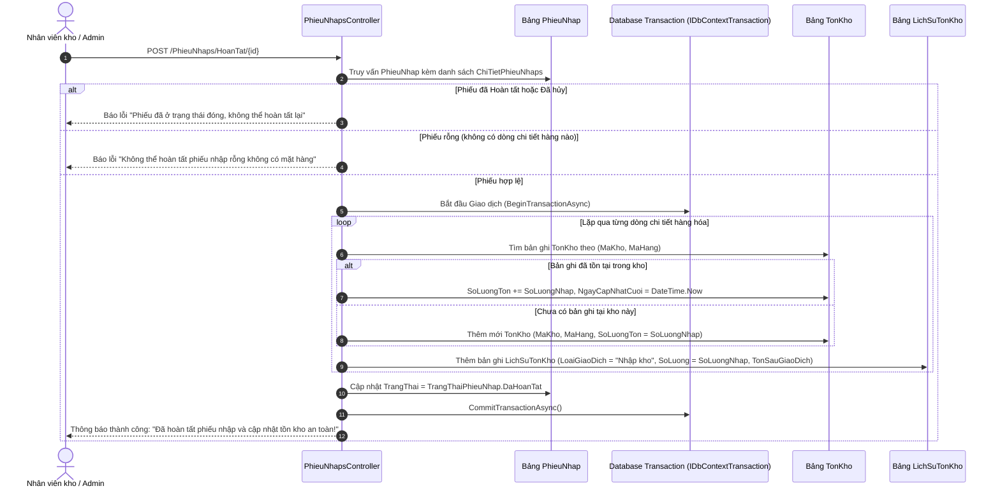

# TÀI LIỆU CHI TIẾT MODULE 3: NHÀ CUNG CẤP & NGHIỆP VỤ NHẬP KHO (INBOUND LOGISTICS)

> **Dự án:** Hệ thống Quản Lý Kho Hàng UNETI (ASP.NET Core 10 MVC)  
> **Sinh viên phụ trách:** Lê Văn Hùng  
> **Mã sinh viên:** 23103100177  
> **Lớp:** ĐHTI17A3HN  
> **Phạm vi trách nhiệm:** Quản lý Đối tác Nhà cung cấp & Quy trình Nhập kho Inbound Logistics  
> **Trở về:** [Xem README Tổng quan](../../README.md)

---

## 1. TỔNG QUAN & PHẠM VI TRÁCH NHIỆM

Module 3 đảm nhiệm **chu trình hậu cần đầu vào (Inbound Logistics)** - dòng chảy hàng hóa từ nhà cung cấp bên ngoài nhập về kho bãi của doanh nghiệp:
1. **Quản lý danh bạ Nhà cung cấp (Suppliers):** Khai báo thông tin đối tác cung ứng, đầu mối liên hệ, số điện thoại, email, địa chỉ và trạng thái hợp tác.
2. **Quy trình Lập Phiếu nhập kho (Purchase Receipt / Inbound Order):** Khởi tạo phiếu nhập với nhà cung cấp, chọn kho tiếp nhận, ngày nhập, nhân viên phụ trách và ghi chú.
3. **Quản lý Chi tiết phiếu nhập (Master - Detail Line Items):** Bổ sung từng món hàng, khai báo số lượng nhập ($> 0$), đơn giá nhập ($\ge 0$), tự động tính thành tiền từng dòng và cộng dồn tổng tiền toàn phiếu.
4. **Cơ chế quản lý 4 trạng thái vòng đời phiếu:**
   - `0: Nháp (Draft)` - Đang tạo lập thông tin, có thể sửa đổi thoải mái.
   - `1: Chờ xác nhận (Pending)` - Chờ kiểm đếm thực tế tại cửa kho.
   - `2: Đã hoàn tất (Completed)` - Đã nghiệm thu vào kho, **đã cộng tồn kho thực tế**.
   - `3: Đã hủy (Cancelled)` - Hủy bỏ phiếu, không tác động đến tồn kho.
5. **Thực thi giao dịch Database Transaction bảo đảm an toàn:** Khi duyệt **Hoàn tất phiếu nhập** (`HoanTat`), hệ thống khởi tạo `IDbContextTransaction` nguyên tử để đồng thời:
   - Cộng dồn số lượng vào bảng `TonKho` theo cặp khóa `(MaKho, MaHang)`. Nếu chưa có bản ghi thì tự động tạo mới.
   - Ghi nhật ký vào bảng `LichSuTonKho` (Audit Trail) để đối soát.
   - Cập nhật trạng thái phiếu sang `DaHoanTat`.
6. **Cơ chế chống hoàn tất trùng lặp (Anti-Double-Spend):** Chặn đứng việc bấm duyệt nhiều lần làm tăng khống số lượng hàng trong kho.

---

## 2. KIẾN TRÚC THỰC THỂ DỮ LIỆU (ENTITIES / DATA MODELS)

### 2.1. Sơ đồ quan hệ thực thể (ERD Trích đoạn Module 3)
```mermaid
erDiagram
    NhaCungCap {
        int MaNCC PK
        string TenNCC UK
        string DiaChi
        string SoDienThoai
        string Email
        bool TrangThai
    }

    Kho {
        int MaKho PK
        string TenKho
    }

    HangHoa {
        int MaHang PK
        string TenHang
    }

    PhieuNhap {
        int MaPhieuNhap PK
        int MaNCC FK
        int MaKho FK
        datetime NgayNhap
        decimal TongTien
        int TrangThai "0: Nhap, 1: Cho, 2: HoanTat, 3: Huy"
        string GhiChu
        string NguoiTao
    }

    ChiTietPhieuNhap {
        int MaCTPN PK
        int MaPhieuNhap FK
        int MaHang FK
        int SoLuongNhap
        decimal DonGiaNhap
        decimal ThanhTien
    }

    TonKho {
        int MaKho PK,FK
        int MaHang PK,FK
        int SoLuongTon
    }

    LichSuTonKho {
        int MaLichSu PK
        int MaKho FK
        int MaHang FK
        string LoaiGiaoDich
        int SoLuong
        int TonSauGiaoDich
    }

    NhaCungCap ||--o{ PhieuNhap : "cung cấp (1-N)"
    Kho ||--o{ PhieuNhap : "nhập về kho (1-N)"
    PhieuNhap ||--|{ ChiTietPhieuNhap : "gồm các dòng nhập (1-N)"
    HangHoa ||--o{ ChiTietPhieuNhap : "mặt hàng nhập (1-N)"
    PhieuNhap -.-> TonKho : "Transaction: cộng tồn kho"
    PhieuNhap -.-> LichSuTonKho : "Transaction: ghi nhật ký"
```

### 2.2. Chi tiết các bảng CSDL thuộc Module 3

#### A. Bảng `NhaCungCap` (Đối tác cung ứng hàng)
- **`MaNCC` (int, PK, Identity):** Mã định danh nhà cung cấp.
- **`TenNCC` (nvarchar(150), Unique, Required):** Tên công ty/đơn vị cung ứng vật tư.
- **`DiaChi` (nvarchar(255), Required):** Trụ sở hoặc kho của đối tác.
- **`SoDienThoai` (nvarchar(20), Required):** Số điện thoại liên lạc đại diện.
- **`Email` (nvarchar(100), EmailAddress):** Email trao đổi đặt hàng.
- **`TrangThai` (bool, Default: true):** Trạng thái quan hệ đối tác (`true`: Đang giao dịch, `false`: Tạm ngừng).

#### B. Bảng `PhieuNhap` (Thông tin tổng thể đơn nhập kho)
- **`MaPhieuNhap` (int, PK, Identity):** Mã số phiếu nhập kho duy nhất.
- **`MaNCC` (int, FK, Required):** Khóa ngoại trỏ đến đối tác cung cấp.
- **`MaKho` (int, FK, Required):** Khóa ngoại chỉ định kho vật lý tiếp nhận hàng.
- **`NgayNhap` (datetime, Required):** Ngày giờ phát sinh phiếu nhập hàng.
- **`TongTien` (decimal(18,2), Default: 0):** Tổng giá trị toàn phiếu nhập.
- **`TrangThai` (enum TrangThaiPhieuNhap):** Trạng thái phiếu (`0: Nháp`, `1: Chờ xác nhận`, `2: Đã hoàn tất`, `3: Đã hủy`).
- **`GhiChu` (nvarchar(500), Nullable):** Thông tin hóa đơn GTGT, biển số xe giao hàng, điều khoản giao nhận.
- **`NguoiTao` (nvarchar(100), Required):** Tên đăng nhập của thủ kho lập phiếu.

#### C. Bảng `ChiTietPhieuNhap` (Danh sách mặt hàng nhập cụ thể)
- **`MaCTPN` (int, PK, Identity):** Mã dòng chi tiết hàng.
- **`MaPhieuNhap` (int, FK, Required):** Khóa ngoại tham chiếu đến phiếu nhập cha.
- **`MaHang` (int, FK, Required):** Khóa ngoại tham chiếu mặt hàng nhập.
- **`SoLuongNhap` (int, Required, Range 1 - 1,000,000):** Số lượng thực nhập của mặt hàng.
- **`DonGiaNhap` (decimal(18,2), Required, Range >= 0):** Đơn giá mua thực tế theo hóa đơn đối tác.
- **`ThanhTien` (decimal(18,2)):** Thành tiền = `SoLuongNhap * DonGiaNhap`.

---

## 3. BẢNG ĐẶC TẢ CHỨC NĂNG & ENDPOINTS

| STT | Chức năng | Tuyến đường (Endpoint) | HTTP Method | Quyền truy cập | Mô tả nghiệp vụ chi tiết |
| :---: | :--- | :--- | :---: | :---: | :--- |
| 1 | **Danh mục Nhà cung cấp** | `/NhaCungCaps/Index` | `GET` | **Admin**, **NhanVienKho** | Danh bạ đối tác cung ứng, tìm kiếm theo tên, số điện thoại hoặc email. |
| 2 | **Thêm Nhà cung cấp** | `/NhaCungCaps/Create` | `GET`, `POST` | **Admin**, **NhanVienKho** | Form thêm đối tác: Kiểm tra duy nhất tên NCC, định dạng email và số điện thoại. |
| 3 | **Sửa / Xóa Nhà cung cấp** | `/NhaCungCaps/Edit`, `Delete` | `GET`, `POST` | **Admin**, **NhanVienKho** | Chỉnh sửa thông tin đối tác; Chặn xóa vật lý nếu đã có phiếu nhập liên kết. |
| 4 | **Danh sách Phiếu nhập** | `/PhieuNhaps/Index` | `GET` | **Admin**, **NhanVienKho** | Quản lý danh sách toàn bộ phiếu nhập kho, hỗ trợ lọc theo trạng thái (`0: Nháp`, `1: Chờ`, `2: Hoàn tất`, `3: Hủy`). |
| 5 | **Lập phiếu nhập mới** | `/PhieuNhaps/Create` | `GET`, `POST` | **Admin**, **NhanVienKho** | Chọn Nhà cung cấp, Kho nhập, Ngày nhập, Ghi chú; tự động gán người lập từ Session hiện hành; tạo phiếu ở trạng thái Nháp. |
| 6 | **Quản lý Chi tiết hàng** | `/ChiTietPhieuNhaps/Create` | `GET`, `POST` | **Admin**, **NhanVienKho** | Thêm món hàng vào phiếu: Chọn sản phẩm, số lượng, đơn giá. Tự động tính thành tiền và cộng dồn `TongTien` của `PhieuNhap`. |
| 7 | **Sửa / Xóa Chi tiết hàng** | `/ChiTietPhieuNhaps/Edit`, `Delete` | `GET`, `POST` | **Admin**, **NhanVienKho** | Cho phép chỉnh sửa số lượng, đơn giá hoặc bỏ mặt hàng ra khỏi phiếu khi phiếu chưa ở trạng thái Đã hoàn tất. |
| 8 | **Xem Hóa đơn chi tiết** | `/PhieuNhaps/Details/{id}` | `GET` | Mọi vai trò đã đăng nhập | Xem giao diện hóa đơn hoàn chỉnh: Thông tin nhà cung cấp, kho tiếp nhận, bảng danh sách chi tiết các mặt hàng và tổng tiền thanh toán. |
| 9 | **Duyệt Hoàn tất phiếu** | `/PhieuNhaps/HoanTat/{id}` | `POST` | **Admin**, **NhanVienKho** | **Nghiệp vụ cốt lõi:** Kích hoạt Database Transaction: Kiểm tra trạng thái phiếu, cộng dồn tồn kho vào bảng `TonKho`, ghi nhật ký `LichSuTonKho`, đổi trạng thái sang `Đã hoàn tất`. |
| 10 | **Hủy phiếu nhập** | `/PhieuNhaps/HuyPhieu/{id}` | `POST` | **Admin**, **NhanVienKho** | Chuyển trạng thái phiếu sang `Đã hủy`. Chỉ cho phép hủy phiếu đang ở trạng thái Nháp hoặc Chờ xác nhận, tuyệt đối không làm biến động số lượng tồn kho. |

---

## 4. SƠ ĐỒ TUẦN TỰ HOÀN TẤT PHIẾU NHẬP & CỘNG DỒN TỒN KHO



---

## 5. CÁC QUY TẮC NGHIỆP VỤ & KỸ THUẬT NỔI BẬT

### 5.1. Cơ chế đảm bảo tính nguyên tử (Database Transaction Atomicity)
- Nghiệp vụ nhập kho tác động đồng thời lên 3 bảng: `PhieuNhap`, `TonKho` và `LichSuTonKho`.
- Nếu có bất kỳ sự cố phát sinh (mất kết nối mạng, lỗi CSDL, server gián đoạn), toàn bộ thao tác trong `IDbContextTransaction` sẽ được Rollback tự động, tránh hiện tượng lệch sổ (phiếu báo hoàn tất nhưng tồn kho chưa tăng).
  ```csharp
  using var transaction = await _context.Database.BeginTransactionAsync();
  try {
      // 1. Cập nhật bảng TonKho
      // 2. Ghi nhật ký LichSuTonKho
      // 3. Đổi trạng thái PhieuNhap
      await _context.SaveChangesAsync();
      await transaction.CommitAsync();
  } catch {
      await transaction.RollbackAsync();
      throw;
  }
  ```

### 5.2. Chống hoàn tất trùng lặp (Anti-Double-Execution)
- Trước khi thực hiện xử lý, action `HoanTat` luôn kiểm tra điều kiện tiên quyết:
  ```csharp
  if (phieuNhap.TrangThai == TrangThaiPhieuNhap.DaHoanTat || phieuNhap.TrangThai == TrangThaiPhieuNhap.DaHuy) {
      TempData["ErrorMessage"] = "Phiếu này đã được hoàn tất hoặc đã hủy trước đó!";
      return RedirectToAction(nameof(Details), new { id });
  }
  ```
- Ràng buộc này đảm bảo không bao giờ xảy ra việc một phiếu bị bấm 2 lần gây nhân đôi số lượng tồn kho.

### 5.3. Khóa chỉnh sửa sau khi Hoàn tất
- Khi phiếu đã đạt trạng thái `Đã hoàn tất` (`DaHoanTat`), hệ thống ẩn toàn bộ các nút Sửa, Xóa chi tiết và nút Hủy trên giao diện Razor View, đồng thời Controller chặn mọi request POST sửa/xóa nhằm đảm bảo chứng từ kế toán bất biến.

---

## 6. MA TRẬN PHÂN QUYỀN TRUY CẬP (RBAC CHO MODULE 3)

| Tuyến đường (Route) | Quyền Admin | Quyền NhanVienKho | Quyền BoPhanNhan | Chưa đăng nhập |
| :--- | :---: | :---: | :---: | :---: |
| `/NhaCungCaps/Index` | **Toàn quyền** | **Xem / Thêm / Sửa** | ⛔ 403 Forbidden | Chuyển hướng Login |
| `/NhaCungCaps/Delete/{id}` | **Được phép** | ⛔ 403 Forbidden | ⛔ 403 Forbidden | Chuyển hướng Login |
| `/PhieuNhaps/Index` | **Xem toàn bộ** | **Xem toàn bộ** | ⛔ 403 Forbidden | Chuyển hướng Login |
| `/PhieuNhaps/Details/{id}` | **Xem hóa đơn** | **Xem hóa đơn** | ⛔ 403 Forbidden | Chuyển hướng Login |
| `/PhieuNhaps/Create` | **Lập phiếu** | **Lập phiếu** | ⛔ 403 Forbidden | Chuyển hướng Login |
| `/PhieuNhaps/Edit/{id}` | **Được phép** | **Được phép** | ⛔ 403 Forbidden | Chuyển hướng Login |
| `/ChiTietPhieuNhaps/*` | **Thêm/Sửa/Xóa** | **Thêm/Sửa/Xóa** | ⛔ 403 Forbidden | Chuyển hướng Login |
| `/PhieuNhaps/HoanTat/{id}` | **Duyệt hoàn tất** | **Duyệt hoàn tất** | ⛔ 403 Forbidden | Chuyển hướng Login |
| `/PhieuNhaps/HuyPhieu/{id}` | **Hủy phiếu** | **Hủy phiếu** | ⛔ 403 Forbidden | Chuyển hướng Login |

---

## 7. CẤU TRÚC FILE MÃ NGUỒN CỦA MODULE 3

```
QuanLyKhoHang_UNETI01_TI17A3HN/
├── Controllers/
│   ├── NhaCungCapsController.cs       # Điều khiển danh bạ nhà cung cấp
│   ├── PhieuNhapsController.cs        # Điều khiển lập phiếu, duyệt hoàn tất & hủy nhập
│   └── ChiTietPhieuNhapsController.cs # Thêm, sửa, xóa các dòng mặt hàng nhập
├── Models/
│   ├── NhaCungCap.cs                  # Entity đối tác nhà cung cấp
│   ├── PhieuNhap.cs                   # Entity phiếu nhập hàng
│   ├── ChiTietPhieuNhap.cs            # Entity dòng chi tiết mặt hàng nhập
│   └── Enums/
│       └── TrangThaiPhieuNhap.cs      # Enum trạng thái (Nhap, ChoXacNhan, DaHoanTat, DaHuy)
├── Views/
│   ├── NhaCungCaps/                   # Views danh mục Nhà cung cấp (CRUD)
│   ├── PhieuNhaps/
│   │   ├── Index.cshtml               # Danh sách phiếu nhập kèm lọc trạng thái
│   │   ├── Create.cshtml              # Form lập phiếu nhập mới
│   │   ├── Details.cshtml             # Giao diện hóa đơn phiếu nhập & nút Hoàn tất / Hủy
│   │   └── Edit.cshtml                # Chỉnh sửa thông tin chung phiếu nhập
│   └── ChiTietPhieuNhaps/
│       ├── Create.cshtml              # Thêm mặt hàng vào phiếu nhập
│       └── Edit.cshtml                # Sửa số lượng / đơn giá nhập
```

---

## 8. HÌNH ẢNH CHƯƠNG TRÌNH THỰC TẾ

| Danh sách Phiếu nhập kho đa trạng thái | Chi tiết Hóa đơn phiếu nhập hàng |
| :---: | :---: |
|  |  |

---

## 9. CÁC CA KIỂM THỬ TỰ ĐỘNG (INTEGRATION TESTS)

1. **TC-INBOUND-01:** Khởi tạo phiếu nhập mới $\rightarrow$ Lưu thành công ở trạng thái `Nhap` (`TrangThai == 0`), tính đúng `NguoiTao` từ phiên đăng nhập.
2. **TC-INBOUND-02:** Thêm 2 dòng hàng hóa vào phiếu nhập $\rightarrow$ `TongTien` của phiếu nhập bằng tổng thành tiền của 2 dòng.
3. **TC-INBOUND-03:** Duyệt hoàn tất phiếu nhập $\rightarrow$ Bảng `TonKho` tăng chính xác số lượng nhập; Bảng `LichSuTonKho` ghi nhận dòng lịch sử mới với loại giao dịch `"Nhập kho"`.
4. **TC-INBOUND-04:** Gọi lại `HoanTat` trên phiếu đã hoàn tất $\rightarrow$ Chặn thực thi, báo lỗi, không làm tăng thêm số lượng tồn kho.
5. **TC-INBOUND-05:** Cố gắng hoàn tất phiếu nhập chưa có dòng chi tiết nào $\rightarrow$ Báo lỗi phiếu rỗng, không cho phép hoàn tất.
