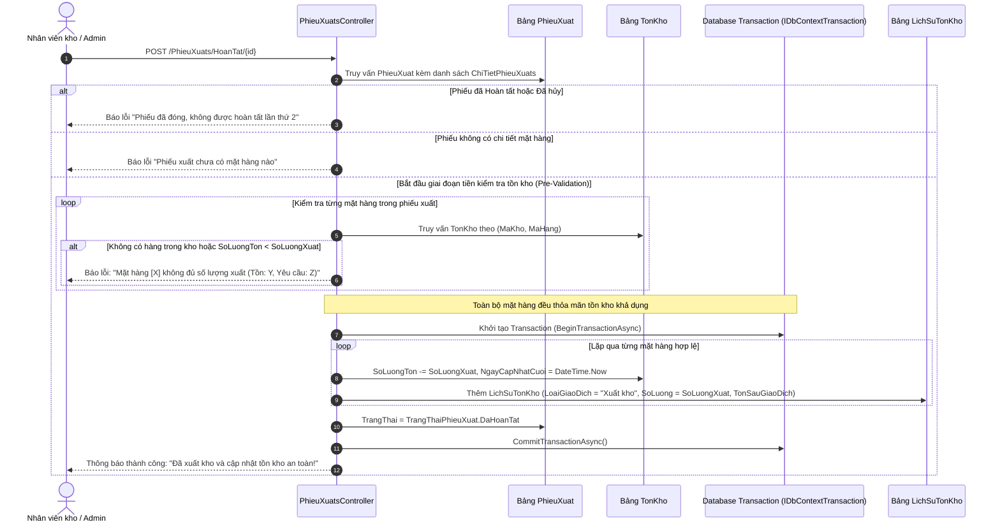

# TÀI LIỆU CHI TIẾT MODULE 4: BỘ PHẬN NHẬN, XUẤT KHO & KIỂM THỬ TỰ ĐỘNG (OUTBOUND LOGISTICS)

> **Dự án:** Hệ thống Quản Lý Kho Hàng UNETI (ASP.NET Core 10 MVC)  
> **Sinh viên phụ trách:** Nguyễn Việt Dũng  
> **Mã sinh viên:** 23103100127  
> **Lớp:** ĐHTI17A3HN  
> **Phạm vi trách nhiệm:** Quản lý Bộ phận nhận, Nghiệp vụ Xuất kho & Bộ kiểm thử xUnit tự động  
> **Trở về:** [Xem README Tổng quan](../../README.md)

---

## 1. TỔNG QUAN & PHẠM VI TRÁCH NHIỆM

Module 4 đảm nhận **chu trình hậu cần đầu ra (Outbound Logistics)** - kiểm soát dòng chảy hàng hóa xuất giao cho khách hàng hoặc các phòng ban nội bộ, đồng thời chịu trách nhiệm về **hệ thống kiểm thử tự động (Automation Test Suite)**:
1. **Quản lý danh mục Bộ phận nhận (Receiving Departments / Customers):** Khai báo danh sách các phòng ban, phân xưởng, đại lý hoặc khách hàng nhận hàng (Tên đơn vị, Người đại diện, Số điện thoại, Địa chỉ, Trạng thái).
2. **Quy trình Lập Phiếu xuất kho (Delivery Order / Outbound Order):** Khởi tạo phiếu xuất giao cho đơn vị nhận, chọn kho nguồn xuất hàng, ngày xuất, người lập và ghi chú giao nhận.
3. **Quản lý Chi tiết phiếu xuất (Master - Detail Line Items):** Thêm các dòng sản phẩm xuất, số lượng xuất ($> 0$), đơn giá tham chiếu, tự động tính tổng tiền phiếu xuất.
4. **Quy tắc vàng: Kiểm tra Tồn kho khả dụng (Available Stock Validation):**
   $$\text{SoLuongXuat} \le \text{SoLuongTon}$$
   Hệ thống kiểm tra nghiêm ngặt tại thời điểm thêm chi tiết và tại thời điểm duyệt hoàn tất. Nếu số lượng xuất vượt quá số lượng đang tồn tại kho nguồn, hoặc hàng hóa đã hết sạch ($\text{Ton} = 0$), hệ thống **lập tức chặn lại và cảnh báo lỗi**.
5. **Thực thi giao dịch Database Transaction trừ tồn an toàn:** Khi duyệt **Hoàn tất phiếu xuất**, hệ thống:
   - Khóa và trừ chính xác số lượng trong bảng `TonKho` theo `(MaKho, MaHang)`.
   - Ghi nhận biến động vào bảng `LichSuTonKho` (Audit Trail).
   - Chuyển trạng thái phiếu sang `DaHoanTat`.
   - Tuyệt đối không để xảy ra hiện tượng tồn kho bị âm ($\text{SoLuongTon} < 0$).
6. **Hệ sinh thái Kiểm thử tự động xUnit:** Thiết lập bộ test suite tích hợp tự động (Integration Tests) chạy trên nền SQLite In-Memory và `WebApplicationFactory`, xác minh tính toàn vẹn nghiệp vụ sau mỗi lần commit.

---

## 2. KIẾN TRÚC THỰC THỂ DỮ LIỆU (ENTITIES / DATA MODELS)

### 2.1. Sơ đồ quan hệ thực thể (ERD Trích đoạn Module 4)
```mermaid
erDiagram
    BoPhanNhan {
        int MaBoPhan PK
        string TenBoPhan UK
        string NguoiDaiDien
        string SoDienThoai
        string DiaChi
        string GhiChu
        bool TrangThai
    }

    Kho {
        int MaKho PK
        string TenKho
    }

    HangHoa {
        int MaHang PK
        string TenHang
    }

    PhieuXuat {
        int MaPhieuXuat PK
        int MaBoPhan FK
        int MaKho FK
        datetime NgayXuat
        decimal TongTien
        int TrangThai "0: Nhap, 1: Cho, 2: HoanTat, 3: Huy"
        string GhiChu
        string NguoiTao
    }

    ChiTietPhieuXuat {
        int MaCTPX PK
        int MaPhieuXuat FK
        int MaHang FK
        int SoLuongXuat
        decimal DonGiaXuat
        decimal ThanhTien
    }

    TonKho {
        int MaKho PK,FK
        int MaHang PK,FK
        int SoLuongTon
    }

    LichSuTonKho {
        int MaLichSu PK
        int MaKho FK
        int MaHang FK
        string LoaiGiaoDich
        int SoLuong
        int TonSauGiaoDich
    }

    BoPhanNhan ||--o{ PhieuXuat : "tiếp nhận hàng (1-N)"
    Kho ||--o{ PhieuXuat : "xuất từ kho (1-N)"
    PhieuXuat ||--|{ ChiTietPhieuXuat : "gồm các dòng xuất (1-N)"
    HangHoa ||--o{ ChiTietPhieuXuat : "mặt hàng xuất (1-N)"
    PhieuXuat -.-> TonKho : "Transaction: trừ tồn kho"
    PhieuXuat -.-> LichSuTonKho : "Transaction: ghi nhật ký"
```

### 2.2. Chi tiết các bảng CSDL thuộc Module 4

#### A. Bảng `BoPhanNhan` (Đơn vị tiếp nhận hàng hóa)
- **`MaBoPhan` (int, PK, Identity):** Mã định danh bộ phận / khách nhận hàng.
- **`TenBoPhan` (nvarchar(150), Unique, Required):** Tên đơn vị tiếp nhận (ví dụ: Phòng Sản Xuất 1, Showroom Cầu Giấy, Đại lý Miền Bắc).
- **`NguoiDaiDien` (nvarchar(100), Required):** Họ tên người đại diện tiếp nhận bàn giao.
- **`SoDienThoai` (nvarchar(20), Required):** Số điện thoại liên lạc nhận hàng.
- **`DiaChi` (nvarchar(255), Required):** Địa chỉ giao nhận hàng hóa.
- **`GhiChu` (nvarchar(500), Nullable):** Ghi chú thông tin phụ.
- **`TrangThai` (bool, Default: true):** Trạng thái hoạt động (`true`: Đang hoạt động, `false`: Tạm ngừng).

#### B. Bảng `PhieuXuat` (Hóa đơn / Lệnh xuất kho tổng thể)
- **`MaPhieuXuat` (int, PK, Identity):** Mã số phiếu xuất kho duy nhất.
- **`MaBoPhan` (int, FK, Required):** Khóa ngoại trỏ đến đối tượng nhận hàng.
- **`MaKho` (int, FK, Required):** Khóa ngoại chỉ định kho vật lý xuất hàng đi.
- **`NgayXuat` (datetime, Required):** Ngày giờ phát sinh phiếu xuất.
- **`TongTien` (decimal(18,2), Default: 0):** Tổng giá trị thanh toán toàn phiếu xuất.
- **`TrangThai` (enum TrangThaiPhieuXuat):** Trạng thái phiếu (`0: Nháp`, `1: Chờ xác nhận`, `2: Đã hoàn tất`, `3: Đã hủy`).
- **`GhiChu` (nvarchar(500), Nullable):** Phương tiện vận chuyển, mục đích xuất, điều khoản giao nhận.
- **`NguoiTao` (nvarchar(100), Required):** Tên đăng nhập của thủ kho lập lệnh xuất.

#### C. Bảng `ChiTietPhieuXuat` (Mặt hàng chi tiết cần xuất)
- **`MaCTPX` (int, PK, Identity):** Mã dòng chi tiết xuất kho.
- **`MaPhieuXuat` (int, FK, Required):** Khóa ngoại tham chiếu phiếu xuất cha.
- **`MaHang` (int, FK, Required):** Khóa ngoại tham chiếu sản phẩm xuất.
- **`SoLuongXuat` (int, Required, Range 1 - 1,000,000):** Số lượng yêu cầu xuất.
- **`DonGiaXuat` (decimal(18,2), Required, Range >= 0):** Đơn giá xuất kho.
- **`ThanhTien` (decimal(18,2)):** Thành tiền = `SoLuongXuat * DonGiaXuat`.

---

## 3. BẢNG ĐẶC TẢ CHỨC NĂNG & ENDPOINTS

| STT | Chức năng | Tuyến đường (Endpoint) | HTTP Method | Quyền truy cập | Mô tả nghiệp vụ chi tiết |
| :---: | :--- | :--- | :---: | :---: | :--- |
| 1 | **Danh mục Bộ phận nhận** | `/BoPhanNhans/Index` | `GET` | **Admin**, **NhanVienKho**, **BoPhanNhan** | Danh bạ đơn vị tiếp nhận hàng hóa. Tài khoản `BoPhanNhan` chỉ xem đơn vị của mình. |
| 2 | **Thêm Bộ phận nhận** | `/BoPhanNhans/Create` | `GET`, `POST` | **Admin**, **NhanVienKho** | Form thêm mới: Kiểm tra tên đơn vị không trùng lặp, số điện thoại và địa chỉ bắt buộc. |
| 3 | **Sửa / Xóa Bộ phận nhận** | `/BoPhanNhans/Edit`, `Delete` | `GET`, `POST` | **Admin**, **NhanVienKho** | Chỉnh sửa thông tin đơn vị; Chặn xóa vật lý nếu đơn vị đã phát sinh phiếu xuất liên kết. |
| 4 | **Danh sách Phiếu xuất** | `/PhieuXuats/Index` | `GET` | **Admin**, **NhanVienKho**, **BoPhanNhan** | Quản lý danh sách phiếu xuất kho, lọc theo trạng thái (`0: Nháp`, `1: Chờ`, `2: Hoàn tất`, `3: Hủy`). |
| 5 | **Lập phiếu xuất mới** | `/PhieuXuats/Create` | `GET`, `POST` | **Admin**, **NhanVienKho** | Chọn Bộ phận nhận, Kho nguồn xuất, Ngày xuất, Ghi chú; tự động gán `NguoiTao` từ Session; tạo phiếu ở trạng thái Nháp. |
| 6 | **Quản lý Chi tiết xuất** | `/ChiTietPhieuXuats/Create` | `GET`, `POST` | **Admin**, **NhanVienKho** | Chọn hàng hóa, số lượng xuất. **Validate kiểm tra tồn kho ngay lập tức:** Nếu số lượng yêu cầu $>$ tồn hiện tại thì báo lỗi ngay tại Form. |
| 7 | **Sửa / Xóa Chi tiết xuất** | `/ChiTietPhieuXuats/Edit`, `Delete` | `GET`, `POST` | **Admin**, **NhanVienKho** | Chỉnh sửa số lượng hoặc gỡ bỏ sản phẩm khỏi phiếu xuất khi phiếu chưa Hoàn tất. |
| 8 | **Xem Biên bản xuất kho** | `/PhieuXuats/Details/{id}` | `GET` | Mọi vai trò đã đăng nhập | Hiển thị phiếu xuất dạng biên bản bàn giao: Đơn vị nhận, kho xuất, bảng chi tiết từng mặt hàng và tổng tiền. |
| 9 | **Duyệt Hoàn tất phiếu xuất** | `/PhieuXuats/HoanTat/{id}` | `POST` | **Admin**, **NhanVienKho** | **Nghiệp vụ cốt lõi:** Kích hoạt Database Transaction: Tái kiểm tra tồn kho thực tế, trừ số lượng trong `TonKho`, ghi sổ `LichSuTonKho`, chuyển trạng thái `DaHoanTat`. |
| 10 | **Hủy phiếu xuất** | `/PhieuXuats/HuyPhieu/{id}` | `POST` | **Admin**, **NhanVienKho** | Hủy phiếu xuất đang ở trạng thái Nháp hoặc Chờ; Không làm thay đổi số lượng tồn kho. |
| 11 | **Chạy bộ kiểm thử tự động** | `dotnet test` hoặc `Run-Tests.ps1` | CLI | Developer / Tester | Chạy toàn bộ 26 kịch bản Integration Tests tự động, xác minh bảo mật và quy trình nhập - xuất kho. |

---

## 4. SƠ ĐỒ TUẦN TỰ KIỂM TRA TỒN KHO & HOÀN TẤT PHIẾU XUẤT



---

## 5. CÁC QUY TẮC NGHIỆP VỤ & KỸ THUẬT NỔI BẬT

### 5.1. Hai tầng kiểm tra Tồn kho khả dụng (Two-Tier Stock Validation)
Nhằm triệt tiêu khả năng xuất âm kho do người dùng thao tác chậm hoặc nhiều thủ kho cùng xuất một lúc, hệ thống bảo vệ bằng 2 tầng:
- **Tầng 1 (Client / Form level):** Khi thêm mặt hàng vào phiếu xuất (`ChiTietPhieuXuatsController.Create`), hệ thống kiểm tra tồn kho tại kho xuất đã chọn. Nếu $SoLuongXuat > SoLuongTon$, form trả về lỗi `ModelState.AddModelError("SoLuongXuat", "Số lượng xuất vượt quá tồn kho hiện tại (Tồn: X)!")`.
- **Tầng 2 (Execution level):** Khi bấm nút **Hoàn tất phiếu xuất** (`PhieuXuatsController.HoanTat`), trước khi mở Transaction, hệ thống quét lại toàn bộ danh sách mặt hàng đối chiếu với số dư thời gian thực trong CSDL. Nếu có bất kỳ món hàng nào bị thiếu hụt, quy trình lập tức dừng lại và thông báo chi tiết mã hàng bị thiếu.

### 5.2. Chống xuất âm và bảo vệ toàn vẹn số liệu
- Bảng `TonKho` không cho phép số lượng âm. Khi hoàn tất xuất kho:
  $$\text{SoLuongTon}_{\text{mới}} = \text{SoLuongTon}_{\text{cũ}} - \text{SoLuongXuat} \ge 0$$
- Dữ liệu lịch sử `TonSauGiaoDich` trong `LichSuTonKho` ghi nhận chính xác giá trị $\text{SoLuongTon}_{\text{mới}}$ sau phép trừ, tạo cơ sở cho việc kiểm toán kho sau này.

### 5.3. Framework kiểm thử tự động xUnit & WebApplicationFactory
Dự án tích hợp bộ test tự động độc lập tại thư mục `Tests/QuanLyKhoHang.Tests`:
- Sử dụng `WebApplicationFactory<Program>` để khởi động web server ảo trong bộ nhớ RAM.
- Cấu hình SQLite In-Memory Database mô phỏng CSDL riêng biệt cho mỗi lần test mà không ảnh hưởng CSDL SQL Server thật.
- Kiểm thử đầy đủ chu trình: Đăng nhập $\rightarrow$ Lập phiếu $\rightarrow$ Thêm chi tiết $\rightarrow$ Duyệt xuất kho $\rightarrow$ Đối soát số lượng tồn giảm chính xác.

---

## 6. MA TRẬN PHÂN QUYỀN TRUY CẬP (RBAC CHO MODULE 4)

| Tuyến đường (Route) | Quyền Admin | Quyền NhanVienKho | Quyền BoPhanNhan | Chưa đăng nhập |
| :--- | :---: | :---: | :---: | :---: |
| `/BoPhanNhans/Index` | **Toàn quyền** | **Xem / Thêm / Sửa** | **Chỉ xem đơn vị mình** | Chuyển hướng Login |
| `/BoPhanNhans/Delete/{id}` | **Được phép** | ⛔ 403 Forbidden | ⛔ 403 Forbidden | Chuyển hướng Login |
| `/PhieuXuats/Index` | **Xem toàn bộ** | **Xem toàn bộ** | **Xem phiếu của đơn vị** | Chuyển hướng Login |
| `/PhieuXuats/Details/{id}` | **Xem biên bản** | **Xem biên bản** | **Xem biên bản** | Chuyển hướng Login |
| `/PhieuXuats/Create` | **Lập phiếu** | **Lập phiếu** | ⛔ 403 Forbidden | Chuyển hướng Login |
| `/PhieuXuats/Edit/{id}` | **Được phép** | **Được phép** | ⛔ 403 Forbidden | Chuyển hướng Login |
| `/ChiTietPhieuXuats/*` | **Thêm/Sửa/Xóa** | **Thêm/Sửa/Xóa** | ⛔ 403 Forbidden | Chuyển hướng Login |
| `/PhieuXuats/HoanTat/{id}` | **Duyệt hoàn tất** | **Duyệt hoàn tất** | ⛔ 403 Forbidden | Chuyển hướng Login |
| `/PhieuXuats/HuyPhieu/{id}` | **Hủy phiếu** | **Hủy phiếu** | ⛔ 403 Forbidden | Chuyển hướng Login |

---

## 7. CẤU TRÚC FILE MÃ NGUỒN CỦA MODULE 4

```
QuanLyKhoHang_UNETI01_TI17A3HN/
├── Controllers/
│   ├── BoPhanNhansController.cs       # Điều khiển danh bạ khách hàng / bộ phận nhận
│   ├── PhieuXuatsController.cs        # Điều khiển lập phiếu, duyệt hoàn tất & hủy xuất
│   └── ChiTietPhieuXuatsController.cs # Thêm, sửa, xóa các dòng mặt hàng xuất & kiểm tra tồn
├── Models/
│   ├── BoPhanNhan.cs                  # Entity khách hàng / bộ phận nhận
│   ├── PhieuXuat.cs                   # Entity phiếu xuất hàng
│   ├── ChiTietPhieuXuat.cs            # Entity dòng chi tiết mặt hàng xuất
│   └── Enums/
│       └── TrangThaiPhieuXuat.cs      # Enum trạng thái (Nhap, ChoXacNhan, DaHoanTat, DaHuy)
├── Views/
│   ├── BoPhanNhans/                   # Views danh mục Bộ phận nhận (CRUD)
│   ├── PhieuXuats/
│   │   ├── Index.cshtml               # Danh sách phiếu xuất kèm lọc trạng thái
│   │   ├── Create.cshtml              # Form lập phiếu xuất mới
│   │   ├── Details.cshtml             # Giao diện biên bản xuất kho & nút Hoàn tất / Hủy
│   │   └── Edit.cshtml                # Chỉnh sửa thông tin chung phiếu xuất
│   └── ChiTietPhieuXuats/
│       ├── Create.cshtml              # Thêm mặt hàng xuất & validate tồn khả dụng
│       └── Edit.cshtml                # Sửa số lượng xuất
└── Tests/
    └── QuanLyKhoHang.Tests/
        ├── WarehouseWebApplicationFactory.cs # Cấu hình môi trường Web test & SQLite Memory
        ├── InventoryBusinessIntegrationTests.cs # Kiểm thử luồng xuất kho & trừ tồn
        └── AuthenticationIntegrationTests.cs  # Kiểm thử xác thực & phân quyền
```

---

## 8. HÌNH ẢNH CHƯƠNG TRÌNH THỰC TẾ

| Danh sách Phiếu xuất kho đa trạng thái | Chi tiết Biên bản phiếu xuất kho |
| :---: | :---: |
|  |  |

---

## 9. CÁC CA KIỂM THỬ TỰ ĐỘNG (INTEGRATION TESTS)

1. **TC-OUTBOUND-01:** Khởi tạo phiếu xuất mới $\rightarrow$ Lưu thành công ở trạng thái `Nhap` (`TrangThai == 0`).
2. **TC-OUTBOUND-02:** Thêm mặt hàng với số lượng lớn hơn tồn kho thực tế ($SoLuongXuat > SoLuongTon$) $\rightarrow$ Hệ thống chặn lại và trả về lỗi ModelState.
3. **TC-OUTBOUND-03:** Duyệt hoàn tất phiếu xuất hợp lệ $\rightarrow$ Số lượng tồn kho trong `TonKho` giảm chính xác bằng số lượng xuất; Bảng `LichSuTonKho` ghi nhận dòng nhật ký `"Xuất kho"`.
4. **TC-OUTBOUND-04:** Gọi lại `HoanTat` trên phiếu đã xuất $\rightarrow$ Chặn thực thi, báo lỗi, không làm trừ tiếp tồn kho lần thứ 2.
5. **TC-OUTBOUND-05:** Người dùng vai trò `BoPhanNhan` cố truy cập action duyệt phiếu xuất `/PhieuXuats/HoanTat/1` $\rightarrow$ Nhận phản hồi HTTP 403 Forbidden.
