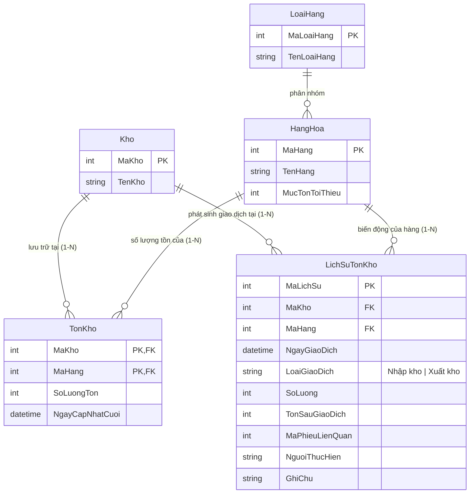
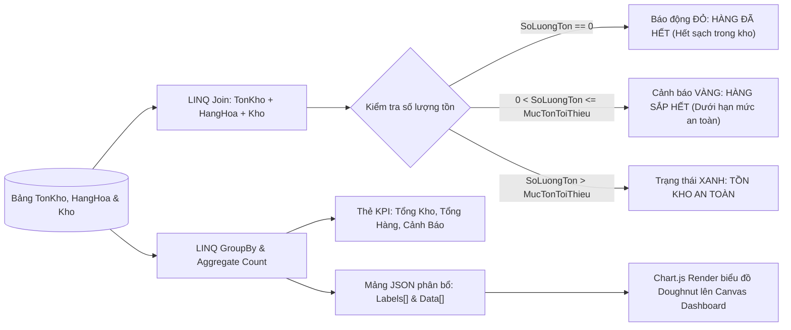

# TÀI LIỆU CHI TIẾT MODULE 5: QUẢN LÝ TỒN KHO, CẢNH BÁO, LỊCH SỬ BIẾN ĐỘNG & DASHBOARD

> **Dự án:** Hệ thống Quản Lý Kho Hàng UNETI (ASP.NET Core 10 MVC)  
> **Sinh viên phụ trách:** Nguyễn Văn Cường  
> **Mã sinh viên:** 23103100132  
> **Lớp:** ĐHTI17A3HN  
> **Phạm vi trách nhiệm:** Quản lý Tồn kho tức thời, Cảnh báo hạn mức, Nhật ký biến động (Audit Trail) & Dashboard KPIs  
> **Trở về:** [Xem README Tổng quan](../../README.md)

---

## 1. TỔNG QUAN & PHẠM VI TRÁCH NHIỆM

Module 5 là **trung tâm giám sát, cảnh báo sớm và phân tích số liệu điều hành (Analytics & Intelligence Layer)** của toàn hệ thống kho vận:
1. **Quản lý Tồn kho tức thời (Real-time Stock Management):** Lưu trữ và tính toán chính xác số lượng hàng hóa khả dụng tại từng địa điểm kho theo cặp khóa chính phức hợp `(MaKho, MaHang)` trong bảng `TonKho`. Dữ liệu mang tính chất **Read-only đối với người dùng**, được cập nhật hoàn toàn tự động qua Database Transaction của Module 3 và Module 4.
2. **Cơ chế Cảnh báo hạn mức tồn kho đa cấp độ (Multi-Level Stock Alerts):**
   - **Báo động ĐỎ (Hết hàng):** $\text{SoLuongTon} = 0$ $\rightarrow$ Kho đã cạn kiệt, cần nhập gấp để không đứt gãy cung ứng.
   - **Cảnh báo VÀNG (Sắp hết hàng):** $0 < \text{SoLuongTon} \le \text{MucTonToiThieu}$ $\rightarrow$ Hàng chạm ngưỡng an toàn, hệ thống nhắc nhở thủ kho lập kế hoạch nhập hàng.
   - **Trạng thái XANH (An toàn):** $\text{SoLuongTon} > \text{MucTonToiThieu}$ $\rightarrow$ Hoạt động lưu kho bình thường.
3. **Nhật ký biến động kho (Audit Trail / Stock Movement History):** Bảng `LichSuTonKho` ghi nhận bất biến mọi giao dịch Nhập/Xuất kho (Ngày phát sinh, loại giao dịch, mã phiếu liên quan, số lượng thay đổi, số dư tồn sau giao dịch, người thực hiện, ghi chú).
4. **Bảng điều khiển trung tâm (Executive Dashboard KPIs):** 4 thẻ KPI chỉ số quan trọng (Tổng kho bãi, Tổng số mặt hàng, Phiếu nhập/xuất trong ngày, Tổng số mặt hàng rơi vào vùng báo động).
5. **Trực quan hóa dữ liệu bằng Chart.js:** Tích hợp thư viện đồ thị JavaScript hiện đại, trực quan hóa cơ cấu mặt hàng theo loại hàng dạng Doughnut Chart / Pie Chart.
6. **Báo cáo tổng hợp Nhập - Xuất - Tồn theo thời gian:** Bộ lọc LINQ tổng hợp sản lượng nhập, sản lượng xuất và tính đối soát tồn kho trong kỳ báo cáo (`TuNgay` đến `DenNgay`).

---

## 2. KIẾN TRÚC THỰC THỂ DỮ LIỆU (ENTITIES / DATA MODELS)

### 2.1. Sơ đồ quan hệ thực thể (ERD Trích đoạn Module 5)


### 2.2. Chi tiết các bảng CSDL thuộc Module 5

#### A. Bảng `TonKho` (Số dư tồn kho tức thời)
- **`MaKho` (int, PK, FK, Composite Key):** Mã kho bãi lưu trữ.
- **`MaHang` (int, PK, FK, Composite Key):** Mã mặt hàng lưu kho.
- **`SoLuongTon` (int, Required, Default: 0, Range >= 0):** Số lượng tồn kho thực tế hiện tại.
- **`NgayCapNhatCuoi` (datetime, Default: GETDATE()):** Mốc thời gian gần nhất phát sinh giao dịch nhập/xuất hàng này.
- *Ghi chú thiết kế:* Sử dụng Fluent API cấu hình Composite Primary Key `modelBuilder.Entity<TonKho>().HasKey(t => new { t.MaKho, t.MaHang })`.

#### B. Bảng `LichSuTonKho` (Sổ cái kiểm toán biến động kho - Audit Trail)
- **`MaLichSu` (int, PK, Identity):** Mã định danh bản ghi nhật ký.
- **`MaKho` (int, FK, Required):** Kho xảy ra biến động.
- **`MaHang` (int, FK, Required):** Mặt hàng bị thay đổi số lượng.
- **`NgayGiaoDich` (datetime, Default: GETDATE()):** Ngày giờ chính xác hoàn tất giao dịch.
- **`LoaiGiaoDich` (nvarchar(50), Required):** `"Nhập kho"` hoặc `"Xuất kho"`.
- **`SoLuong` (int, Required):** Số lượng dịch chuyển của giao dịch.
- **`TonSauGiaoDich` (int, Required):** Số lượng tồn kho sau khi cộng/trừ giao dịch thành công.
- **`MaPhieuLienQuan` (int, Nullable):** Mã `MaPhieuNhap` hoặc `MaPhieuXuat` tương ứng.
- **`NguoiThucHien` (nvarchar(100), Required):** Tên tài khoản thủ kho duyệt lệnh.
- **`GhiChu` (nvarchar(500), Nullable):** Diễn giải chi tiết giao dịch.

---

## 3. BẢNG ĐẶC TẢ CHỨC NĂNG & ENDPOINTS

| STT | Chức năng | Tuyến đường (Endpoint) | HTTP Method | Quyền truy cập | Mô tả nghiệp vụ chi tiết |
| :---: | :--- | :--- | :---: | :---: | :--- |
| 1 | **Cảnh báo hạn mức tồn kho** | `/TonKho/CanhBao` | `GET` | **Admin**, **NhanVienKho** | Danh sách các mặt hàng đang rơi vào tình trạng báo động: Hết sạch hàng ($\text{Ton} = 0$) hoặc Sắp hết ($0 < \text{Ton} \le \text{Min}$). Hỗ trợ lọc theo Kho và lọc theo Mức độ cảnh báo. |
| 2 | **Nhật ký biến động kho** | `/TonKho/LichSu` | `GET` | **Admin**, **NhanVienKho** | Bảng Audit Trail hiển thị toàn bộ lịch sử biến động nhập/xuất kho. Cho phép lọc theo Kho, lọc theo Mặt hàng và tìm kiếm theo người thực hiện. |
| 3 | **Bảng điều khiển trung tâm (Dashboard KPIs)** | `/ThongKe/Dashboard` | `GET` | **Admin**, **NhanVienKho** | Tổng hợp 4 thẻ chỉ số KPIs kinh doanh và quản trị: Tổng số kho, Tổng danh mục hàng, Số phiếu phát sinh trong ngày, Số mặt hàng đang báo động. |
| 4 | **Biểu đồ cơ cấu hàng hóa (Chart.js)** | `/ThongKe/Dashboard` | `GET` | **Admin**, **NhanVienKho** | Tích hợp biểu đồ tròn (Doughnut Chart) hiển thị tỷ trọng phân bố hàng hóa theo từng Loại hàng, kết xuất dữ liệu động từ backend sang JSON. |
| 5 | **Báo cáo Tổng hợp Nhập - Xuất - Tồn** | `/ThongKe/BaoCaoNhapXuat` | `GET` | **Admin**, **NhanVienKho** | Báo cáo thống kê nâng cao bằng LINQ: Chọn khoảng thời gian (`TuNgay` đến `DenNgay`), tổng hợp tổng số lượng và giá trị hàng nhập, hàng xuất, đối soát biến động kho. |

---

## 4. SƠ ĐỒ XỬ LÝ THỐNG KÊ & PHÂN LOẠI CẢNH BÁO TỒN KHO



---

## 5. CÁC QUY TẮC NGHIỆP VỤ & KỸ THUẬT NỔI BẬT

### 5.1. Thiết kế Bảng Tồn kho Bất biến (Read-only TonKho Table)
- Để đảm bảo tính trung thực tuyệt đối của số liệu tồn kho, trong toàn bộ mã nguồn **không có bất kỳ View hay Controller nào cho phép người dùng trực tiếp sửa (`Edit`) hay xóa (`Delete`) bản ghi `TonKho`**.
- Mọi biến động số lượng tồn bắt buộc phải sinh ra từ một Phiếu Nhập hoặc Phiếu Xuất được ký duyệt thông qua Database Transaction (`Module 3` và `Module 4`).

### 5.2. Nguyên tắc Sổ cái Kiểm toán Bất biến (Immutable Audit Trail)
- Bảng `LichSuTonKho` được thiết kế theo nguyên lý Write-Once, Read-Many (WORM).
- Khi đã ghi nhận một dòng lịch sử với giá trị `TonSauGiaoDich`, dòng này vĩnh viễn không bị sửa đổi hay xóa bỏ. Điều này cho phép thủ kho và kiểm toán viên có thể tái hiện lại chính xác lịch sử biến động của bất kỳ món hàng nào tại bất kỳ thời điểm nào trong quá khứ.

### 5.3. Trực quan hóa dữ liệu với Chart.js
- Controller `ThongKeController.Dashboard()` chuẩn bị dữ liệu thống kê bằng LINQ:
  ```csharp
  var loaiHangStats = await _context.HangHoas
      .GroupBy(h => h.LoaiHang.TenLoaiHang)
      .Select(g => new { TenLoai = g.Key, SoLuong = g.Count() })
      .ToListAsync();

  ViewBag.ChartLabels = loaiHangStats.Select(x => x.TenLoai).ToArray();
  ViewBag.ChartData = loaiHangStats.Select(x => x.SoLuong).ToArray();
  ```
- Razor View `Views/ThongKe/Dashboard.cshtml` chuyển đổi mảng dữ liệu này thành JavaScript object thông qua `@Html.Raw(Json.Serialize(ViewBag.ChartLabels))` và vẽ lên thẻ HTML5 `<canvas id="productCategoryChart">`.

### 5.4. Truy vấn LINQ Báo cáo Nhập - Xuất - Tồn theo thời gian
- Sử dụng LINQ trên tập `LichSuTonKho`:
  ```csharp
  var query = _context.LichSuTonKhoes.AsQueryable();
  if (tuNgay.HasValue) query = query.Where(l => l.NgayGiaoDich >= tuNgay.Value);
  if (denNgay.HasValue) query = query.Where(l => l.NgayGiaoDich <= denNgay.Value);

  var baoCao = await query
      .GroupBy(l => new { l.MaHang, l.HangHoa.TenHang, l.LoaiGiaoDich })
      .Select(g => new {
          g.Key.TenHang,
          g.Key.LoaiGiaoDich,
          TongSoLuong = g.Sum(x => x.SoLuong)
      })
      .ToListAsync();
  ```

---

## 6. MA TRẬN PHÂN QUYỀN TRUY CẬP (RBAC CHO MODULE 5)

| Tuyến đường (Route) | Quyền Admin | Quyền NhanVienKho | Quyền BoPhanNhan | Chưa đăng nhập |
| :--- | :---: | :---: | :---: | :---: |
| `/TonKho/CanhBao` | **Xem toàn bộ** | **Xem toàn bộ** | ⛔ 403 Forbidden | Chuyển hướng Login |
| `/TonKho/LichSu` | **Xem sổ cái** | **Xem sổ cái** | ⛔ 403 Forbidden | Chuyển hướng Login |
| `/ThongKe/Dashboard` | **Xem Dashboard** | **Xem Dashboard** | ⛔ 403 Forbidden | Chuyển hướng Login |
| `/ThongKe/BaoCaoNhapXuat` | **Xuất báo cáo** | **Xuất báo cáo** | ⛔ 403 Forbidden | Chuyển hướng Login |

---

## 7. CẤU TRÚC FILE MÃ NGUỒN CỦA MODULE 5

```
QuanLyKhoHang_UNETI01_TI17A3HN/
├── Controllers/
│   ├── TonKhoController.cs       # Điều khiển màn hình Cảnh báo tồn kho & Nhật ký lịch sử
│   └── ThongKeController.cs      # Điều khiển Dashboard KPIs & Báo cáo tổng hợp Nhập-Xuất
├── Models/
│   ├── TonKho.cs                 # Entity số dư tồn kho (Composite Key: MaKho, MaHang)
│   └── LichSuTonKho.cs           # Entity nhật ký biến động kho (Audit Trail)
├── ViewModels/
│   ├── DashboardViewModel.cs     # ViewModel tổng hợp 4 thẻ KPIs và dữ liệu biểu đồ
│   └── BaoCaoNhapXuatViewModel.cs# ViewModel đóng gói dữ liệu báo cáo đối soát
└── Views/
    ├── TonKho/
    │   ├── CanhBao.cshtml        # Giao diện cảnh báo hàng hết & hàng sắp hết
    │   └── LichSu.cshtml         # Giao diện bảng Audit Trail nhật ký lịch sử
    └── ThongKe/
        ├── Dashboard.cshtml      # Giao diện bảng điều khiển KPIs & Canvas Chart.js
        └── BaoCaoNhapXuat.cshtml # Giao diện báo cáo tổng hợp Nhập - Xuất - Tồn
```

---

## 8. HÌNH ẢNH CHƯƠNG TRÌNH THỰC TẾ

| Dashboard KPIs & Biểu đồ trực quan | Cảnh báo hạn mức tồn kho (Hết hàng & Sắp hết) |
| :---: | :---: |
|  |  |

| Nhật ký lịch sử biến động nhập - xuất kho | Báo cáo tổng hợp Nhập - Xuất - Tồn |
| :---: | :---: |
|  |  |

---

## 9. CÁC CA KIỂM THỬ TỰ ĐỘNG (INTEGRATION TESTS)

1. **TC-ALERT-01:** Mặt hàng có số lượng tồn bằng 0 ($\text{Ton} = 0$) $\rightarrow$ Xuất hiện chính xác trong danh sách cảnh báo với cấp độ Báo động Đỏ ("Hết hàng").
2. **TC-ALERT-02:** Mặt hàng có số lượng tồn nhỏ hơn hoặc bằng mức tối thiểu ($0 < \text{Ton} \le \text{Min}$) $\rightarrow$ Xuất hiện trong danh sách cảnh báo với cấp độ Vàng ("Sắp hết hàng").
3. **TC-AUDIT-01:** Mỗi lần duyệt hoàn tất 1 phiếu nhập $\rightarrow$ Bảng `LichSuTonKho` ghi nhận thêm đúng số lượng bản ghi tương ứng với số dòng hàng nhập.
4. **TC-AUDIT-02:** Mỗi lần duyệt hoàn tất 1 phiếu xuất $\rightarrow$ Bảng `LichSuTonKho` ghi nhận chính xác trường `TonSauGiaoDich` bằng tồn trước trừ số lượng xuất.
5. **TC-DASH-01:** Truy cập `/ThongKe/Dashboard` với tài khoản `Admin` hoặc `NhanVienKho` $\rightarrow$ Trả về mã phản hồi HTTP 200 OK với đủ 4 thẻ KPIs và dữ liệu mảng Chart.js.
