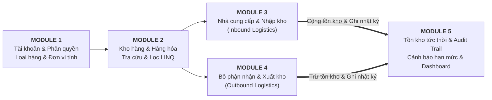

# DANH MỤC TÀI LIỆU CHI TIẾT THEO TỪNG MODULE

> **Dự án:** Hệ thống Quản Lý Kho Hàng UNETI (ASP.NET Core 10 MVC)  
> **Nhóm thực hiện:** Nhóm 1 - ĐHTI17A3HN  
> **Trở về:** [Xem README Tổng quan](../../README.md)

---

## BẢNG ĐIỀU HƯỚNG TÀI LIỆU CÁC MODULE

Dưới đây là các tài liệu đặc tả nghiệp vụ, kiến trúc CSDL, sơ đồ tuần tự Mermaid, ma trận phân quyền RBAC và giao diện chi tiết của từng Module:

| Module | Tên Module | Sinh viên phụ trách | MSSV | Tài liệu chi tiết |
| :---: | :--- | :--- | :---: | :---: |
| **Module 1** | **Tài khoản, Xác thực, Phân quyền, Profile & Danh mục cơ sở** | **Trần Xuân Hải** | `23103100135` | [Xem Module 1](MODULE_01_TAI_KHOAN_XAC_THUC.md) |
| **Module 2** | **Kho hàng, Hàng hóa & Bộ tra cứu LINQ đa tiêu chí** | **Nguyễn Thị Cúc** | `23103100178` | [Xem Module 2](MODULE_02_KHO_HANG_HOA.md) |
| **Module 3** | **Nhà cung cấp & Nghiệp vụ Nhập kho (Inbound Logistics)** | **Lê Văn Hùng** | `23103100177` | [Xem Module 3](MODULE_03_NHA_CUNG_CAP_NHAP_KHO.md) |
| **Module 4** | **Bộ phận nhận, Xuất kho & Kiểm thử tự động (Outbound Logistics)** | **Nguyễn Việt Dũng** | `23103100127` | [Xem Module 4](MODULE_04_BO_PHAN_NHAN_XUAT_KHO.md) |
| **Module 5** | **Quản lý Tồn kho, Cảnh báo, Lịch sử biến động & Dashboard** | **Nguyễn Văn Cường** | `23103100132` | [Xem Module 5](MODULE_05_TON_KHO_DASHBOARD.md) |

---

## SƠ ĐỒ LIÊN KẾT LUỒNG DỮ LIỆU GIỮA CÁC MODULE

---

## CÁC TIÊU CHUẨN KỸ THUẬT ÁP DỤNG TRÊN TẤT CẢ CÁC MODULE
- **Khung công nghệ:** ASP.NET Core 10.0 MVC (C# 14 / .NET 10 LTS).
- **ORM & CSDL:** Entity Framework Core 10 kết hợp Microsoft Azure SQL Database & SQL Server LocalDB với cơ chế tự phục hồi High-Availability.
- **Bảo mật:** Cookie Authentication, Session, Chống Brute-force lockout (5 lần sai -> khóa 5 phút), Mã hóa mật khẩu ASP.NET Identity `IPasswordHasher<TaiKhoan>`, bảo vệ kiểm soát truy cập bằng `[AuthorizeRole(...)]`.
- **Giao diện:** Responsive Bootstrap 5, Font Awesome Icons, Chart.js Dashboard.
- **Kiểm thử tự động:** xUnit Test Suite + SQLite In-Memory Database + WebApplicationFactory.
